# Design references

Design work to look at and learn from: layouts, color, typography, and branding. Entries here have no reusable prompt or tool. If it can be used to generate something, it belongs in [Image generation](image-generation.md).

[← Back to index](README.md)

<!-- Add entries below using the format in _template.md. Newest first. -->

### [洋服記念日 illustrations](https://www.threads.com/@pg_aiart/post/DfoFA-Zkcuc)
`status: watching` · `tags: illustration, fashion, western-wear, character-design, portrait, japanese` · added 2026-11

A six-image series of women in Western dress by PG (@pg_aiart), posted for 11/12 洋服記念日 (Western Clothing Memorial Day, November 12). The post says the day comes from the 1872 (明治5年) 太政官布告 「礼服ニハ洋服ヲ採用ス」, which adopted Western clothing for formal dress. The illustrations show women in Western suits, waistcoats, a corset-style outfit, and a ruffled blouse, in a detailed illustration style on pale grounds.
**Why I care:** Consistent character illustration across tailored Western outfits — useful reference for suit, waistcoat, corset, and ruffled-blouse styling, with windblown hair and high-contrast portraits on pale grounds.
**Notes:** No prompt, model, tool, or license disclosed. The author's account is @pg_aiart; no specific tool is named. Shown here as first 5 of 6 source images. Not tested.

  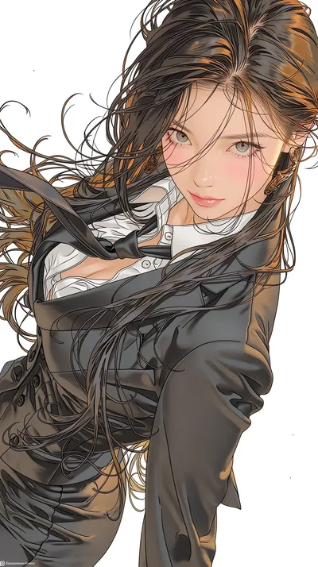
  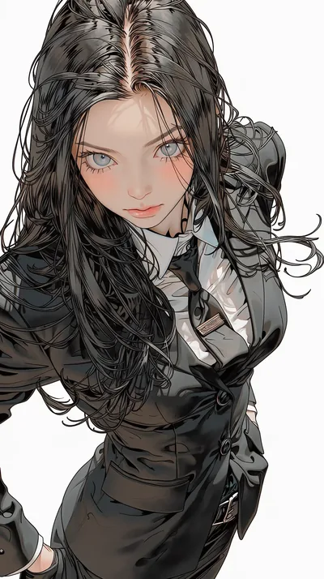
  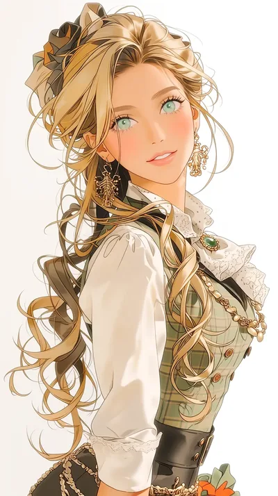
  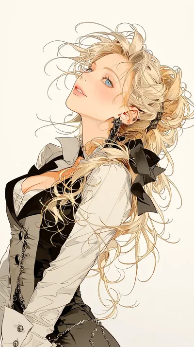
  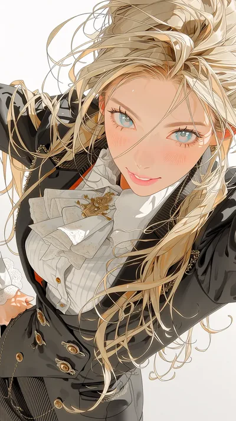

First 5 of 6 images from [@pg_aiart's post](https://www.threads.com/@pg_aiart/post/DfoFA-Zkcuc).

### [Absent Mirror 230](https://www.threads.com/@absentmirror/post/DfmnKoVjat4)
`status: watching` · `tags: poster, typography, grain, atmosphere, abstract, color` · added 2026-11

Four grainy posters by Absent Mirror (@absentmirror). The post text is "230". Soft, blurred hand and figure forms sit in a blue-purple field with a warm orange light, on a canvas-like grain, with short poetic type: "imprint", "a memory without a story.", "a feeling without a name.", and "maybe some things are meant to be felt, not remembered." The first still is also marked 230 and 230/1000; all four carry small "absentmirror" and "spaces we carry" labels.
**Why I care:** A tight atmospheric poster language — limited palette, heavy grain, and quiet typography over almost-abstract light and form. Useful reference for mood typography and light-on-texture compositions.
**Notes:** No continuations, links, prompt, model, tool, or license disclosed. Not tested.

  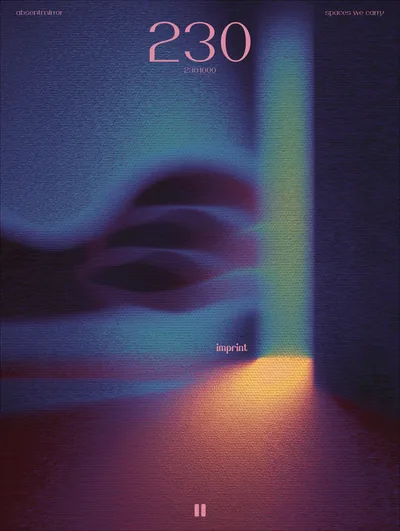
  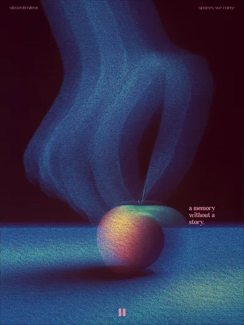
  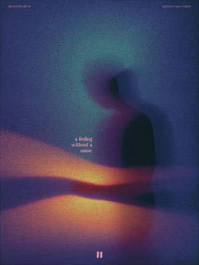
  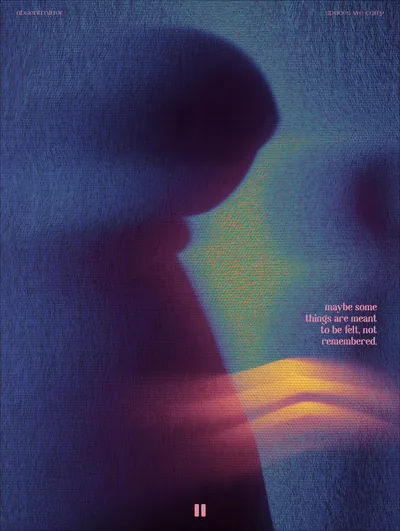

All 4 images from [@absentmirror's post](https://www.threads.com/@absentmirror/post/DfmnKoVjat4).

### [サムライの日 illustrations](https://www.threads.com/@pg_aiart/post/DflD82kkmOP)
`status: watching` · `tags: illustration, samurai, character-design, armor, japanese` · added 2026-11

A ten-image series of samurai-style warriors by PG (@pg_aiart), posted for サムライの日 (Samurai Day, November 11). The post explains the date as 十 + 一 = 士, and says the day was established by 日本和装ホールディングス, which runs the men's kimono store SAMURAI. The warriors wear ornate gold or floral headpieces, patterned armor, and swords, in a detailed illustration style on pale grounds.
**Why I care:** Consistent character design across many poses — useful reference for ornamental armor, floral headpieces, and blade compositions in a refined, high-contrast palette.
**Notes:** No prompt, model, tool, or license disclosed. The author's account is @pg_aiart; no specific tool is named. Shown here as first 5 of 10 source images. Not tested.

  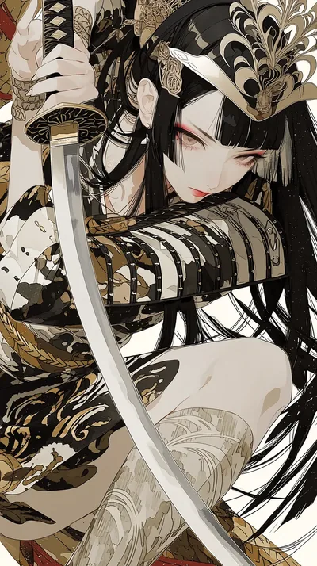
  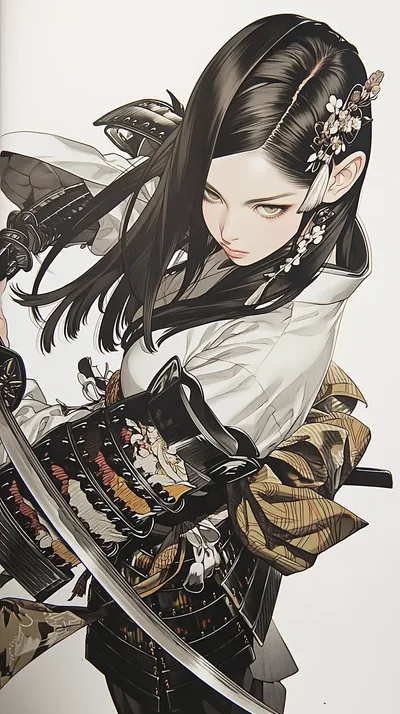
  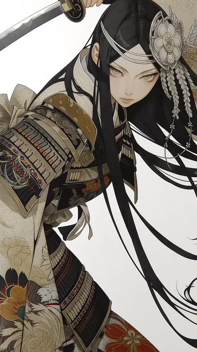
  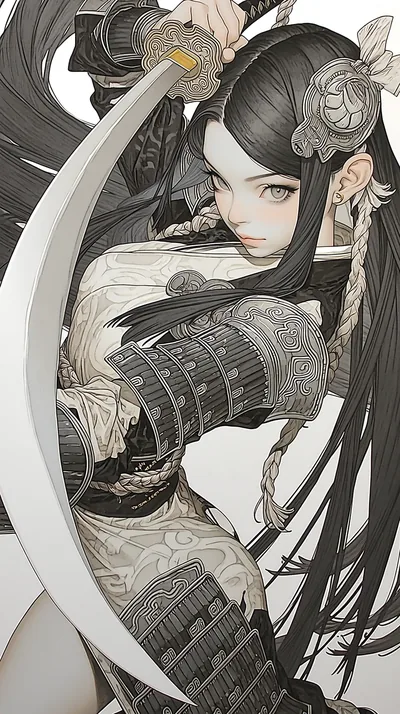
  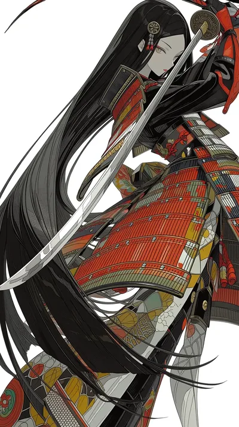

First 5 of 10 images from [@pg_aiart's post](https://www.threads.com/@pg_aiart/post/DflD82kkmOP).
### [Fruit collection food prints](https://www.threads.com/@foxandvelvet/post/DfkrdsHHURG)
`status: watching` · `tags: illustration, poster, fruit, typography, kitchen, mid-century, commercial` · added 2026-11

A fruit-print series by Fox & Velvet (@foxandvelvet): watermelon, banana, pineapple, orange, and lime posters in bold flat colours, with playful stylized fruit (some with simple faces) and irregular hand-drawn typography repeating the fruit's name. The post calls them "Fruit collection food prints, perfect to add some bright colour to your kitchen."
**Why I care:** Tight, graphic fruit typography on saturated fields — useful kitchen-poster or packaging reference when you want colour and lettering to do the work.
**Notes:** Commercial prints by the artist. Official site: [foxandvelvet.com](https://www.foxandvelvet.com/). The profile describes the studio as "Mid Century Poster Design | Food, Drink, & Travel." No prompt, model, or tool disclosed. Not tested.

  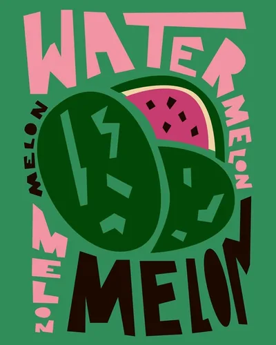
  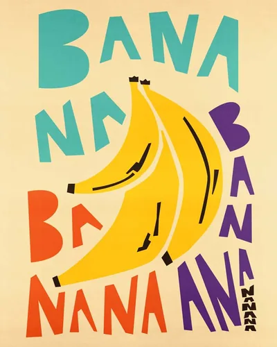
  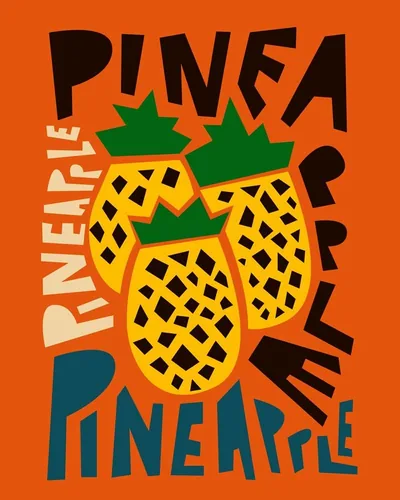
  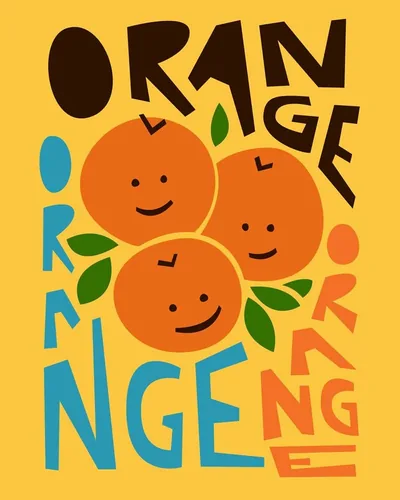
  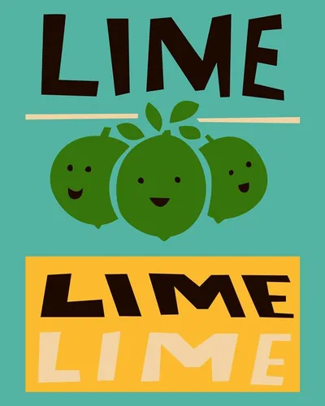

All 5 images from [@foxandvelvet's post](https://www.threads.com/@foxandvelvet/post/DfkrdsHHURG).

### [Movie ticket-purchasing concept](https://www.threads.com/@scroll.gallery/post/Dfh3qlZjuQu)
`status: watching` · `tags: ui, mobile, cinema, ticket-booking, motion, concept` · added 2026-11

A movie ticket-purchasing UI concept credited to raminnasibov, shared by Scroll Gallery (@scroll.gallery). Source post text: "Movie ticket-purchasing concept by raminnasibov."
**Why I care:** Cinema booking flows are a useful reference for dense mobile commerce — showtime selection, seats, and confirmation — when designing similar purchase journeys.
**Notes:** Shared via [Scroll Gallery](https://scroll.gallery/), whose site describes itself as discovering "best design resources & solutions from industry leaders" for inspiration and creative workflow. Author continuation: [link post](https://www.threads.com/@scroll.gallery/post/Dfh3xO3DKFH). A designer named Ramin Nasibov exists online, but no public page for this specific concept was verified, so only the credited handle is used. Video-only source; footage not reviewed. No prompt, tool, model, or license disclosed. Not tested.

### [Ensemble (앙상블)](https://www.threads.com/@ath.butordinary/post/DffvqwBkjKd)
`status: watching` · `tags: illustration, hanbok, music, portrait, color-blocking, korean` · added 2026-11

A music-themed portrait series by LSHA (@ath.butordinary) titled "앙상블" (Ensemble): traditional Korean dress and hair styling paired with contemporary instruments and bold graphic color fields — DJ booth, red vinyl close-up, cello, gayageum, and blue violin.
**Why I care:** Clean modern-tradition contrast — hanbok/gat and saturated geometric backdrops against DJ gear, vinyl, cello, zither, and violin — with a consistent blue/orange/cream palette across the set.
**Notes:** Creator reply [continuation](https://www.threads.com/@ath.butordinary/post/Dff2oH7E-6Z) shares no prompt. No model, tool, or license disclosed. Shown here as first 5 of 20 source images.

  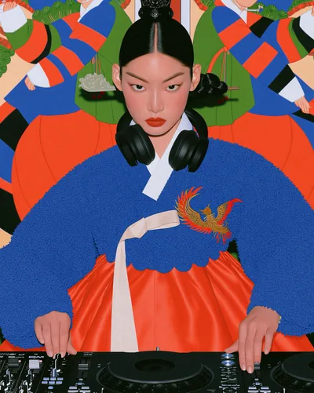
  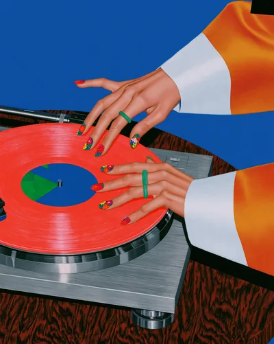
  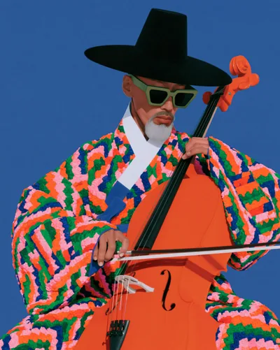
  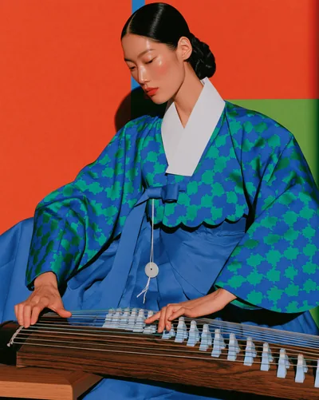
  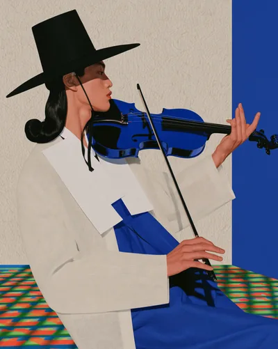

First 5 of 20 images from [@ath.butordinary's post](https://www.threads.com/@ath.butordinary/post/DffvqwBkjKd).

### [Ornate floral portrait](https://www.threads.com/@shin_photo128/post/DfdgMaNgb8Y)
`status: watching` · `tags: illustration, portrait, ukiyo-e, peony, gold, red, neo-traditional` · added 2026-11

A vertical ornate illustration by しん (@shin_photo128): a pale-haired woman in profile with a black glove at her lips, a large red disc behind her head, and dense red/cream/gold peonies with gold hair ornaments on a black-and-gold patterned ground.
**Why I care:** Strong neo-traditional Japanese graphic language — flat decorative layering, high-contrast red/black/gold, and peony framing that reads as print-ready poster art.
**Notes:** No prompt, model, tool, or reuse license disclosed. Single source image.

  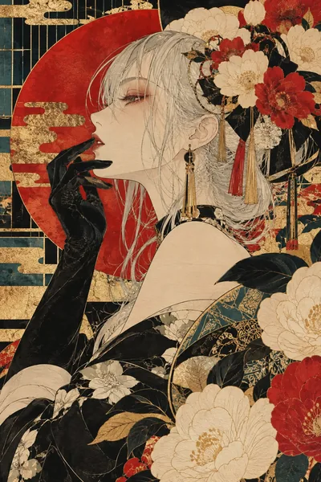

Image from [@shin_photo128's post](https://www.threads.com/@shin_photo128/post/DfdgMaNgb8Y).

### [Hacktron website launch](https://www.hacktron.ai/)
`status: watching` · `tags: landing-page, cybersecurity, startup, dark-theme, announcement` · added 2026-11

Website for Hacktron, an AI-native cybersecurity platform offering continuous red teaming, PR review, and white-box pentests. Announced via [@HacktronAI](https://x.com/HacktronAI/status/2119252317241303221) with "new website who dis."
**Why I care:** A cybersecurity startup landing page to reference for dark-themed, technical product sites.
**Notes:** Commercial product; no repo or pricing verified. Built with Astro. Site confirmed live. Video-only source; layout/motion not described (footage not reviewed). Not tested.

### [footer.design](https://www.footer.design/)
`status: watching` · `tags: gallery, footer, web-design, inspiration, curated` · added 2026-11

A curated gallery of website footer designs. Browse real-world examples for layout, navigation patterns, and visual approaches to the often-neglected bottom of the page.
**Why I care:** Footers are easy to overlook, and this collects good ones in one place. Useful when the rest of a site is done but the footer feels like an afterthought.
**Notes:** From [Aman Singh (@amananimates)](https://x.com/amananimates/status/2119127905666314632), co-founder of Scrolltide. Related to but distinct from the [Wren footer concept](#wren-illustrated-footer-concept) and [Aboard footer](#aboard-engraved-website-footer) entries in this list, which are specific designs rather than a gallery. No license or commercial reuse terms verified. Not tested.

### [CTA Gallery](https://www.cta.gallery/)
`status: watching` · `tags: gallery, cta, call-to-action, web-design, inspiration, curated` · added 2026-11

A curated gallery of call-to-action designs. Browse real-world examples of buttons, banners, and conversion prompts across different sites and styles.
**Why I care:** CTAs are high-stakes UI: they have to stand out without being obnoxious. A gallery of working examples beats guessing.
**Notes:** From Scrolltide team. No license or commercial reuse terms verified. Not tested.

### [Mother Trucker](https://www.threads.com/@hannibalvector/post/DfdZo2xoJb3)
`status: watching` · `tags: illustration, trucks, graffiti, urban, line-art, vehicles` · added 2026-11

A three-image series by @hannibalvector titled "Mother Trucker 🚛." Detailed line-art illustrations of white commercial trucks with bold red graffiti-style lettering: a delivery truck in an urban street scene, a box truck against a solid red background, and a crane truck from a dramatic low angle with utility wires and city skyline.
**Why I care:** The consistent style (precise linework, white vehicles, red graffiti, urban grit) across different truck types shows how a visual language can unify varied subjects. Good reference for vehicle illustration or urban poster work.
**Notes:** No prompt, model, tool, or license disclosed. Same creator as [mass_TECH after midnight](#mass_tech-after-midnight).

  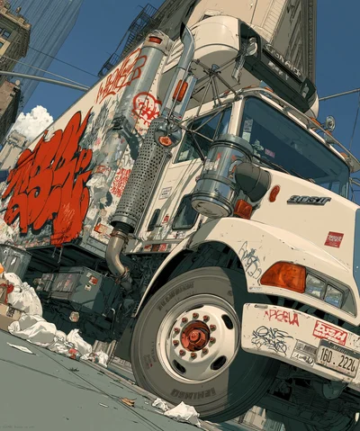
  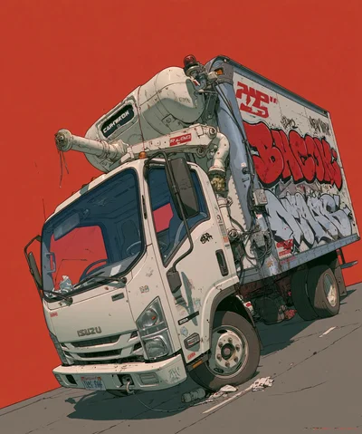
  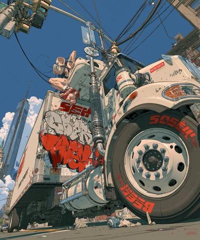

All 3 images from [@hannibalvector's post](https://www.threads.com/@hannibalvector/post/DfdZo2xoJb3).

### [mass_TECH after midnight](https://www.threads.com/@hannibalvector/post/DfeGs9fldXV)
`status: watching` · `tags: sci-fi, biomechanical, orange-black, illustration, cyberpunk` · added 2026-11

A seven-image series by @hannibalvector titled "mass_TECH after midnight 🟧." Striking orange-and-black sci-fi scenes: multi-eyed biomechanical entities with astronaut figures, a seated figure with mechanical eye apparatus against anatomical diagrams, a white-haired figure amid glowing orange flasks under a red moon, a helmeted figure with vintage electronics, and a wire-suspended figure hovering over an operating table surrounded by masked surgeons.
**Why I care:** The limited orange/black/grey palette and mix of clinical, biomechanical, and cosmic imagery create a cohesive dystopian aesthetic. Useful reference for sci-fi illustration or dark tech visuals.
**Notes:** No prompt, model, tool, or license disclosed. Shown here as first 5 of 7 source images.

  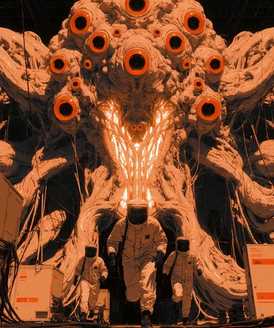
  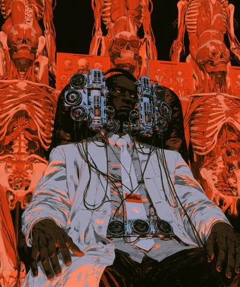
  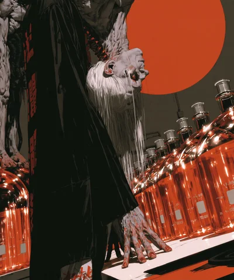
  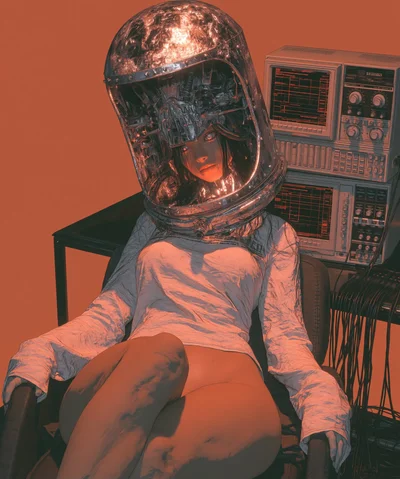
  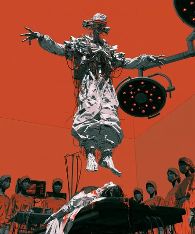

First 5 of 7 images from [@hannibalvector's post](https://www.threads.com/@hannibalvector/post/DfeGs9fldXV).

### [39 — beast and figure illustrations](https://www.threads.com/@yuo_art/post/Dfdh-6Vj0pR)
`status: watching` · `tags: ai-art, illustration, maximalist, floral, creature, figure` · added 2026-11

A four-image series by ユオ (@yuo_art) titled "39." Dense illustrative compositions pairing small human figures with large wolf-like or multi-eyed creatures, surrounded by swirling organic forms, flowers, and foliage. Shared palette across the set: cream, black, red-orange accents, and muted blue.
**Why I care:** The maximalist density and scale contrast (tiny figure, towering beast) create striking compositions. Useful reference for layered organic illustration or dark-fantasy atmosphere.
**Notes:** Tagged AI Art by the source; no prompt, model, or tool disclosed. Reuse rights unknown.

  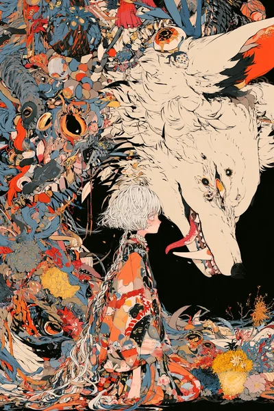
  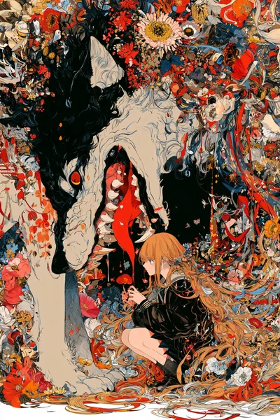
  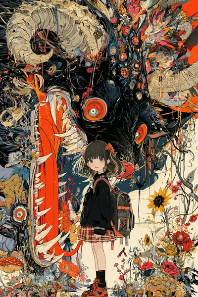
  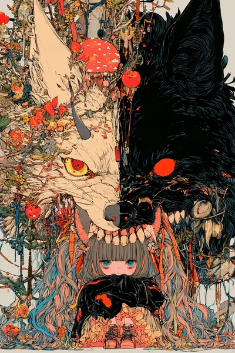

All 4 images from [@yuo_art's post](https://www.threads.com/@yuo_art/post/Dfdh-6Vj0pR).

### [Surreal coastal staircase series](https://www.threads.com/@vesarie.co/post/DfcuVPUl7P4)
`status: watching` · `tags: ai-art, surreal, architecture, coastal, staircase, atmosphere` · added 2026-11

A 20-image AI series shared by VESARIÉ (@vesarie.co) of white cliffside villages with winding staircases above the sea. Visual motifs include hazy golden-hour light, organic rock faces that blend into architecture, fabric-like flowing forms, and stairs that descend toward calm water. The post caption reads: "Some staircases lead somewhere. Others remind us that the beauty is in the journey itself..."
**Why I care:** The consistent palette (cream, pale blue, dark water) and soft atmospheric haze tie the series together while each composition finds a new way to frame the staircase motif.
**Notes:** Threads labels this as AI content; no specific model, tool, or prompt shared. Shown here as first 5 of 20 source images.

  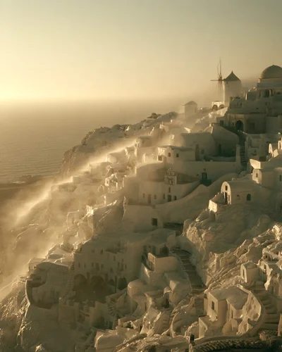
  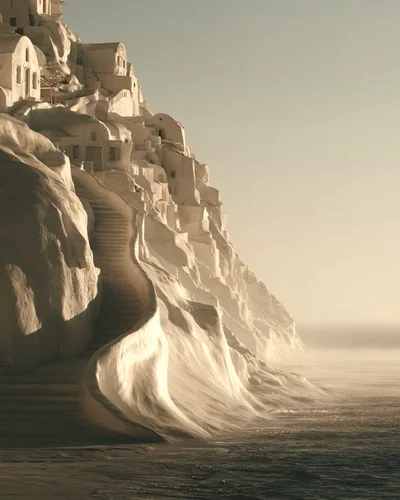
  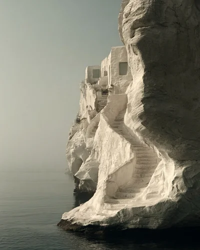
  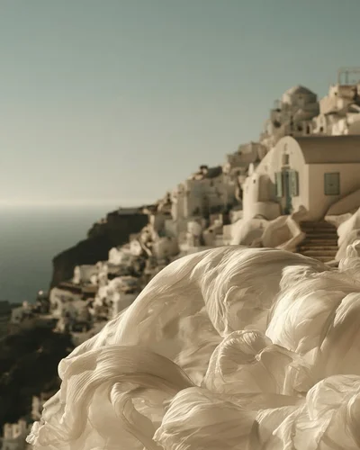
  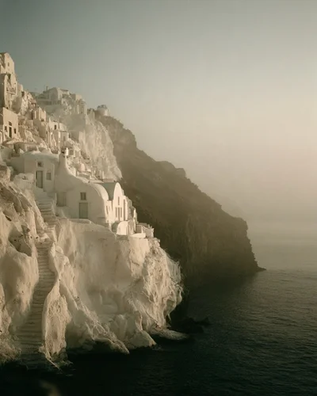

First 5 of 20 images from [@vesarie.co's post](https://www.threads.com/@vesarie.co/post/DfcuVPUl7P4).

### [Morphiq shape-to-pattern motion](https://www.threads.com/@alvarodiazds_/post/DfcYGnQTRVW)
`status: watching` · `tags: motion, pattern, generative, shapes, video` · added 2026-11

A video post by Álvaro Díaz (@alvarodiazds_) captioned "Morphiq turns simple shapes into patterns that move."
**Why I care:** The caption promises a shape-to-pattern motion workflow, which could be useful for generative motion graphics or looping backgrounds.
**Notes:** Video-only post; footage not reviewed, so no visual details confirmed. No replies, prompt, settings, tool, model, or demo link visible. Morphiq is named only in the caption; its nature (software, technique, or concept) is unclear from the post alone.

### [Design Rule No. 11: Negative Space](https://www.threads.com/@346eur/post/DfcTv1UEVNd)
`status: watching` · `tags: design-education, negative-space, layout, principles, slides` · added 2026-11

An educational carousel by Mohamed (@346eur) breaking down negative space as part of a 14-rule design principles series. Covers the definition ("breathing room" that gives clarity, balance, and focus), then distinguishes active (deliberately placed to guide attention), passive (natural gaps that aid readability), and macro (large empty areas that convey elegance).
**Why I care:** A clear, visual reference for explaining why empty space matters. The simple red-dot diagrams make each concept easy to remember.
**Notes:** Part of the creator's "Rules of Discovery" series. Shown here as first 5 of 7 slides.

  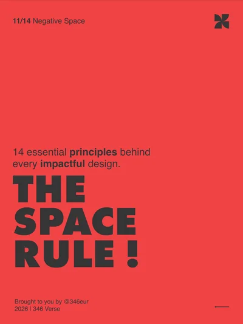
  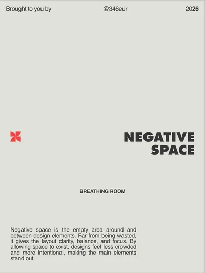
  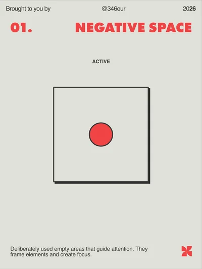
  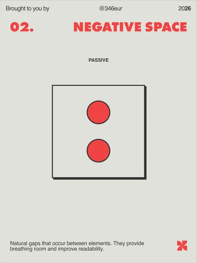
  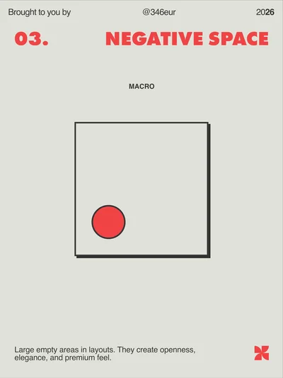

First 5 of 7 slides from [@346eur's post](https://www.threads.com/@346eur/post/DfcTv1UEVNd).

### [Portfolio hero motion reference](https://www.threads.com/@viktoroddy/post/Dfb6-UZDYkF)
`status: watching` · `tags: portfolio, motion, 3d, video-ribbon, scroll-interaction` · added 2026-11

A portfolio hero concept described by Viktor (@viktoroddy): a ribbon of live project videos flowing through 3D space, bending as the user scrolls.
**Why I care:** The idea of weaving video thumbnails through a 3D ribbon instead of a flat grid is a fresh take on portfolio presentation. The caption frames it as "AI designing is just designing now... taste is still the job."
**Notes:** Video-only post; the video did not render during verification, so this entry is based on the caption description only. No prompt, tool, or model specified. The creator's profile links to designrocket.io, but it's unverified whether that site shows this specific demo.

### [Three Kingdoms character posters](https://www.threads.com/@ofnnse/post/DfcDZ3Ak1h-)
`status: watching` · `tags: illustration, character-design, geometric, historical, poster, three-kingdoms` · added 2026-11

Seven character illustrations of Three Kingdoms heroes by Tokyo designer Nanase (@ofnnse): angular, faceted robes with muted teal, gold, and purple palettes on cream backgrounds, each with "THREE KINGDOMS" typography and the character's romanized name.
**Why I care:** The geometric fabric folds give historical costume a modern, almost low-poly feel. The consistent layout and restrained palette make them work as a series while each character stays distinct.
**Notes:** No prompt, AI model, or tool credited. Shown here as first 5 of 7 source images.

  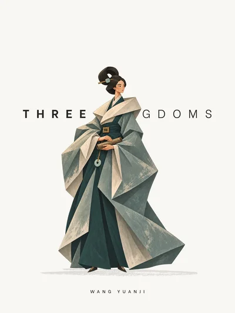
  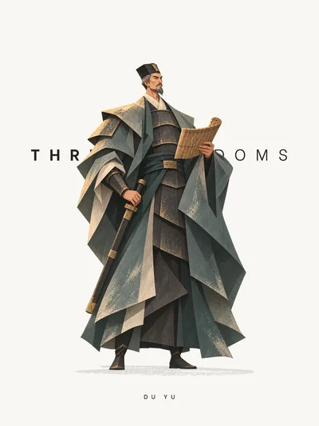
  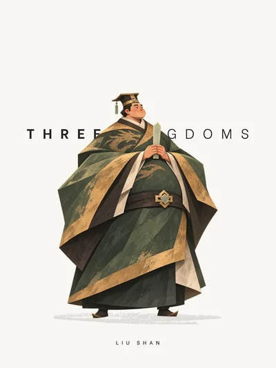
  
  

First 5 of 7 images from [@ofnnse's post](https://www.threads.com/@ofnnse/post/DfcDZ3Ak1h-).

### [Interactive 3D keyboard](https://www.threads.com/@pussmolly/post/DfZ1iYbjB04)
`status: watching` · `tags: interactive, 3d, keyboard, webgl, demo` · added 2026-11

An interactive 3D keyboard demo by @pussmolly titled "Feel": a textured mechanical keyboard in WebGL that responds to interaction.
**Why I care:** A tactile, almost toy-like 3D object that invites clicking. Good reference for interactive product showcases or playful landing pages.
**Notes:** [Live demo](https://sickmolly.space/play/) (mobile-friendly). The creator's [process reply](https://www.threads.com/@pussmolly/post/DfaEurcDDoL) says the 3D model was made by Codex at her request with supplied visual references and feedback on texture and interaction. Caption says "GPT 6 Astra + Three.js" (source wording, unverified). No thumbnail saved (source media is video; a second carousel item was inaccessible).

### [Wren illustrated footer concept](https://www.threads.com/@yasrinoori/post/Dfbll_AG2Ig)
`status: watching` · `tags: web-design, footer, illustration, landscape, cream-navy, landing-page` · added 2026-11

A footer design concept by Yasir Ahmad Noori (@yasrinoori) for a property management brand called Wren: warm cream background with Product, Company, and Resources navigation columns, anchored by a wide blue illustrated landscape of a mountain, forested hills, and a town.
**Why I care:** The illustration does the heavy lifting. Instead of ending on plain links, the footer becomes a destination with generous whitespace above and the landscape drawing the eye down through the page.
**Notes:** Designer-shared concept; no live site URL provided. Same creator as the [Aboard footer](#aboard-engraved-website-footer) in this list, with a similar cream-and-blue palette but a completely different illustration style.

  

Work by Yasir Ahmad Noori (@yasrinoori), shown as a small thumbnail for reference.

### [Outfit collage typography series](https://www.threads.com/@ha.ru57/post/DfZWMIDAewV)
`status: watching` · `tags: fashion, editorial, cutout, typography, color-blocking, collage` · added 2026-11

A series of outfit photography collages by はる (@ha.ru57): full-body cutouts on bold solid-color backgrounds with large brand typography layered behind or around the figure.
**Why I care:** Each composition pairs a saturated background color with contrasting outfit tones and a single brand wordmark, creating an instant poster feel. The face is always obscured, keeping focus on the clothes and overall silhouette.
**Notes:** The creator's profile states all colorful editing is done by hand. Dynamic poses interact with the typography, and the color palette shifts per image: beige/purple (UNIQLO), red-orange/blue (BIGMAC), yellow/magenta (JANSPORT), pale blue/brown (Columbia), chartreuse/violet (SILK). No prompt, tool, or model shared.

  
  
  
  
  

First 5 of 13 images from [@ha.ru57's post](https://www.threads.com/@ha.ru57/post/DfZWMIDAewV).

### [Blue and orange floral still-life series](https://www.threads.com/@prada3388/post/DfPcrIXiXQB)
`status: watching` · `tags: floral, still-life, blue-orange, painterly, decorative, botanical` · added 2026-11

Eight floral still-life images shared by 任毅豪 (@prada3388): ornate vases, blue and orange poppies, white peonies on marbled blue-orange grounds, and delicate blue wildflowers against black or ochre backgrounds.
**Why I care:** The palette is consistently blue, orange, white, and gold across all pieces, with painterly textures that read as decorative art rather than photography. The tall vertical compositions and dark backgrounds give them a classical feel.
**Notes:** The post doesn't share a prompt, name a tool or model, or credit an original artist. Shown here as first 5 of 8 source images. No explicit license restrictions visible.

  
  
  
  
  

First 5 of 8 images from [@prada3388's post](https://www.threads.com/@prada3388/post/DfPcrIXiXQB).

### [八岐遠呂智 Yamata no Orochi ukiyo-e series](https://www.threads.com/@takumi_3_22/post/DfPxK7_E7kJ)
`status: watching` · `tags: ukiyo-e, woodblock, mythology, storytelling, poster, ai-generated` · added 2026-11

A ten-image AI series from 一匠斎 / Isshosai (@takumi_3_22) that tells the Japanese myth of the eight-headed serpent in woodblock print style: a tiny swordsman reflected in a giant red eye, heads rising above sake barrels, a sword in the scales, and hills that turn out to be the serpent's body.
**Why I care:** It works like a storyboard, not a set of posters. Each image plays with scale in a new way, and some of the best ones hardly show the monster at all, like a black forest with only red eyes.
**Notes:** **No images are saved here on purpose.** As with the 百鬼曼荼羅 series in this list, the artist's profile forbids redistribution, resale, and trademark registration, so open the post to see them. It doesn't share a prompt or name an image model.

### [Semantics landscape series](https://www.threads.com/@gualtieri_oo/post/DfP5EsrlZsT)
`status: watching` · `tags: architecture, computational-design, landscape, painting, collage, speculative` · added 2026-11

Four images from Felice Gualtieri (@gualtieri_oo), an architect and computational designer who directs LabOFF: faceted white buildings set in worn, fresco-like landscapes with grazing animals and floating plan fragments.
**Why I care:** It mixes two eras that shouldn't fit together. Sharp computational geometry sits inside an old painted surface, so the buildings feel like something from a found painting rather than a render.
**Notes:** The caption only says "semantics", "2026", and "it.u.3.1 [landscape]". It doesn't explain the project or say how the images were made, and there's no prompt.

  
  
  
  

Work by Felice Gualtieri (@gualtieri_oo), shown as small thumbnails for reference.

### [Color kanji typography posters](https://www.threads.com/@noydesign_minami/post/DfPR5UWiVw-)
`status: watching` · `tags: typography, poster, kanji, geometric, letterform, color` · added 2026-11

Seven posters by Japanese designer Kenichi Minami (@noydesign_minami), each a grid of twelve kanji designs on black, with some English words mixed in. It's the color side of the [black-and-white posters](#japanese-typography-posters) already in this list.
**Why I care:** Each character keeps its own bright color, so the eye moves across the grid from one to the next. Seen together, it also shows how many different characters the same kit of circles and bars can make.
**Notes:** Saved three of the seven posters. The designer sells prints, so open the post for the full versions; these are small thumbnails.

  
  
  

Artwork © Kenichi Minami (@noydesign_minami), shown as small thumbnails for reference.

### [Aboard engraved website footer](https://www.threads.com/@yasrinoori/post/DfPluqylaL1)
`status: watching` · `tags: web-design, footer, engraving, duotone, landing-page, illustration` · added 2026-11

A website footer design by Yasir Ahmad Noori (@yasrinoori) for a product called Aboard: the usual link columns on cream, sitting above a blue engraved scene of passengers waiting beside a steam train.
**Why I care:** A footer is usually the most ignored part of a page, and here it's a full illustration. The train is a visual pun on the name "Aboard", which is about getting new users on board.
**Notes:** The illustration uses the same blue and cream as the rest of the footer, so it feels like part of the page rather than a picture placed on it. The links stay simple and readable above it. The post doesn't say how the illustration was made, or whether Aboard is a real client.

  

Work by Yasir Ahmad Noori (@yasrinoori), shown as a small thumbnail for reference.

### [Bastards Dancing to the Black Hit of Space](https://www.threads.com/@adorable_bastards/post/DfMKdguDW9X)
`status: watching` · `tags: poster, typography, experimental-type, red-black, ai-generated, editorial` · added 2026-11

A set of AI poster designs from Max (@adorable_bastards): dark portraits under blocky, almost unreadable red type, with fine lines of small text around the edges.
**Why I care:** The red letterforms work more like shapes than words, and the figures overlap them, which adds depth to a flat layout. The contrast between huge blocks and tiny text does most of the work.
**Notes:** The post doesn't share a prompt or name an image model. The account's profile says all its images are AI-generated. I saved three of the four.

  
  
  

AI-generated examples from @adorable_bastards' post.

### [Ancestors cyberpunk portrait series](https://www.threads.com/@feedingthegods/post/DfMp2K0jft-)
`status: watching` · `tags: illustration, cyberpunk, cyborg, poster, symmetry, limited-palette` · added 2026-11

A 20-image series from FeedingTheGods (@feedingthegods) of stern, repeated heads over dense circuit-like machinery, drawn with fine engraved lines in cream, gray, and red.
**Why I care:** Twenty variations stay together as one series because the rules barely change: a central face, copies at its sides, strict symmetry, and red as the only strong color.
**Notes:** The post doesn't say how the images were made and shares no prompt. I saved five of the twenty.

  
  
  
  
  

Images © FeedingTheGods (@feedingthegods), shown as small thumbnails for reference.

### [Hantum Architectural Studio branding](https://www.threads.com/@imagenewpic/post/DfNLbBGE_C2)
`status: watching` · `tags: branding, logo, architecture, monochrome, grid-construction, editorial` · added 2026-11

A black-and-white identity for an architecture studio, shared by @imagenewpic: a slanted monogram built on a visible grid, shown on concrete, posters, a billboard, and business cards.
**Why I care:** The logo is drawn from thin strokes that feel like an architect's lines, and the construction sheet shows how it was made. Almost everything is black and white, so the one colored billboard stands out.
**Notes:** The post has no caption or designer credit, so I don't know who made it or whether the studio is real.

  
  
  
  
  

Designer not credited. From @imagenewpic's post, shown as small thumbnails for reference.

### [Sci-fi vehicle concept sketches](https://www.threads.com/@g_art_space/post/DfMqR7QGvwY)
`status: watching` · `tags: concept-art, sci-fi, ink-sketch, spot-color, ai-generated, midjourney` · added 2026-11

Two AI concept pieces from Duck82 (@g_art_space), made with Midjourney v8.1: a space station and a jet-engine vehicle drawn like ink sketches, with cream paint and small orange accents.
**Why I care:** They look like pages from a design sketchbook rather than finished renders. Loose linework and one spot color keep the heavy mechanical detail easy to read.
**Notes:** The post doesn't share a prompt, so it's here as a style reference. To try it, describe an ink sketch with construction lines, a pale paper background, and one accent color.

  
  

AI-generated examples from @g_art_space's post.

### [Arbiter brand exploration](https://www.threads.com/@thebroadbrandings/post/DfNSDM3gZK_)
`status: watching` · `tags: branding, logo, heraldry, blackletter, law-firm, editorial` · added 2026-11

A brand exploration credited to [jky.design](http://jky.design/), featured by The Broad Brandings, for a real estate law firm with a medieval tilt: a heraldic lion, a blackletter-style wordmark, and landscape paintings of castles.
**Why I care:** It takes "know your rights over your land" literally, so the castles and landscapes carry the idea of property. The medieval look could easily feel like a costume, but a lot of plain space and a warm, limited palette keep it serious.
**Notes:** It works across billboards, letterhead, and even branded pencils, so it's a good example of how far one crest and one wordmark can go. The post calls it an exploration, so it may not be a real client.

  
  
  
  
  

Work credited to jky.design, from @thebroadbrandings' post, shown as small thumbnails for reference.

### [The Art of Pleats / 01](https://www.threads.com/@the.velth/post/DfNRRU_CF6V)
`status: watching` · `tags: architecture, fashion, pleats, concrete, editorial, red-accent` · added 2026-11

An "architecture couture" series from VELTH (@the.velth) where concrete buildings fold like fabric, and a figure in a pleated red gown stands on the stairs below them.
**Why I care:** The pleats repeat at two scales, in the gown and in the building, so the two read as one idea. Keeping everything gray except one saturated red makes the small figure the focus of a very large space.
**Notes:** The post doesn't say how the images were made and shares no prompt. I saved four of the five.

  
  
  
  

Images © VELTH (@the.velth), shown as small thumbnails for reference.

### [百鬼曼荼羅 skull ukiyo-e series](https://www.threads.com/@takumi_3_22/post/DfNL9jrkzMi)
`status: watching` · `tags: ukiyo-e, woodblock, skulls, poster, ai-generated, visual-pun` · added 2026-11

A ten-image AI series from 一匠斎 / Isshosai (@takumi_3_22) that hides skulls inside classic woodblock print scenes: a great wave with a skull in its crest, a giant seated figure built from small skulls, and a snowy slope that turns out to be a skeleton.
**Why I care:** Each image starts as a calm, familiar scene and then shows you the skull, so the idea works like a visual pun. The tall format and the same print texture and red seal hold the set together.
**Notes:** **No images are saved here on purpose.** The artist's profile says the images are free for wallpapers and editing, but forbids redistribution, resale, and trademark registration, so open the post to see them. It doesn't share a prompt or name an image model.

### [Pumpkin village miniature](https://www.threads.com/@tanaka_tatsuya/post/DfJIREnoDeJ)
`status: watching` · `tags: miniature, mitate, photography, halloween, visual-pun` · added 2026-11

A Halloween piece from Tatsuya Tanaka (@tanaka_tatsuya), a Japanese miniature and mitate artist: a row of pumpkins turned into autumn hills, with tiny trees, a little house, and a witch and her cat standing beside a stem.
**Why I care:** It shows how much a small change of scale can do. One tiny figure makes a pumpkin stem read as a tree trunk and the pumpkins read as a landscape you could walk through.
**Notes:** It's a photographed handmade miniature with no prompt. Mitate means seeing one thing as another, which is a useful way to look for ideas: find a shape in an everyday object, then add one detail that changes how it reads.

  
  

Artwork © Tatsuya Tanaka 田中達也 (@tanaka_tatsuya), shown as small thumbnails for reference.

### [Mid-century geometric travel posters](https://www.threads.com/@reelscene_ai/post/DfKOyWyEkFf)
`status: watching` · `tags: poster, travel, mid-century, geometric, ai-generated, midjourney` · added 2026-11

Three AI travel posters of New York, Sydney, and Paris shared by 릴씬 (@reelscene_ai), made with Midjourney v8.2: flat geometric landmarks, hard diagonal shadows, and a muted palette of teal, cream, rust, and mustard.
**Why I care:** A big diagonal band of light gives each poster its energy and links all three as a series, even though the landmarks are very different shapes.
**Notes:** The post doesn't share a prompt, so it's here as a style reference. To try it, describe the era, flat shapes, diagonal light, and limited palette, then check the text and fine details in the result. The post thanks @ai_traveler_k but doesn't say what they contributed.

  
  
  

AI-generated examples from @reelscene_ai's post.

### [Culinary Blueprints daily sketches](https://www.threads.com/@archfinn_/post/DfL4c7dEmHU)
`status: watching` · `tags: illustration, food, infographic, hand-lettering, paper-texture, editorial` · added 2026-11

Daily food illustrations by Finn (@archfinn_): one full-color dessert in the center of textured paper, circled by blue ink sketches of its ingredients, with handwritten tasting notes and a short description.
**Why I care:** It's a clear way to explain a dish at a glance. Only the food has color, so the eye lands there first, and the blue sketches stay in the background as supporting detail.
**Notes:** It's an illustrator's work with no prompt. The same blueprint layout could work for menus, packaging, or product breakdowns. Ingredient labels are also shown in the dish's own language, which adds a sense of place. These three are Es Dawet Telasih, Kakigōri, and Coconut Ice Cream.

  
  
  

Artwork © Finn (@archfinn_), shown as small thumbnails for reference.

### [Chance and Destiny tattoo flash](https://www.threads.com/@da.gomin/post/DfMq2pMmX1B)
`status: watching` · `tags: tattoo, flash, illustration, retro, character, lettering` · added 2026-11

A 2026 tattoo flash set by tattoo artist 大過敏 (@da.gomin): two archers whose beaded arrows spell CHANCE and DESTINY, a flower with letter beads on its stem, a small blue creature hugging an apple, and a cupid with a LOVE ME banner.
**Why I care:** The thick wobbly outlines and a tight palette of coral, blue, and green make very different subjects feel like one set. The words are part of the drawing, not captions added on top.
**Notes:** It's human-made work with no prompt. The post title plays on the Chance and Destiny cards in Monopoly, which is a nice example of one small idea carrying a whole set. The first image is the full sheet, and the rest are single designs.

  
  
  
  
  

Artwork © 大過敏 (@da.gomin), shown as small thumbnails for reference.

### [Negative space logos](https://www.threads.com/@malinacosmica/post/DfKJHISCiQ2)
`status: watching` · `tags: logo, negative-space, branding, black-and-white, marks` · added 2026-11

Five black logo marks by logo designer Malina Cosmica (@malinacosmica) on a warm off-white background, where the cut-out shapes do the work: a cross inside linked bars, a name carved through an afro silhouette, a nail shape holding lettering and stripes, and a hand against bold stripes.
**Why I care:** Each mark gets a lot from a single color. The empty space reads as a second shape, so the logo holds up small and stays memorable without gradients or effects.
**Notes:** It's human-made work with no prompt, and the post is only a title and the images. Try the same trick when a logo feels too busy: remove a shape instead of adding one, then check it still reads at favicon size.

  
  
  
  
  

Artwork © Malina Cosmica (@malinacosmica), shown as small thumbnails for reference.

### [Japanese typography posters](https://www.threads.com/@noydesign_minami/post/DfKKrjYidEZ)
`status: watching` · `tags: style-reference, typography, kanji, poster, black-and-white, geometric` · added 2026-11

Black-and-white posters by Japanese designer Kenichi Minami (@noydesign_minami) that rebuild kanji from a small kit of circles, bars, and arches, each labelled with its reading and English meaning.
**Why I care:** It's a masterclass in constraint. A few basic shapes and one color make a whole matching type system, and each character works like a logo. The idea could suit icon sets, brand marks, or Chinese-character logos.
**Notes:** **Style reference only.** There's no prompt, and the post is tagged as art, not AI. The author sells these posters, so open the post for the full versions; these are small thumbnails.

  
  
  

Artwork © Kenichi Minami (@noydesign_minami), shown as small thumbnails for reference.

### [Clean food and drink menu layouts](https://www.threads.com/@jagg3rbomb/post/DfK5fBlEq7T)
`status: watching` · `tags: style-reference, menu, food-photography, layout, typography, cafe` · added 2026-11

Three examples of clean, photo-led menus, collected by @jagg3rbomb in a post looking for a food photographer in Bali.
**Why I care:** A simple recipe for menus that feel premium: top-down or cut-out product shots on a plain background, hard natural shadows, plenty of space, and small tidy type. Each item gets the same angle and size, so the page reads like a neat grid or a card set.
**Notes:** **Style reference only.** The post is a hiring request, not a design showcase, and it doesn't credit the original designers, so I don't know who made these. The first image is a menu for the brand Earl of East. The third image in the post, a cocktail menu, has a good layout but is left out here because it has a "free font" QR code on it. The replies include portfolios from food photographers.

  
  

From @jagg3rbomb's post, original designers not credited there. Shown as small thumbnails for reference.

### [Geometric pumpkin still life (かぼちゃ)](https://www.threads.com/@dada_610/post/DfKARIoiYRm)
`status: watching` · `tags: style-reference, illustration, geometric, still-life, color, texture` · added 2026-11

A still life of a pumpkin slice by 六角堂DADA (@dada_610), an illustrator in Tokyo. Everything, even the seeds, is built from angular flat planes that overlap in glowing orange against a dark navy and brown background.
**Why I care:** It shows how far simple geometry can go. Nothing is curved, yet it still reads as a soft, real pumpkin. The offset color layers, like misaligned print plates, plus a paper-grain texture give it depth and a printed feel.
**Notes:** **Style reference only.** There's no prompt, and the post isn't labelled as AI.

  

Artwork © 六角堂DADA (@dada_610), shown as a small thumbnail for reference.

### [Someone's Home lamp poster](https://www.threads.com/@jiaan.anan/post/DfKgAcMo_gX)
`status: watching` · `tags: style-reference, illustration, poster, color, day-night, motion` · added 2026-11

A Halloween illustration by @jiaan.anan, a freelance graphic designer in brand and packaging work: three retro table lamps on a warm flat background, which switch on at night and reveal ghost cats in the dark.
**Why I care:** A clever idea built on one simple change. The same layout works twice, with the day version in warm flat color and the night version showing glow and hidden characters. The grainy texture and restrained type keep it feeling handmade.
**Notes:** **Style reference only.** There's no prompt, and the post isn't labelled as AI. The post also has an 8-second video, so open the link to see it move. The day-to-night reveal could work for a poster pair, a hover effect, or a short animation.

  
  

Artwork © Jiaan (@jiaan.anan), shown as small thumbnails for reference.

### [Krums bakery brand identity](https://www.threads.com/@anita__designer/post/DfKu7-ijn2V)
`status: watching` · `tags: style-reference, branding, packaging, typography, layout` · added 2026-11

An AI-labelled brand identity by @anita__designer for a bakery called Krums, shown across cups, pastry boxes, posters, and a storefront.
**Why I care:** The design looks great, and it holds together across every item. Worth copying: one pale sky-blue color with a heavy black wordmark, a mix of monospace, clean sans-serif, and red handwritten script, spec-sheet style product labels, and the logo cropped large off the edge.
**Notes:** **No prompt is shared**, and the post doesn't say which AI tool was used, so this is a style reference only. It has no caption, just 10 images. To recreate the look, I could write a prompt from the notes above, then swap in my own brand and colors.

  
  
  
  
  

Examples from @anita__designer's post.

### [Japan scenery poster style](https://www.threads.com/@ryobiyori/post/Dc7b9C8E6-m)
`status: watching` · `tags: style-reference, poster, japan, limited-palette, photo-to-poster` · added 2026-11

Real travel photos turned into retro screen-print posters by @ryobiyori using ChatGPT: navy, red, and mustard on cream paper, with geometric shapes and a big place name at the bottom.
**Why I care:** A striking way to turn my own travel photos into a matching poster series. The post went viral, with over 500k views.
**Notes:** **No prompt is shared.** The author says they're still refining it and may explain later, so this entry is a style reference only. To try it, I could write my own prompt from the look above, or combine it with the [travel poster prompt](image-generation.md#minimalist-travel-poster-prompt). There's also a follow-up autumn version in the replies.

  
  
  

Examples from @ryobiyori's post, cropped to the generated poster.
