# Design references

Design work to look at and learn from: layouts, color, typography, and branding. Entries here have no reusable prompt or tool. If it can be used to generate something, it belongs in [Image generation](image-generation.md).

[← Back to index](README.md)

<!-- Add entries below using the format in _template.md. Newest first. -->

### [Color kanji typography posters](https://www.threads.com/@noydesign_minami/post/DfPR5UWiVw-)
`status: watching` · `tags: typography, poster, kanji, geometric, letterform, color` · added 2026-11

Seven posters by Japanese designer Kenichi Minami (@noydesign_minami), each a grid of twelve kanji designs on black, with some English words mixed in. It's the color side of the [black-and-white posters](#japanese-typography-posters) already in this list.
**Why I care:** Each character keeps its own bright color, so the eye moves across the grid from one to the next. Seen together, it also shows how many different characters the same kit of circles and bars can make.
**Notes:** Saved three of the seven posters. The designer sells prints, so open the post for the full versions; these are small thumbnails.

  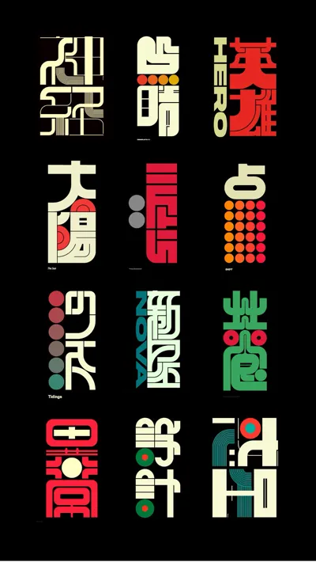
  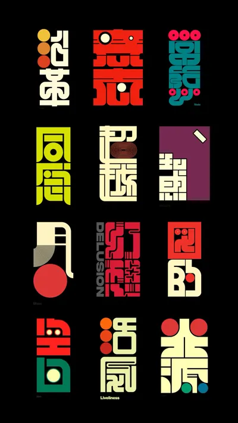
  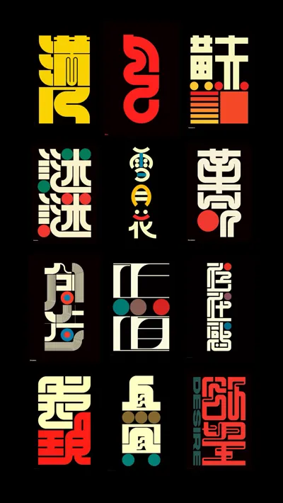

Artwork © Kenichi Minami (@noydesign_minami), shown as small thumbnails for reference.

### [Aboard engraved website footer](https://www.threads.com/@yasrinoori/post/DfPluqylaL1)
`status: watching` · `tags: web-design, footer, engraving, duotone, landing-page, illustration` · added 2026-11

A website footer design by Yasir Ahmad Noori (@yasrinoori) for a product called Aboard: the usual link columns on cream, sitting above a blue engraved scene of passengers waiting beside a steam train.
**Why I care:** A footer is usually the most ignored part of a page, and here it's a full illustration. The train is a visual pun on the name "Aboard", which is about getting new users on board.
**Notes:** The illustration uses the same blue and cream as the rest of the footer, so it feels like part of the page rather than a picture placed on it. The links stay simple and readable above it. The post doesn't say how the illustration was made, or whether Aboard is a real client.

  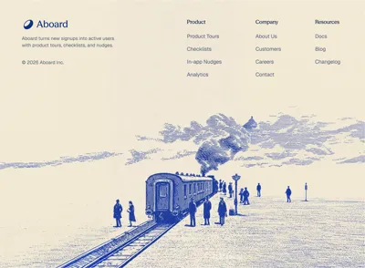

Work by Yasir Ahmad Noori (@yasrinoori), shown as a small thumbnail for reference.

### [Bastards Dancing to the Black Hit of Space](https://www.threads.com/@adorable_bastards/post/DfMKdguDW9X)
`status: watching` · `tags: poster, typography, experimental-type, red-black, ai-generated, editorial` · added 2026-11

A set of AI poster designs from Max (@adorable_bastards): dark portraits under blocky, almost unreadable red type, with fine lines of small text around the edges.
**Why I care:** The red letterforms work more like shapes than words, and the figures overlap them, which adds depth to a flat layout. The contrast between huge blocks and tiny text does most of the work.
**Notes:** The post doesn't share a prompt or name an image model. The account's profile says all its images are AI-generated. I saved three of the four.

  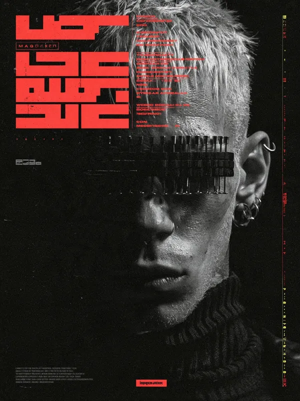
  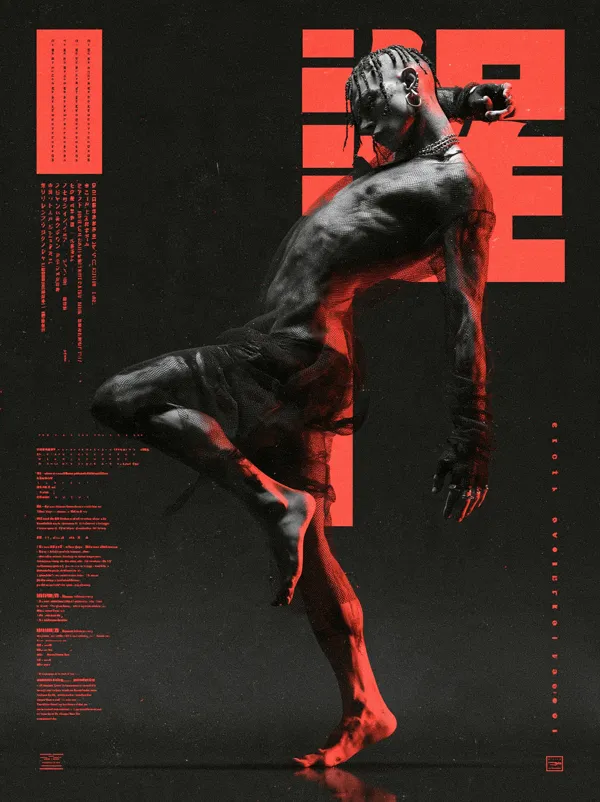
  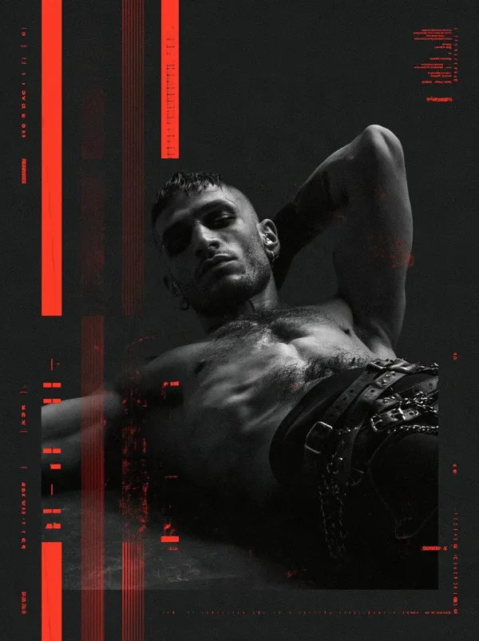

AI-generated examples from @adorable_bastards' post.

### [Ancestors cyberpunk portrait series](https://www.threads.com/@feedingthegods/post/DfMp2K0jft-)
`status: watching` · `tags: illustration, cyberpunk, cyborg, poster, symmetry, limited-palette` · added 2026-11

A 20-image series from FeedingTheGods (@feedingthegods) of stern, repeated heads over dense circuit-like machinery, drawn with fine engraved lines in cream, gray, and red.
**Why I care:** Twenty variations stay together as one series because the rules barely change: a central face, copies at its sides, strict symmetry, and red as the only strong color.
**Notes:** The post doesn't say how the images were made and shares no prompt. I saved five of the twenty.

  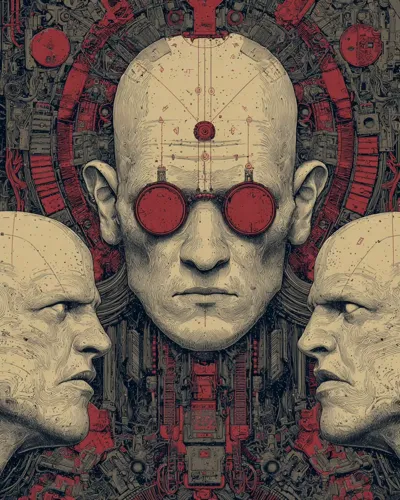
  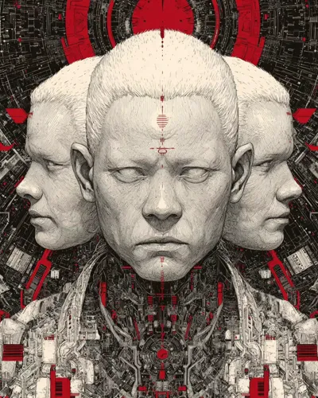
  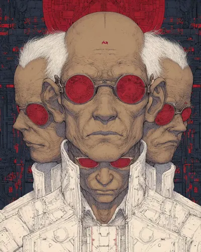
  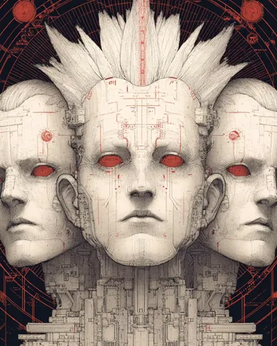
  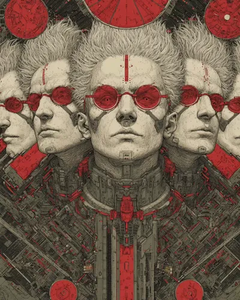

Images © FeedingTheGods (@feedingthegods), shown as small thumbnails for reference.

### [Hantum Architectural Studio branding](https://www.threads.com/@imagenewpic/post/DfNLbBGE_C2)
`status: watching` · `tags: branding, logo, architecture, monochrome, grid-construction, editorial` · added 2026-11

A black-and-white identity for an architecture studio, shared by @imagenewpic: a slanted monogram built on a visible grid, shown on concrete, posters, a billboard, and business cards.
**Why I care:** The logo is drawn from thin strokes that feel like an architect's lines, and the construction sheet shows how it was made. Almost everything is black and white, so the one colored billboard stands out.
**Notes:** The post has no caption or designer credit, so I don't know who made it or whether the studio is real.

  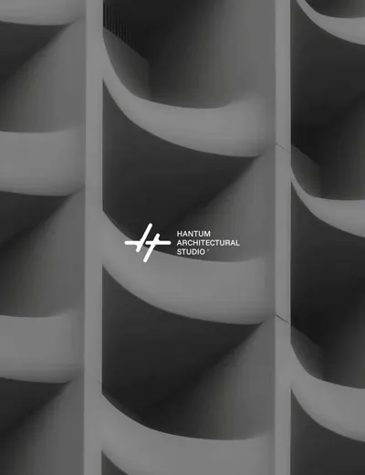
  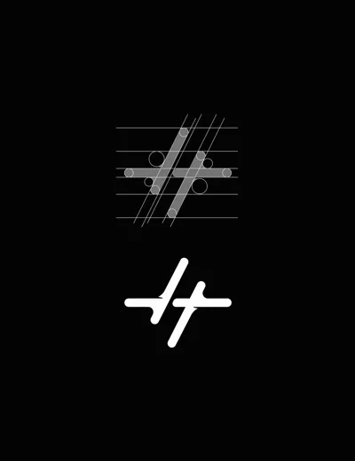
  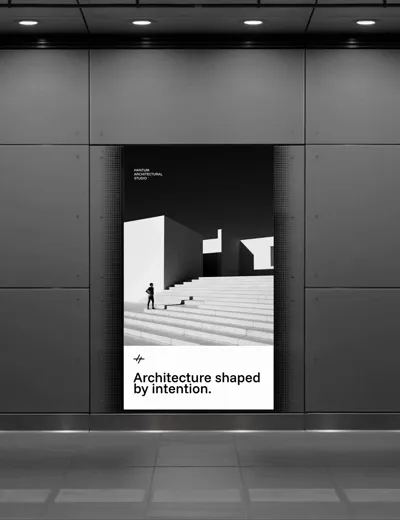
  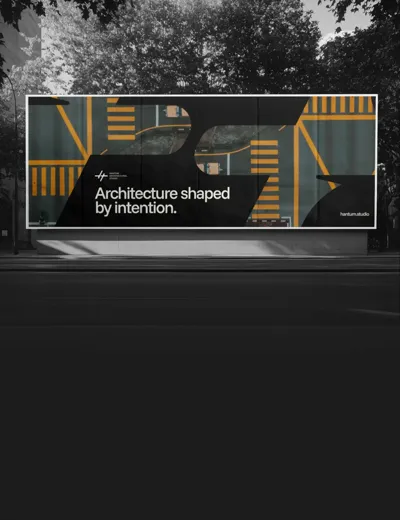
  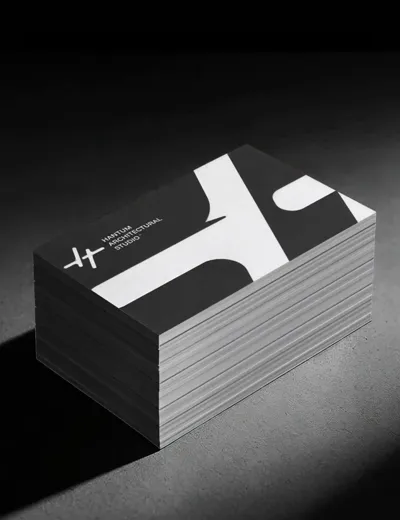

Designer not credited. From @imagenewpic's post, shown as small thumbnails for reference.

### [Sci-fi vehicle concept sketches](https://www.threads.com/@g_art_space/post/DfMqR7QGvwY)
`status: watching` · `tags: concept-art, sci-fi, ink-sketch, spot-color, ai-generated, midjourney` · added 2026-11

Two AI concept pieces from Duck82 (@g_art_space), made with Midjourney v8.1: a space station and a jet-engine vehicle drawn like ink sketches, with cream paint and small orange accents.
**Why I care:** They look like pages from a design sketchbook rather than finished renders. Loose linework and one spot color keep the heavy mechanical detail easy to read.
**Notes:** The post doesn't share a prompt, so it's here as a style reference. To try it, describe an ink sketch with construction lines, a pale paper background, and one accent color.

  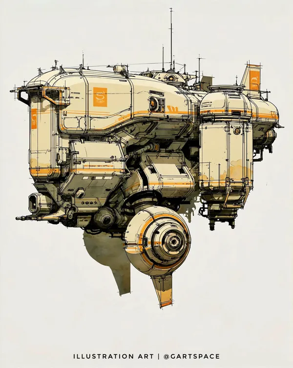
  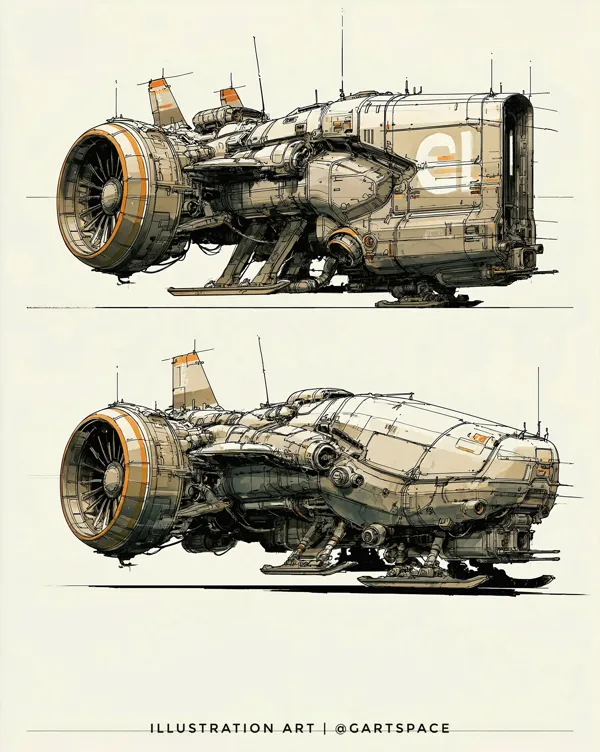

AI-generated examples from @g_art_space's post.

### [Arbiter brand exploration](https://www.threads.com/@thebroadbrandings/post/DfNSDM3gZK_)
`status: watching` · `tags: branding, logo, heraldry, blackletter, law-firm, editorial` · added 2026-11

A brand exploration credited to [jky.design](http://jky.design/), featured by The Broad Brandings, for a real estate law firm with a medieval tilt: a heraldic lion, a blackletter-style wordmark, and landscape paintings of castles.
**Why I care:** It takes "know your rights over your land" literally, so the castles and landscapes carry the idea of property. The medieval look could easily feel like a costume, but a lot of plain space and a warm, limited palette keep it serious.
**Notes:** It works across billboards, letterhead, and even branded pencils, so it's a good example of how far one crest and one wordmark can go. The post calls it an exploration, so it may not be a real client.

  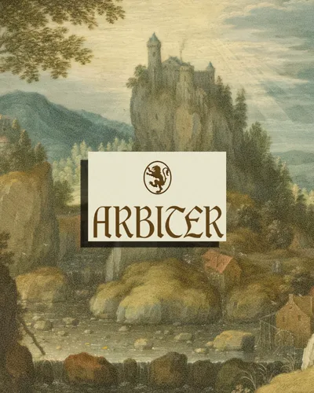
  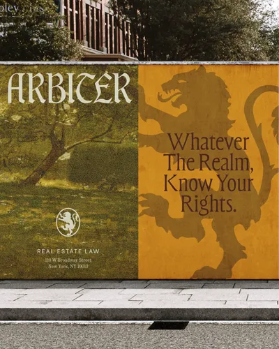
  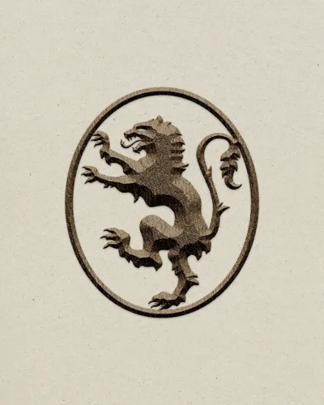
  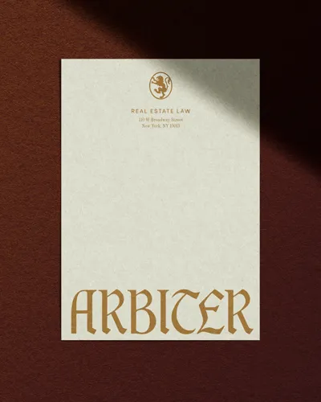
  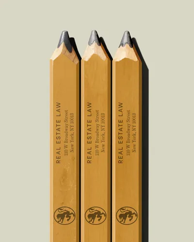

Work credited to jky.design, from @thebroadbrandings' post, shown as small thumbnails for reference.

### [The Art of Pleats / 01](https://www.threads.com/@the.velth/post/DfNRRU_CF6V)
`status: watching` · `tags: architecture, fashion, pleats, concrete, editorial, red-accent` · added 2026-11

An "architecture couture" series from VELTH (@the.velth) where concrete buildings fold like fabric, and a figure in a pleated red gown stands on the stairs below them.
**Why I care:** The pleats repeat at two scales, in the gown and in the building, so the two read as one idea. Keeping everything gray except one saturated red makes the small figure the focus of a very large space.
**Notes:** The post doesn't say how the images were made and shares no prompt. I saved four of the five.

  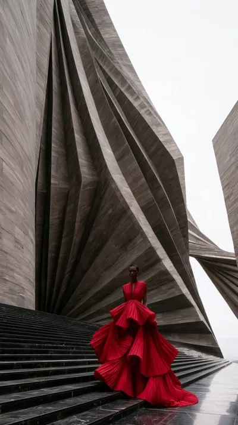
  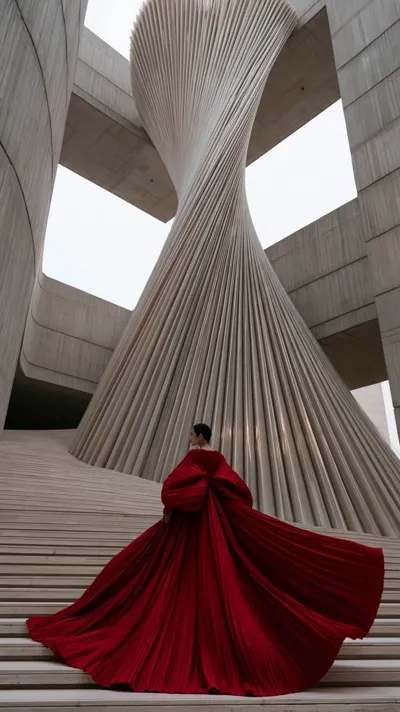
  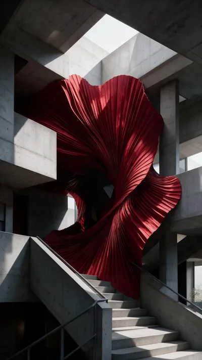
  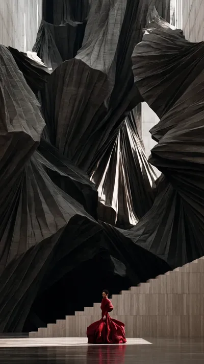

Images © VELTH (@the.velth), shown as small thumbnails for reference.

### [百鬼曼荼羅 skull ukiyo-e series](https://www.threads.com/@takumi_3_22/post/DfNL9jrkzMi)
`status: watching` · `tags: ukiyo-e, woodblock, skulls, poster, ai-generated, visual-pun` · added 2026-11

A ten-image AI series from 一匠斎 / Isshosai (@takumi_3_22) that hides skulls inside classic woodblock print scenes: a great wave with a skull in its crest, a giant seated figure built from small skulls, and a snowy slope that turns out to be a skeleton.
**Why I care:** Each image starts as a calm, familiar scene and then shows you the skull, so the idea works like a visual pun. The tall format and the same print texture and red seal hold the set together.
**Notes:** **No images are saved here on purpose.** The artist's profile says the images are free for wallpapers and editing, but forbids redistribution, resale, and trademark registration, so open the post to see them. It doesn't share a prompt or name an image model.

### [Pumpkin village miniature](https://www.threads.com/@tanaka_tatsuya/post/DfJIREnoDeJ)
`status: watching` · `tags: miniature, mitate, photography, halloween, visual-pun` · added 2026-11

A Halloween piece from Tatsuya Tanaka (@tanaka_tatsuya), a Japanese miniature and mitate artist: a row of pumpkins turned into autumn hills, with tiny trees, a little house, and a witch and her cat standing beside a stem.
**Why I care:** It shows how much a small change of scale can do. One tiny figure makes a pumpkin stem read as a tree trunk and the pumpkins read as a landscape you could walk through.
**Notes:** It's a photographed handmade miniature with no prompt. Mitate means seeing one thing as another, which is a useful way to look for ideas: find a shape in an everyday object, then add one detail that changes how it reads.

  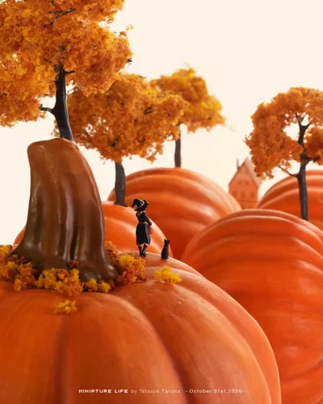
  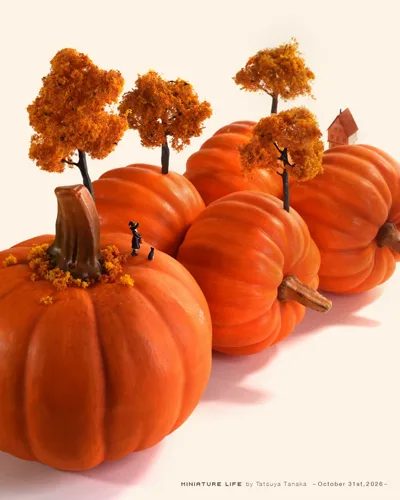

Artwork © Tatsuya Tanaka 田中達也 (@tanaka_tatsuya), shown as small thumbnails for reference.

### [Mid-century geometric travel posters](https://www.threads.com/@reelscene_ai/post/DfKOyWyEkFf)
`status: watching` · `tags: poster, travel, mid-century, geometric, ai-generated, midjourney` · added 2026-11

Three AI travel posters of New York, Sydney, and Paris shared by 릴씬 (@reelscene_ai), made with Midjourney v8.2: flat geometric landmarks, hard diagonal shadows, and a muted palette of teal, cream, rust, and mustard.
**Why I care:** A big diagonal band of light gives each poster its energy and links all three as a series, even though the landmarks are very different shapes.
**Notes:** The post doesn't share a prompt, so it's here as a style reference. To try it, describe the era, flat shapes, diagonal light, and limited palette, then check the text and fine details in the result. The post thanks @ai_traveler_k but doesn't say what they contributed.

  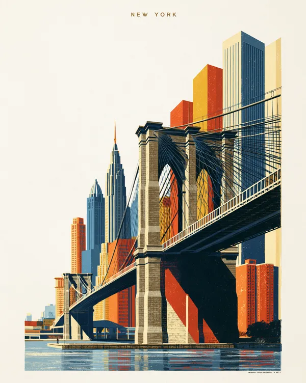
  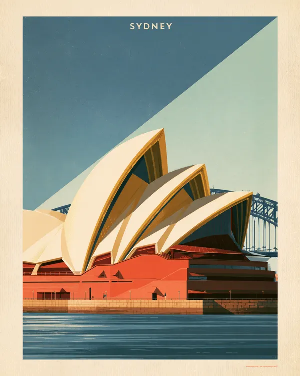
  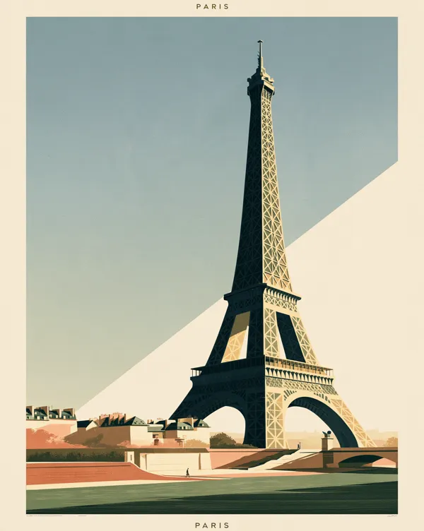

AI-generated examples from @reelscene_ai's post.

### [Culinary Blueprints daily sketches](https://www.threads.com/@archfinn_/post/DfL4c7dEmHU)
`status: watching` · `tags: illustration, food, infographic, hand-lettering, paper-texture, editorial` · added 2026-11

Daily food illustrations by Finn (@archfinn_): one full-color dessert in the center of textured paper, circled by blue ink sketches of its ingredients, with handwritten tasting notes and a short description.
**Why I care:** It's a clear way to explain a dish at a glance. Only the food has color, so the eye lands there first, and the blue sketches stay in the background as supporting detail.
**Notes:** It's an illustrator's work with no prompt. The same blueprint layout could work for menus, packaging, or product breakdowns. Ingredient labels are also shown in the dish's own language, which adds a sense of place. These three are Es Dawet Telasih, Kakigōri, and Coconut Ice Cream.

  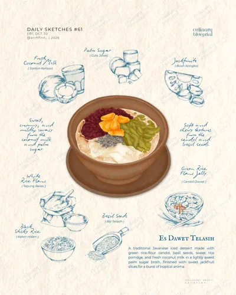
  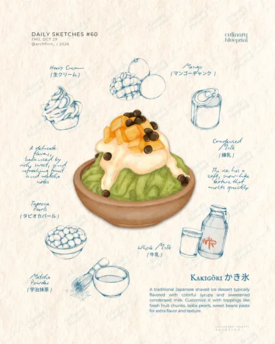
  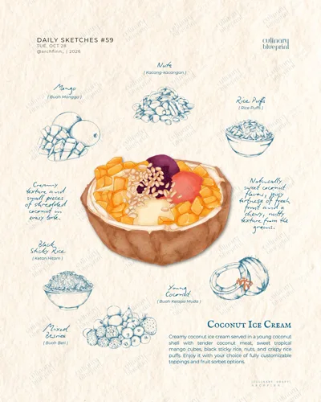

Artwork © Finn (@archfinn_), shown as small thumbnails for reference.

### [Chance and Destiny tattoo flash](https://www.threads.com/@da.gomin/post/DfMq2pMmX1B)
`status: watching` · `tags: tattoo, flash, illustration, retro, character, lettering` · added 2026-11

A 2026 tattoo flash set by tattoo artist 大過敏 (@da.gomin): two archers whose beaded arrows spell CHANCE and DESTINY, a flower with letter beads on its stem, a small blue creature hugging an apple, and a cupid with a LOVE ME banner.
**Why I care:** The thick wobbly outlines and a tight palette of coral, blue, and green make very different subjects feel like one set. The words are part of the drawing, not captions added on top.
**Notes:** It's human-made work with no prompt. The post title plays on the Chance and Destiny cards in Monopoly, which is a nice example of one small idea carrying a whole set. The first image is the full sheet, and the rest are single designs.

  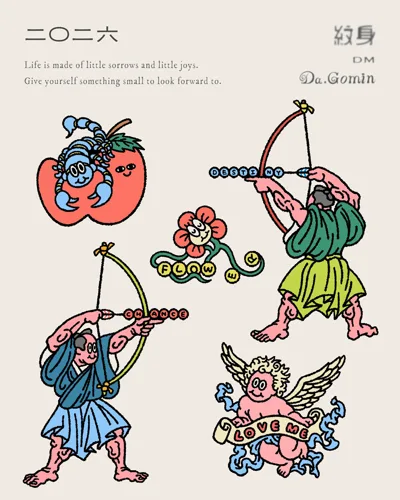
  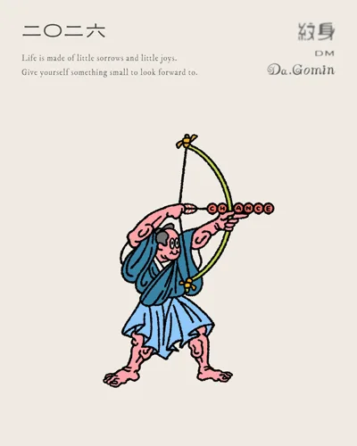
  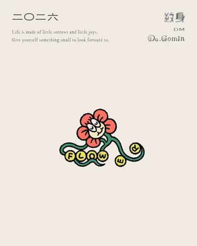
  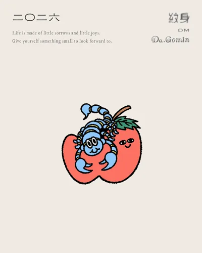
  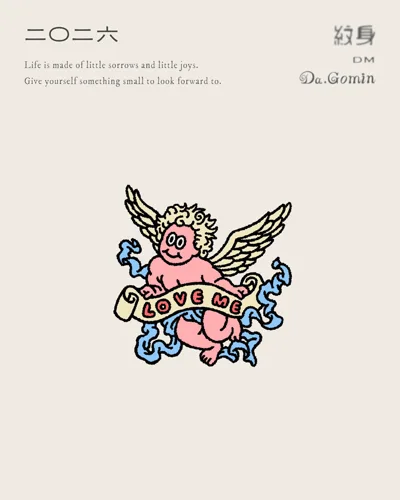

Artwork © 大過敏 (@da.gomin), shown as small thumbnails for reference.

### [Negative space logos](https://www.threads.com/@malinacosmica/post/DfKJHISCiQ2)
`status: watching` · `tags: logo, negative-space, branding, black-and-white, marks` · added 2026-11

Five black logo marks by logo designer Malina Cosmica (@malinacosmica) on a warm off-white background, where the cut-out shapes do the work: a cross inside linked bars, a name carved through an afro silhouette, a nail shape holding lettering and stripes, and a hand against bold stripes.
**Why I care:** Each mark gets a lot from a single color. The empty space reads as a second shape, so the logo holds up small and stays memorable without gradients or effects.
**Notes:** It's human-made work with no prompt, and the post is only a title and the images. Try the same trick when a logo feels too busy: remove a shape instead of adding one, then check it still reads at favicon size.

  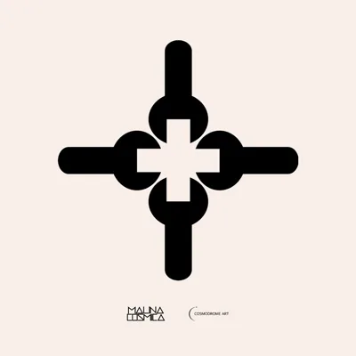
  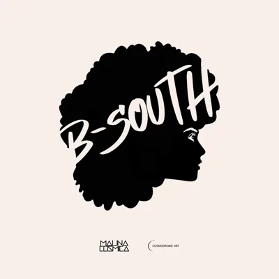
  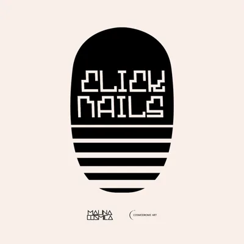
  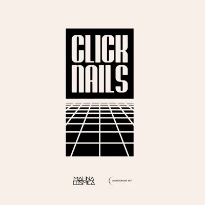
  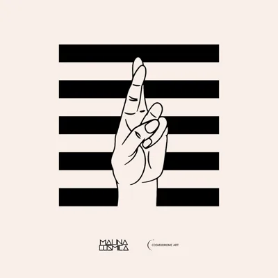

Artwork © Malina Cosmica (@malinacosmica), shown as small thumbnails for reference.

### [Japanese typography posters](https://www.threads.com/@noydesign_minami/post/DfKKrjYidEZ)
`status: watching` · `tags: style-reference, typography, kanji, poster, black-and-white, geometric` · added 2026-11

Black-and-white posters by Japanese designer Kenichi Minami (@noydesign_minami) that rebuild kanji from a small kit of circles, bars, and arches, each labelled with its reading and English meaning.
**Why I care:** It's a masterclass in constraint. A few basic shapes and one color make a whole matching type system, and each character works like a logo. The idea could suit icon sets, brand marks, or Chinese-character logos.
**Notes:** **Style reference only.** There's no prompt, and the post is tagged as art, not AI. The author sells these posters, so open the post for the full versions; these are small thumbnails.

  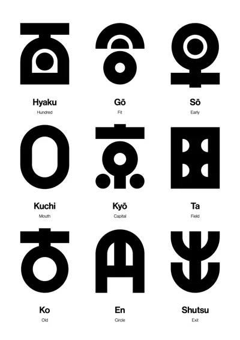
  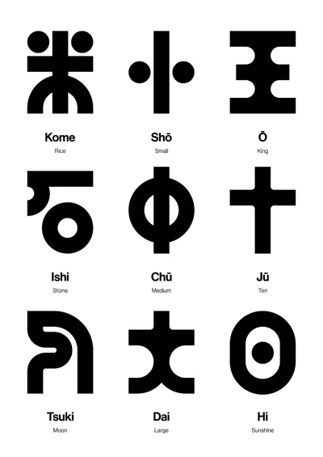
  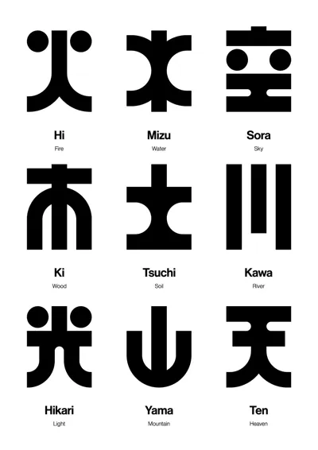

Artwork © Kenichi Minami (@noydesign_minami), shown as small thumbnails for reference.

### [Clean food and drink menu layouts](https://www.threads.com/@jagg3rbomb/post/DfK5fBlEq7T)
`status: watching` · `tags: style-reference, menu, food-photography, layout, typography, cafe` · added 2026-11

Three examples of clean, photo-led menus, collected by @jagg3rbomb in a post looking for a food photographer in Bali.
**Why I care:** A simple recipe for menus that feel premium: top-down or cut-out product shots on a plain background, hard natural shadows, plenty of space, and small tidy type. Each item gets the same angle and size, so the page reads like a neat grid or a card set.
**Notes:** **Style reference only.** The post is a hiring request, not a design showcase, and it doesn't credit the original designers, so I don't know who made these. The first image is a menu for the brand Earl of East. The third image in the post, a cocktail menu, has a good layout but is left out here because it has a "free font" QR code on it. The replies include portfolios from food photographers.

  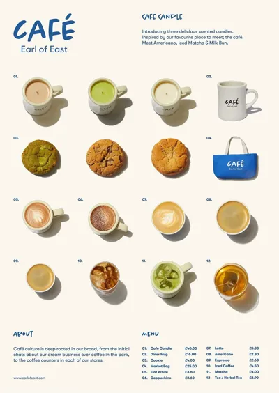
  

From @jagg3rbomb's post, original designers not credited there. Shown as small thumbnails for reference.

### [Geometric pumpkin still life (かぼちゃ)](https://www.threads.com/@dada_610/post/DfKARIoiYRm)
`status: watching` · `tags: style-reference, illustration, geometric, still-life, color, texture` · added 2026-11

A still life of a pumpkin slice by 六角堂DADA (@dada_610), an illustrator in Tokyo. Everything, even the seeds, is built from angular flat planes that overlap in glowing orange against a dark navy and brown background.
**Why I care:** It shows how far simple geometry can go. Nothing is curved, yet it still reads as a soft, real pumpkin. The offset color layers, like misaligned print plates, plus a paper-grain texture give it depth and a printed feel.
**Notes:** **Style reference only.** There's no prompt, and the post isn't labelled as AI.

  

Artwork © 六角堂DADA (@dada_610), shown as a small thumbnail for reference.

### [Someone's Home lamp poster](https://www.threads.com/@jiaan.anan/post/DfKgAcMo_gX)
`status: watching` · `tags: style-reference, illustration, poster, color, day-night, motion` · added 2026-11

A Halloween illustration by @jiaan.anan, a freelance graphic designer in brand and packaging work: three retro table lamps on a warm flat background, which switch on at night and reveal ghost cats in the dark.
**Why I care:** A clever idea built on one simple change. The same layout works twice, with the day version in warm flat color and the night version showing glow and hidden characters. The grainy texture and restrained type keep it feeling handmade.
**Notes:** **Style reference only.** There's no prompt, and the post isn't labelled as AI. The post also has an 8-second video, so open the link to see it move. The day-to-night reveal could work for a poster pair, a hover effect, or a short animation.

  
  

Artwork © Jiaan (@jiaan.anan), shown as small thumbnails for reference.

### [Krums bakery brand identity](https://www.threads.com/@anita__designer/post/DfKu7-ijn2V)
`status: watching` · `tags: style-reference, branding, packaging, typography, layout` · added 2026-11

An AI-labelled brand identity by @anita__designer for a bakery called Krums, shown across cups, pastry boxes, posters, and a storefront.
**Why I care:** The design looks great, and it holds together across every item. Worth copying: one pale sky-blue color with a heavy black wordmark, a mix of monospace, clean sans-serif, and red handwritten script, spec-sheet style product labels, and the logo cropped large off the edge.
**Notes:** **No prompt is shared**, and the post doesn't say which AI tool was used, so this is a style reference only. It has no caption, just 10 images. To recreate the look, I could write a prompt from the notes above, then swap in my own brand and colors.

  
  
  
  
  

Examples from @anita__designer's post.

### [Japan scenery poster style](https://www.threads.com/@ryobiyori/post/Dc7b9C8E6-m)
`status: watching` · `tags: style-reference, poster, japan, limited-palette, photo-to-poster` · added 2026-11

Real travel photos turned into retro screen-print posters by @ryobiyori using ChatGPT: navy, red, and mustard on cream paper, with geometric shapes and a big place name at the bottom.
**Why I care:** A striking way to turn my own travel photos into a matching poster series. The post went viral, with over 500k views.
**Notes:** **No prompt is shared.** The author says they're still refining it and may explain later, so this entry is a style reference only. To try it, I could write my own prompt from the look above, or combine it with the [travel poster prompt](image-generation.md#minimalist-travel-poster-prompt). There's also a follow-up autumn version in the replies.

  
  
  

Examples from @ryobiyori's post, cropped to the generated poster.
