# Image generation

Image models, prompts, skills, and tools you can generate with. Designs with no reusable prompt go in [Design references](design-references.md).

[← Back to index](README.md)

<!-- Add entries below using the format in _template.md. Newest first. -->

### [Dark Studio Portrait Prompt](https://www.threads.com/@agverse__/post/Dfm_EGbjRgo)
`status: watching` · `tags: prompt, photo-to-portrait, monochrome, studio, editorial, face-reference, cinematic` · added 2026-11

A structured prompt by Ashish | AGverse (@agverse__), posted as "Dark Studio Portrait Prompt" and named `AGverse_Classic_Monochrome_Cinematic_Portrait_v1`. It is meant to recreate a supplied black-and-white reference portrait's composition, lighting, and atmosphere while replacing the original subject with the person in the user's identity photo, so it needs both a style reference image and an identity photograph. The examples are tight head-and-shoulders monochrome studio portraits on a dark ground, with formal tailoring and strong rim light.
**Why I care:** A detailed identity-lock plus style-lock recipe for classic black-and-white editorial studio portraits: two references, explicit lighting and wardrobe, and a 3:4 head-and-shoulders frame.
**Notes:** The full prompt begins in the main post and continues across 16 author continuations. It is written as JSON-like text and is included below as posted; the syntax is incomplete or invalid and has not been repaired. No model, tool, or license is stated. The author mentions Instagram but gives no URL (not linked here). Not tested.

<details>
<summary>Full prompt</summary>

```
PROMPT⬇️ "AGverse_Classic_Monochrome_Cinematic_Portrait_v1", "purpose": "Recreate the exact visual aesthetic, portrait composition, lighting direction, tonal contrast, styling, and photographic atmosphere of the supplied black-and-white reference image while completely replacing the original subject with the person in the user's identity reference photograph.", "reference_image": {

"role": "Visual style and composition reference", "instructions": [ "Use the supplied monochrome portrait strictly as the visual reference.", "Reproduce its camera framing, portrait orientation, subject positioning, head angle, facial presentation, lighting direction, background, tonal range, contrast, and photographic atmosphere.", "Do not reproduce the original person's identity.", "Do not copy the original person's facial features." ] }, "identity_reference": {

"role": "Primary identity source", "instructions": [ "Use the user's uploaded personal photograph as the exclusive identity reference.", "Replace the reference subject entirely with the person from the identity photograph.", "Preserve the user's actual facial identity with maximum accuracy.", "Maintain original facial proportions, face shape, jawline, cheekbones, eyes, eyebrows, nose, lips, ears, skin texture, hairline, and other distinctive facial characteristics.",

"Preserve natural skin details, pores, asymmetries, and realistic facial anatomy.", "Do not beautify, redesign, idealize, reshape, or artificially modify the user's face.", "Do not blend the user's face with the reference subject's facial characteristics.", "The final image must unmistakably represent the person in the identity reference." ] }, "composition": { "format": "Vertical portrait", "aspect_ratio": "3:4", "resolution": "1152x1536",

"shot_type": "Tight cinematic head-and-shoulders studio portrait", "camera_angle": "Straight-on eye-level perspective", "framing": "Centered symmetrical composition", "subject_position": "Precisely centered horizontally", "head_position": "Upright, facing directly toward the camera", "eye_direction": "Direct eye contact with the camera", "crop": "Top of hair to upper chest, with both shoulders visible", "headroom": "Moderate negative space above the hairstyle",

"perspective": "Natural portrait perspective without facial distortion" }, "pose_and_expression": { "body_position": "Standing or seated upright, shoulders naturally squared toward the camera", "head_orientation": "Facing directly forward", "facial_expression": "Calm, confident, composed, and subtly serious", "eyes": "Relaxed, naturally focused direct gaze", "mouth": "Closed lips with a neutral expression", "overall_presence": "Understated elegance, timeless sophistication, quiet confidence" },

"wardrobe_and_styling": { "outfit": "Classic tailored black formal suit", "jacket": "Premium black suit jacket with structured shoulders and elegant lapels", "shirt": "Clean white formal dress shirt with a pointed collar", "tie": "Minimalist solid black necktie, neatly knotted", "styling": "Timeless formal menswear", "fabric_details": "Realistic tailoring, subtle fabric texture, natural folds", "accessories": "No unnecessary accessories" }, "hairstyle": {

"direction": "Preserve the hairstyle from the user's identity photograph wherever possible", "texture": "Natural individual hair strands and realistic volume", "finish": "Authentic, slightly textured photographic appearance", "restriction": "Do not automatically copy the reference subject's hairstyle if it conflicts with the user's actual hairstyle." }, "lighting": { "style": "Professional dramatic monochrome studio lighting", "key_light": "Soft but directional frontal studio illumination",

"rim_light": "Strong controlled backlight from the upper rear side, creating luminous highlights around the hair and shoulders", "fill_light": "Subtle fill to retain facial detail without flattening shadows", "shadow_structure": "Deep cinematic shadows around the sides of the face, neck, and suit", "highlight_control": "Preserve detail in bright facial highlights and white shirt", "background_separation": "Distinct luminous hair edges against the dark background",

"overall_effect": "High-end black-and-white editorial portrait photography" }, "background": { "type": "Seamless professional studio background", "color": "Deep charcoal black", "texture": "Smooth, subtle tonal gradient", "lighting": "Very subtle background illumination behind the head", "distractions": "Absolutely none", "environment": "Minimalist dark photographic studio" }, "color_grading": { "color_mode": "Pure black and white monochrome", "tonal_style": "Rich cinematic grayscale",

"blacks": "Deep, rich blacks without losing important details", "whites": "Clean, controlled luminous whites", "midtones": "Detailed natural gray tonal transitions", "contrast": "Strong but carefully balanced high contrast", "skin_tones": "Natural grayscale skin rendering", "grain": "Very subtle fine photographic film grain", "finish": "Timeless fine-art editorial monochrome photography" }, "camera_and_photography": { "photography_style": "Luxury editorial studio portrait",

"lens": "85mm portrait lens", "aperture": "f/2.8", "focus": "Extremely sharp focus on both eyes and facial features", "depth_of_field": "Shallow but natural depth of field", "image_quality": "Ultra-realistic professional photographic detail", "dynamic_range": "High dynamic range with controlled highlights and deep shadows", "retouching": "Minimal professional retouching while retaining authentic skin texture" }, "visual_aesthetic": {

"mood": "Mysterious, sophisticated, timeless, cinematic, elegant", "genre": "Classic black-and-white fashion editorial", "inspiration": "Luxury men's fashion magazine portrait photography", "realism": "Photorealistic", "texture": "Authentic photographic detail", "presentation": "Minimalist, refined, premium studio portrait" }, "strict_removal_instructions": { "typography": "Do not include any text, lettering, captions, titles, typography, watermarks, logos, signatures, or written elements.",

"ui_elements": "Do not include interface elements, buttons, icons, borders, frames, overlays, social media elements, or graphic design components.", "graphic_design": "No poster layout, no decorative graphics, no text overlays.", "final_output": "A clean, uninterrupted, full-frame photographic portrait only." }, "negative_prompt": [ "Different identity", "Face swapping artifacts", "Altered facial proportions", "Artificial facial symmetry", "Unnatural skin smoothing", "Plastic skin",

"Beauty filters", "CGI appearance", "3D rendering", "Illustration", "Cartoon", "Anime", "Color photography", "Colored lighting", "Overexposed forehead", "Crushed facial shadows", "Blurred eyes", "Soft facial details", "Distorted anatomy", "Asymmetrical eyes caused by generation errors", "Extra facial features", "Unnatural hair", "Unrealistic suit fabric", "Busy background", "Visible studio equipment", "Typography", "Text", "Watermarks", "Logos", "UI elements", "Borders", "Frames", "Collage",

"Poster graphics" ], "final_execution": { "priority_1": "Maximum preservation of the user's actual facial identity.", "priority_2": "Reproduce the reference composition, framing, pose, and visual aesthetic.", "priority_3": "Match the dramatic monochrome studio lighting and tonal contrast.", "priority_4": "Reproduce the formal black suit, white shirt, and black tie styling.", "priority_5": "Remove all typography, graphic overlays, and interface elements.",

"output_requirement": "Generate one ultra-realistic, premium-quality black-and-white studio portrait that looks like a professionally photographed version of the user in the supplied reference's visual style."
```

</details>

<p>
  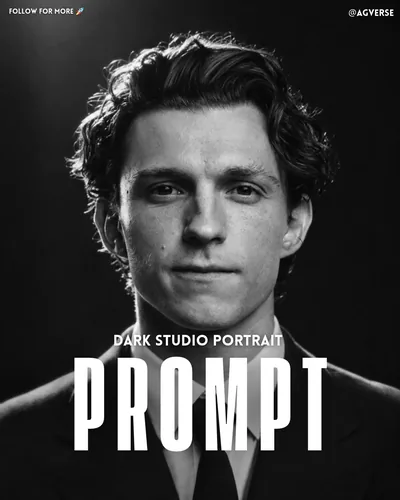
  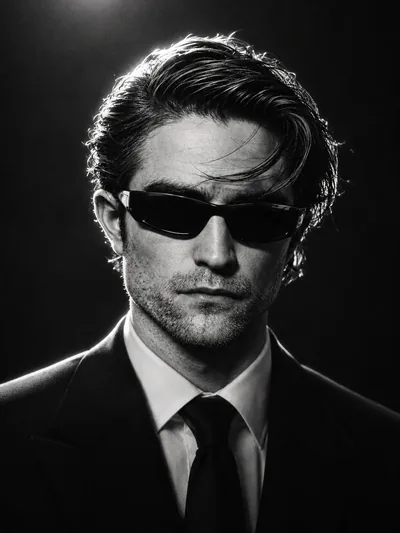
  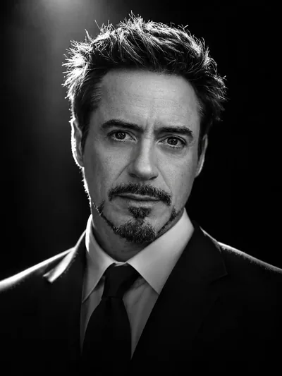
  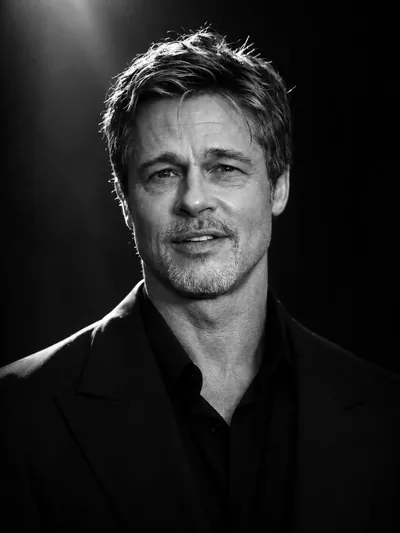
  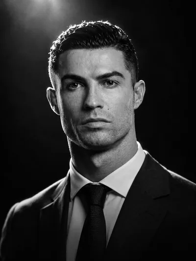
</p>

<sub>First 5 of 8 images from [@agverse__'s post](https://www.threads.com/@agverse__/post/Dfm_EGbjRgo).</sub>

### [CR7 poster prompt](https://www.threads.com/@afzanhilmi/post/Dfmu5UPn7GW)
`status: watching` · `tags: prompt, midjourney, sref, poster, sports, typography` · added 2026-11

A Midjourney poster prompt by Afzan | AI Creative Director (@afzanhilmi), posted as "CR7 | The Collection 🐐": a modern full-body celebration poster of Cristiano Ronaldo in a Portugal kit on a clean background, with particle breakup and a limited colour glow. The third still labels the tool as "4:5 | Midjourney" and prints the reusable prompt, including `--sref` style codes and `--v 8.2`.
**Why I care:** A complete sports-poster recipe where the `--sref` stack does most of the look — useful if you want that dissolving full-body figure on a pale field, and a reminder that the subject here is a real public figure.
**Notes:** The prompt depicts a real public figure (Cristiano Ronaldo). Midjourney is attributed from the author's image overlay; `--v 8.2` is written as it appears in the prompt, not independently verified as a current version. The `--sref` codes drive the look. Spelling in the prompt (e.g. CHRISTIANO, SUITE) is kept as written. The final still of the carousel says "Prompts available on my Telegram channel" but gives no URL; only the one prompt shown in the post is included here. Same creator as the [BURNT MOTION sref set](#burnt-motion-sref-set). Not tested.

<details>
<summary>Full prompt</summary>

```
MODERN POSTER OF CHRISTIANO RONALDO IN PORTUGAL SUITE IN CELEBRATION POSE, CLEAN
BACKGROUND, FULL BODY --CHAOS 15 --AR 4:5 --SREF 2405248426 12133245 3433999548
3520654377 96937294 1444598803 --SW 300 --STYLIZE 300 --HD --V 8.2
```

</details>

<p>
  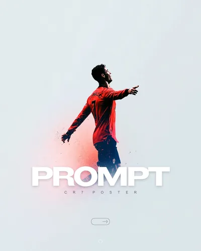
  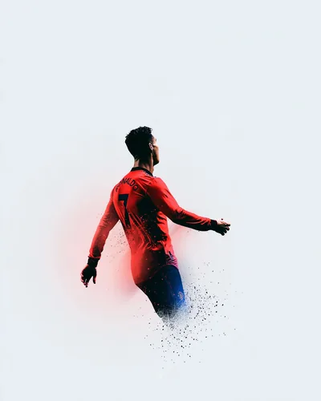
  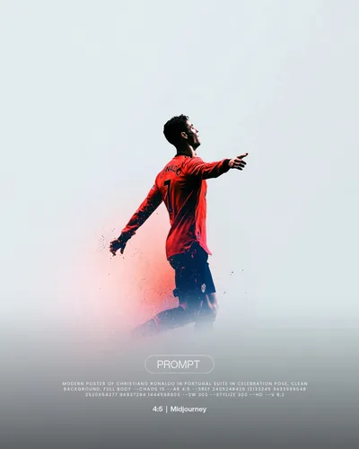
  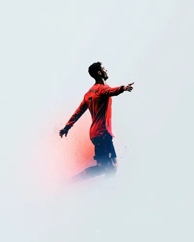
  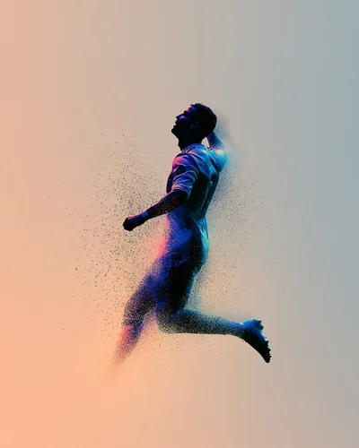
</p>

<sub>First 5 of 15 images from [@afzanhilmi's post](https://www.threads.com/@afzanhilmi/post/Dfmu5UPn7GW).</sub>

### [Cubist minimalist portrait prompt](https://www.threads.com/@anggadaras1908/post/DfkS8womdzl)
`status: watching` · `tags: prompt, photo-to-portrait, cubist, vector, minimal, editorial` · added 2026-11

A prompt by 💙Angga Nerazzurri💙 (@anggadaras1908) that turns an attached photo of a person into a 3:4 "Picasso meets minimalism" neo-expressive cubist vector portrait on a deep matte black background, with flat color blocks, simplified features, and fashion-illustration styling. The source post text is just "Slepp."
**Why I care:** A compact recipe for stylized, print-ready cubist portraits from a real face — useful when you want icon-like faces with limited color and poster texture rather than photorealism.
**Notes:** Needs a reference photo ("the person shown in the attached image"). No model or tool is stated. The prompt tail includes the name "Angga", the line "THE SAME VIBE IN A DIFFERENT PLACE", and ♡ — these appear to be personalized caption text you can replace; the prompt is kept verbatim below. Full prompt is in the [continuation](https://www.threads.com/@anggadaras1908/post/DfkS8riGee2). Not tested.

<details>
<summary>Full prompt</summary>

```
Create a playful, neo-expressive, cubist minimalist vector illustration

of the person shown in the attached image. The style is "Picasso meets minimalism," inspired by stylish fashion magazines and playful modern art. Highly simplified and exaggerated facial features with large, abstract eyes, flat eye shapes, minimal black dots or single curved lines, a lack of realistic iris detail, a lack of eyelashes, and highly simplified facial details. A small, abstract nose drawn with a single, short, angular line. A small, single lip line, a small, soft geometric mouth shape, minimal signs of expression, and a lack of realistic mouth anatomy. Slightly rounded, dreamy, innocent, playful cheeks, asymmetrical, elongated, and elegant proportions, a simplified geometric facial plan, stylized angular hair shapes, subtle cartoon elements, and childish artistic distortions. Use clean, scalable vector shapes, flat color blocks, bold, primitive contour lines, and sharp Bézier curves. Abstract compositions with polygons, minimalist imagery, handcrafted quality, expressive use of white space, abstract faces in an icon style, a lack of realistic images, and 2D facial symbols. Subtle overlapping oil paint textures, the rough accents of a handmade suit, careless handwritten notes, visible pigment textures, and the feel of a silk-screened poster have been added.

A vibrant and limited color palette with a deep matte black background. Premium edition composition, modern fashion illustration, stylish and cute, vector art, print-ready.

Angga

THE SAME VIBE IN A DIFFERENT PLACE

♡

The aspect ratio is 3:4.
```

</details>

<p>
  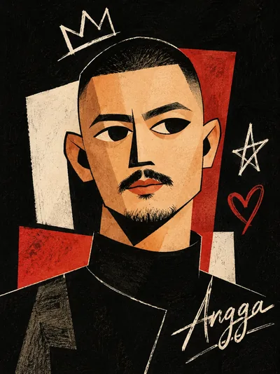
  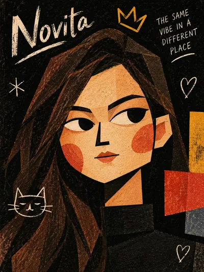
  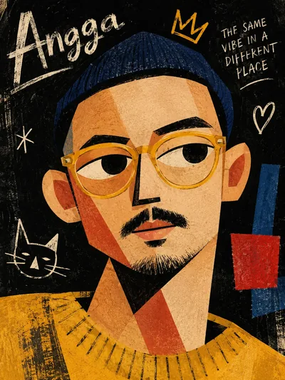
</p>

<sub>All 3 images from [@anggadaras1908's post](https://www.threads.com/@anggadaras1908/post/DfkS8womdzl).</sub>

### [Torn-paper print poster prompt (把照片撕成一幅畫)](https://www.threads.com/@jenniferzhao08/post/DfjpgkHm-II)
`status: watching` · `tags: prompt, photo-to-poster, collage, torn-paper, typography, side-by-side` · added 2026-11

A prompt by Jennifer (@jenniferzhao08) that turns an uploaded photo into a 3:4 vertical comparison poster: the original photograph on the top half, and a small hand-torn paper-print collage of the same scene on a warm ivory field below, with a two-line English caption under the collage.
**Why I care:** Compared with her earlier [paper collage comparison](#paper-collage-comparison-prompt-碎片拼貼), this version keeps the collage small and centered, builds it from a few flat torn color papers sampled from the photo, and adds a short typeset caption — more like a print on a sheet of paper than a full-bleed collage panel.
**Notes:** Needs an uploaded photo. Top half keeps the original composition, light, and color (minimal proportional crop only if needed). Bottom half is warm ivory; the torn-paper group is capped at 45% of that panel's width and 50% of its height, with generous paper-white above and below. No model or tool is stated. Full prompt is in the [continuation](https://www.threads.com/@jenniferzhao08/post/DfjphMtG7O2) (in Chinese). Same creator as the [hand-drawn manga comparison poster](#hand-drawn-manga-comparison-poster-prompt). Not tested.

<details>
<summary>Full prompt</summary>

```
根据上传的照片，制作一张 3:4 竖版「原照片 × 手撕纸版画」对照海报。以整张海报的水平中线分为上下两幅，两幅等宽等高，边缘对齐并直接拼接。 上半幅直接使用原照片，保留原有构图、光线、色彩和摄影细节。需要适配画幅时，只做最小幅度的等比裁切，优先保留主要主体、关键动作和互动关系。 下半幅铺满暖象牙色纸，在纸面中央放一组小幅撕纸版画。将主体、陪衬纸片和所有露出的撕边作为一个整体等比缩放。整组拼贴的宽度不超过下半幅宽度的 45%，高度不超过下半幅高度的 50%。以先达到的上限为准，即使竖长主体两侧仍有大量空白，也保持小画幅。拼贴最上缘与上下拼接处之间，留出至少约五分之一下半幅高度的连续纸白。先确定拼贴尺寸和位置，再排题字。 从原照中选出最能辨认这一幕的主体和关键景物，保留它们的姿态、朝向、相对尺度、遮挡和互动。人物、动物或静物近景，保留有辨识度的剪影、神态和特征色，环境只留与动作直接相关的一小部分，例如脚下的台阶、手中的物件或托住主体的家具边缘。风景与建筑照，用少数大纸片保留决定构图的岸线、山脊、建筑结构或明暗分界。原照中的小人物、船只等保持相对尺度和位置。其余区域露出干净的底纸。 从原照提取两到四种代表色，用少量手撕色纸直接拼出形体。用大纸片建立主体轮廓，再把花纹、衣服、结构转折和前景物件作为独立纸片局部叠上去。上层纸片压住下层的一角，让底层从侧面或断口露出。用少量小纸片点出眼睛、手势或标志性细节。色面平整哑光，靠纸片的大小、方向和搭接表现层次。 在两三处主要接缝清楚露出细窄的浅色纸芯、短纤维和长短不一的撕裂断口，其余纸边自然贴合。各块纸片沿自身轮廓在不同位置收尾，让底纸从两侧和景物之间自然伸入。避免把整组拼贴收成四边齐整的矩形，也避免均匀白边、厚重投影、写实渐变和密集刻线。 在整组拼贴的最低点下方留一小段纸白，再排两行小号深灰色衬线英文。两行左对齐，文字左缘与拼贴左缘对齐，完整放在拼贴下方。根据原照自动写一句简短、具体的英文观察，在自然停顿处换行。若提供指定文案，逐字使用。题字下方继续留出宽裕的纸白。 只输出一张完整的上下对照海报。无分隔线、拼接间隙、外框、水印、账号或额外文字。
```

</details>

<p>
  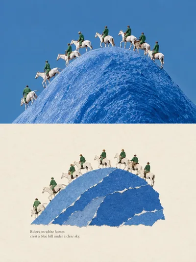
  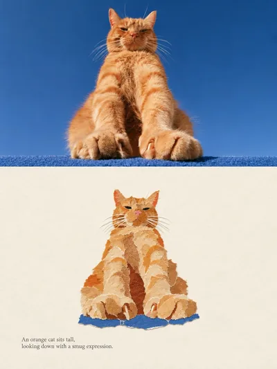
  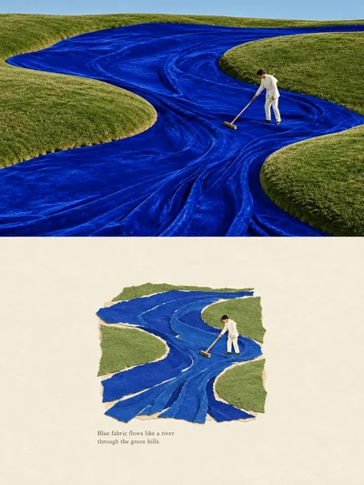
  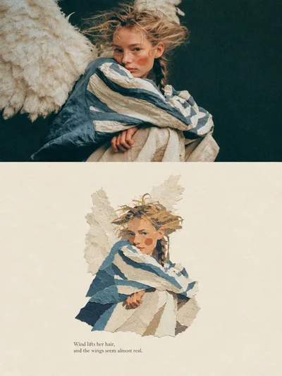
</p>

<sub>All 4 images from [@jenniferzhao08's post](https://www.threads.com/@jenniferzhao08/post/DfjpgkHm-II).</sub>

### [Dune Scarlet](https://www.threads.com/@wwni_y/post/DfeISn0oEES)
`status: watching` · `tags: prompt, photo-to-portrait, desert, scarlet, selfie, face-reference, editorial` · added 2026-11

A face-reference selfie prompt set by @wwni_y titled "Dune Scarlet": scarlet-red hooded draped fabric against golden sand dunes under a bright blue sky, high-angle chest-up framing. Separate female and male prompt variants.
**Why I care:** Clear face-lock language ("exact facial features preserved from reference") plus a strong costume-and-landscape recipe — useful when you want identity held from a reference while swapping outfit and setting.
**Notes:** Requires a face reference image. Model/tool not stated in the post text; the first still visibly overlays the text "NB2PRO/GPT" and "BY NIA" (shown as written on the image, not treated as a confirmed model). Female prompt in [continuation](https://www.threads.com/@wwni_y/post/DfeId5voOoo); male prompt in [reply "here u go"](https://www.threads.com/@wwni_y/post/DfeJJcjoL6A). Post also includes a video (not watched). No license disclosed. Not tested.

<details>
<summary>Full prompt — female version</summary>

```
Hyper-realistic 8K RAW photo, high-angle shot looking slightly down, exact facial features preserved perfectly from reference. Sleek polished hair with clean center part, smoothly pulled back, natural shine, exact hair color. Makeup: soft matte warm neutral lips, natural laminated brows, subtle contour, flawless radiant skin. Flowing scarlet-red draped fabric, elegant hooded silhouette, modern cut-out, soft folds, premium drape. Large polished round silver earrings. Pose: relaxed, looking gently up toward the camera, one arm extended forward in selfie perspective, phone not visible. Background: sweeping high-angle view across vast golden sand dunes, endless desert landscape stretching far below, clear bright blue sky, smooth wind-rippled sand patterns. Lighting: bright warm overhead sunlight, soft natural glow, gentle shadows, vivid natural tones. Style: luxury editorial, ultra-sharp focus everywhere, no blur, photorealistic, Instagram aesthetic, chest-up framing, 3:4
```

</details>

<details>
<summary>Full prompt — male version</summary>

```
Hyper-realistic 8K RAW high-angle selfie, looking slightly down, exact facial features 100% preserved from male reference — eyes, bone structure, jawline, skin tone unchanged. Neat sleek polished hair, clean sharp center part, smoothly styled back, natural healthy shine, exact hair color. Grooming: natural defined brows, subtle facial contouring, clean matte skin, fresh natural finish, sharp jawline preserved. Outfit: elegant flowing deep crimson-red draped fabric, modern hooded silhouette, soft refined folds, clean structured cut-out at chest, premium lightweight fabric with soft natural drape — no earrings. Pose: looking gently up toward camera, one arm extended forward naturally, phone completely out of frame, relaxed confident posture. Background: sweeping high-angle vista across vast golden desert, endless smooth sand dunes stretching to horizon, clear cloudless bright blue sky, soft wind-formed sand ripples. Lighting: bright warm overhead sunlight, natural soft glow, gentle defined shadows, rich natural tones, no harsh glare. Style: modern masculine luxury editorial, ultra-sharp focus everywhere, zero blur, photorealistic, sophisticated minimalist aesthetic, chest-up framing, 3:4
```

</details>

<p>
  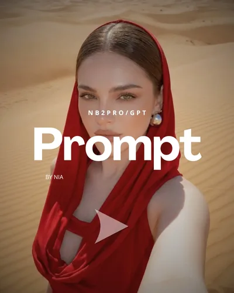
  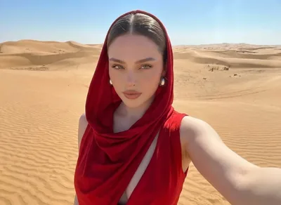
  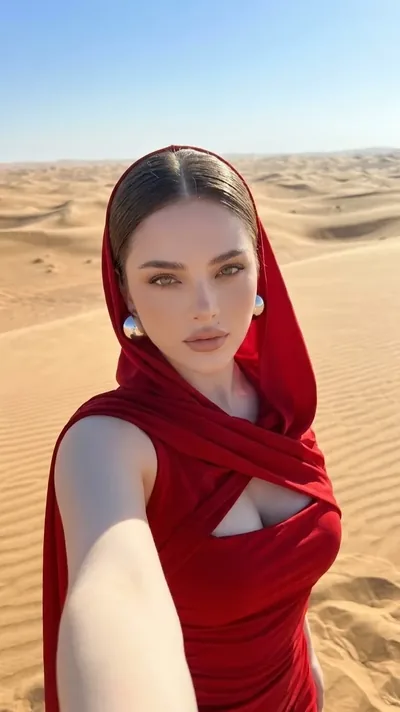
  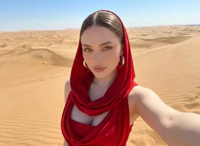
  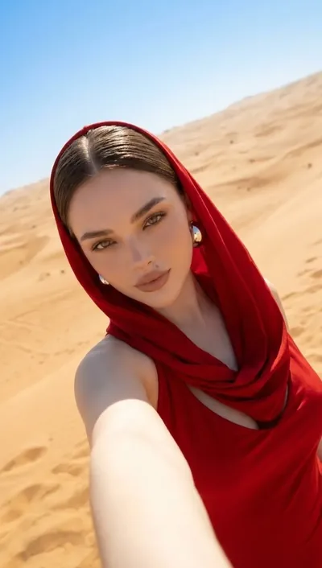
</p>

<sub>All 5 stills from [@wwni_y's post](https://www.threads.com/@wwni_y/post/DfeISn0oEES) (video not included).</sub>

### [Halftone poetic poster prompt](https://www.threads.com/@ammiamia_/post/DfgVj9dkq35)
`status: watching` · `tags: prompt, photo-to-poster, typography, halftone, retro, editorial` · added 2026-11

A prompt by @ammiamia_ that turns an uploaded photo into a 3:4 poetic printed poster: top-third silver-white negative space with short English lines, a huge high-contrast serif title word sampled from the photo's colors, and the subject rising through the letters with fine CMY-style circular halftone dots.
**Why I care:** Close cousin to the Chloe_Lai retro type poster, but without the ORIGINAL inset — denser print-halftone texture and explicit continuity between scene and whitespace. Strong editorial poster look from one photo.
**Notes:** Full prompt is in the [continuation](https://www.threads.com/@ammiamia_/post/DfgVkidksUo) (Traditional Chinese). Model not named. No license disclosed. Not tested. Same creator as the [knitted art toy prompt](#photo-to-knitted-art-toy-prompt).

<details>
<summary>Full prompt</summary>

```
請將我上傳的照片製作成一張高級印刷海報。先觀察照片，選擇最有辨識度、適合向上延伸的主體，保留原照片的關鍵場景、視角、姿態和主體關係，不隨意增添物件。上方約三分之一為乾淨的亮銀白紙色留白，放置兩段與照片情緒呼應的簡短英文詩句，使用克制的小號打字機字體。中部根據照片主題，自選一個簡短英文單詞，以橫跨畫面的巨大高對比襯線大寫字呈現。讓真實攝影主體從下方原場景自然向上延伸，穿過大字、遮擋部分筆畫，並明顯越過字頂進入亮銀白色留白。主體必須與原始場景保持連接、比例正常；優先調整文字位置和取景，不要拉長頭頸、扭曲身體或製造漂浮物。遮擋適量，保持單字清晰可讀。整張海報應為連續畫面。利用主體輪廓、光線、背景色與網點疏密，讓照片在字間及主體周圍自然銜接留白，避免上下矩形拼接、筆直橫切邊、摳圖白邊與生硬漸層。大字顏色從照片的花瓣、果實、枝葉、牆面、羽毛或水色中提取，與畫面主色協調且保持可讀對比，不固定使用藍色。小詩和細節標記採用同色系深色。在大字與風格化照片內部加入細密、清晰可見的圓形彩色印刷網點，青、洋紅、黃等墨點可輕微錯位，暗密亮疏。整體像復古雜誌的彩色半調印刷，而非普通雜訊或刮痕。整體克制、詩意，英文準確，無額外標題、新增浮水印或無關裝飾。
```

</details>

<p>
  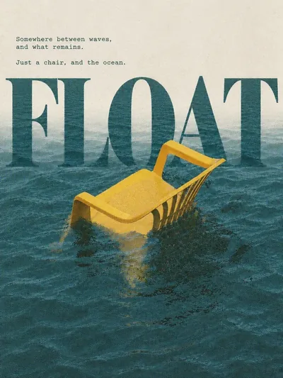
  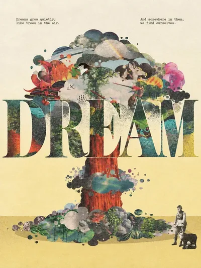
  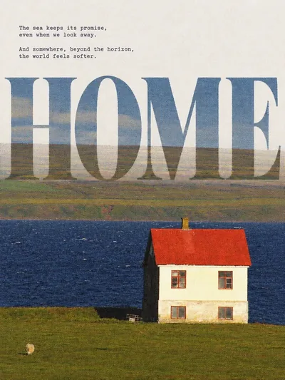
  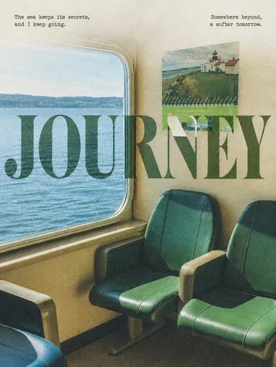
</p>

<sub>All 4 images from [@ammiamia_'s post](https://www.threads.com/@ammiamia_/post/DfgVj9dkq35).</sub>

### [Ethereal human-animal composition prompt](https://www.threads.com/@p2nda/post/DfeTYCLmyDa)
`status: watching` · `tags: prompt, text-to-image, watercolor, ink, translucent, figure, animal` · added 2026-11

A template prompt by Edson Pires (@p2nda) for ethereal fine-art compositions: a human figure with an animal companion, both rendered in translucent ink washes and flowing silhouettes on luminous ivory paper. Slot in `[HUMAN]`, `[ANIMAL]`, `[SETTING]`, `[ACTION]`, `[OUTFIT]`, `[MOTIF]`, and `[COLORS]`.
**Why I care:** The prompt's palette ratios (65% ivory negative space, 20% transparent pigment, 10% charcoal silhouette, 5% gold light) and material vocabulary (organza, sheer silk, folded translucent paper) give specific control over the ethereal look. Embeds the creator's signature in the image.
**Notes:** Author states "Made with GPT image 2.6" (unverified model wording). No license visible. The [full prompt](https://www.threads.com/@p2nda/post/DfeTX6ymxqN) is in the continuation post. Not tested.

<details>
<summary>Full prompt</summary>

```
Ethereal contemporary fine-art composition featuring [HUMAN] accompanied by [ANIMAL] in [SETTING], [ACTION].

A single poetic vertical artwork built from delicate figurative silhouettes and large expanses of luminous warm-ivory paper. The human is recognizable through a few selectively defined facial features, an elegant profile, and a simplified flowing silhouette. The animal retains its essential species-specific features, rendered with the same restrained visual language.

Dress the human in [OUTFIT], suggested through soft shapes and translucent pigment rather than detailed tailoring.

The figures and environment gradually dissolve into broad overlapping sheets of transparent smoky ink, resembling weightless organza, sheer silk, and delicately folded translucent paper. Large fluid veils curl, fold, and overlap with visibly varying opacity, creating depth through transparency rather than conventional anatomical shading.

Include [MOTIF] as one small atmospheric environmental anchor, expressed through fine charcoal silhouettes, subtle reflections, or faint distant forms.

Strict harmonious palette: [COLORS]. Approximately 65% luminous ivory negative space, 20% transparent warm-neutral pigment, 10% concentrated charcoal-black silhouettes, and 5% glowing antique-gold light.

Precise aesthetic: diaphanous translucent layers, silky smoke-like gradients, softly feathered edges, occasional crisp folds, subtle watercolor diffusion, delicate dry-brush accents, extremely selective fine-line drawing, and sophisticated abstract composition.

The primary subject occupies a restrained portion of the composition, surrounded by generous breathing room. Concentrate visual detail in one focal area while allowing surrounding forms to fade naturally into the paper. A contemporary gallery-quality fusion of watercolor, translucent ink, and abstract layered-silk aesthetics.

Integrate the tiny handwritten signature "prompt by @p2nda" discreetly into scene. Single complete artwork. 4:5
```

</details>

<p>
  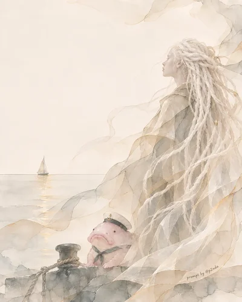
  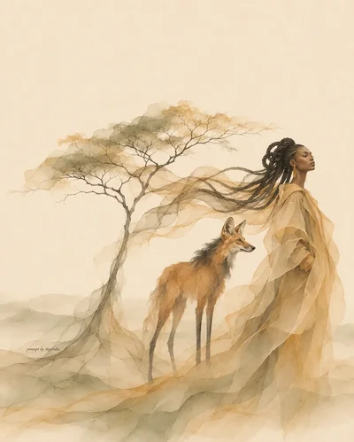
  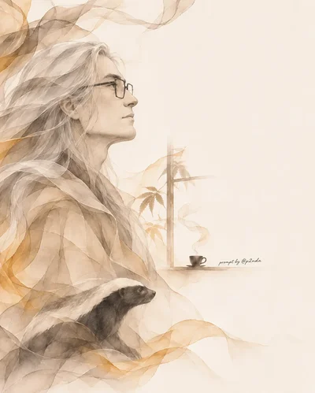
  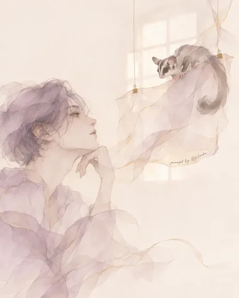
  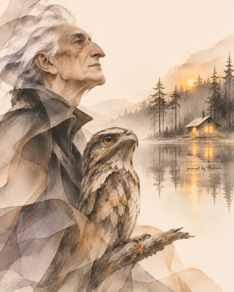
</p>

<sub>First 5 of 8 images from [@p2nda's post](https://www.threads.com/@p2nda/post/DfeTYCLmyDa).</sub>

### [Anthropic Report Illustration Style skill](https://skillry.dev/skills/bs-anthropic-report-illustration)
`status: watching` · `tags: agent-skill, editorial, collage, geometric, illustration, paid` · added 2026-11

A paid agent skill by Yihui Dev (@yihui_indie) that generates illustrations in the Renaissance-printmaking/magazine editorial style seen on Anthropic's website: color-block collage, single objects on flat fields, and abstract geometric prints.
**Why I care:** A packaged style reference for blog headers, report covers, and editorial illustration. The skill handles the prompt engineering so you describe content, not technique.
**Notes:** $4.99 on Skillry (v1.0.3 as of 2026-11-07). Requires `FAL_KEY` for image generation or Codex image allowance; purchase does not include generation credits. Supports GPT Image, Nano Banana/Gemini Image. Not suited for photorealistic images, product shots, real-person portraits, or labeled charts/diagrams. Example invocation: `/bs-anthropic-report-illustration Create 8 square illustrations for a report on how AI agents learn to use tools.` Found via [Threads post](https://www.threads.com/@yihui_indie/post/DfbwcRoidTK) and [continuation](https://www.threads.com/@yihui_indie/post/DfbwdnoCR0p). No thumbnail saved (source is video only); not tested.

### [Retro type poster prompt (詩意復古海報)](https://www.threads.com/@lch1776244/post/DfQ91AxG-TO)
`status: watching` · `tags: prompt, photo-to-poster, typography, halftone, retro, editorial` · added 2026-11

A prompt by Chloe_Lai (@lch1776244) that transforms a reference photo into a 3:4 poetic retro printed poster with a huge one-word title and CMY halftone texture.
**Why I care:** The subject rises organically through and over the letters into the top whitespace, which creates depth without compositing. The small unedited reference inset proves the transformation while the halftone registration offset gives it authentic print feel.
**Notes:** Structure: top third warm white negative space with two short poetic English lines in small typewriter type; huge high-contrast uppercase serif title across middle, color sampled from photo, readable; main subject floats through letters without anatomical stretching or hard cutout edges; subtle CMY halftone dots with slight registration offset in title and stylized photo areas while real photographic textures retained; original uncropped reference inset in upper right (~15-18% width) with fine border labeled "ORIGINAL". No extra headings, watermarks, or mockup frames. The [full prompt](https://www.threads.com/@lch1776244/post/DfQ91vZm5qT) is in the continuation post (in Traditional Chinese). Model not named.

<p>
  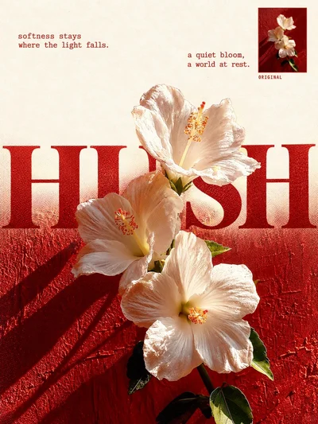
  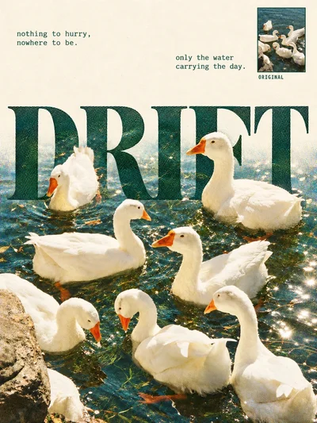
  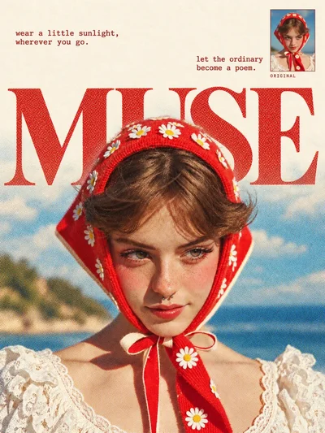
  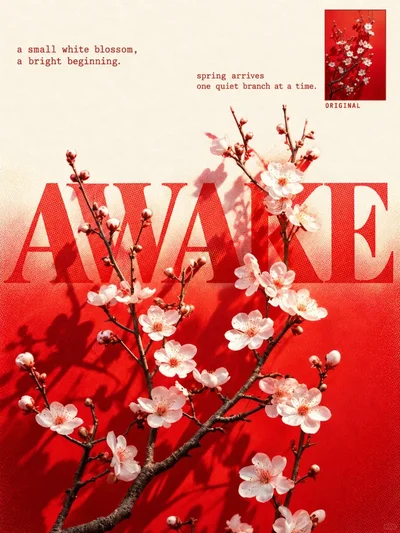
  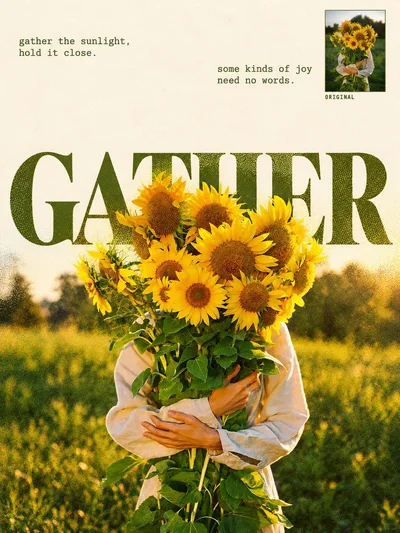
</p>

<sub>Examples from [@lch1776244's post](https://www.threads.com/@lch1776244/post/DfQ91AxG-TO).</sub>

### [Paper collage comparison prompt (碎片拼貼)](https://www.threads.com/@jenniferzhao08/post/DfWtGonGy09)
`status: watching` · `tags: prompt, photo-to-poster, collage, indie-magazine, paper-texture, side-by-side` · added 2026-11

A prompt by Jennifer (@jenniferzhao08) that creates a vertical before/after image: the original photo on top, and a muted poetic paper collage version of the same scene below.
**Why I care:** The collage panel distills the scene into torn grayscale photo fragments on warm ivory paper, with photocopy texture and faded halftone. Subjects stay coherent while scenery simplifies into atmospheric shapes.
**Notes:** Structure: two vertically stacked equal-size panels touching without gaps, borders, or labels; top preserves whole reference image and aspect; bottom translates same scene to indie-magazine paper collage. Keep number, identity, poses, gaze, interactions and key objects of people/subjects. Place related subjects as coherent group (25-35% of lower panel) center-low with generous warm ivory negative space. Simplify scenery into a few grayscale photo fragments with paper fibers, faded halftone, misaligned ink, and small pale sage accent. Faces, hands, and contact points stay coherent; subtle torn edges elsewhere. Matte flat scan, diffuse light; no added text, watermarks, arbitrary objects, or heavy distress. The [full prompt](https://www.threads.com/@jenniferzhao08/post/DfWtHWiG7kr) is in the continuation post (in Traditional Chinese). Model not named.

<p>
  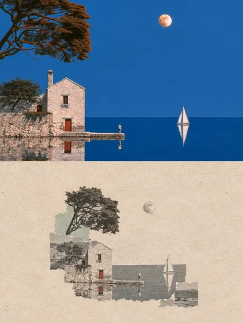
  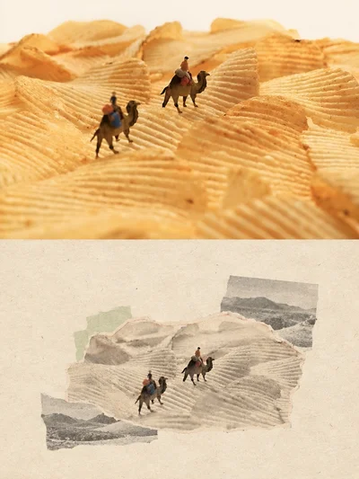
  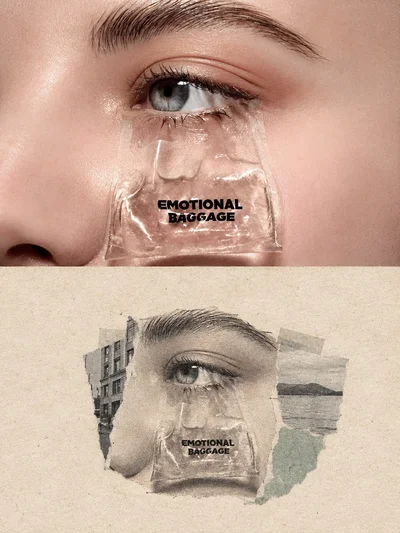
  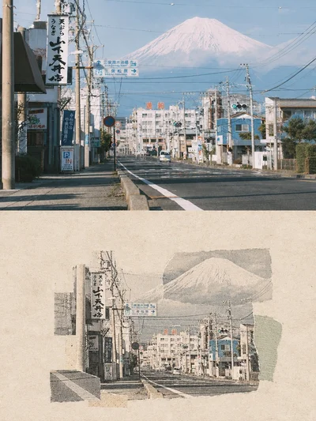
</p>

<sub>Examples from [@jenniferzhao08's post](https://www.threads.com/@jenniferzhao08/post/DfWtGonGy09).</sub>

### [BURNT MOTION sref set](https://www.threads.com/@afzanhilmi/post/DfYtoD4nyks)
`status: watching` · `tags: sref, midjourney, portrait, motion-blur, cinematic, editorial, fashion` · added 2026-11

A Midjourney style-reference set by Afzan | AI Creative Director (@afzanhilmi) for cinematic editorial portraits with selective motion blur: a sharp, centered subject surrounded by streaking pedestrian silhouettes in warm orange and cool blue-grey tones.
**Why I care:** The effect isolates the subject dramatically without compositing. The look blends fashion editorial with street photography, and the color grade (crushed blacks, cyan shadows, neutral skin) gives it a campaign-ready feel.
**Notes:** Uses three `--sref` codes together: `2576855236 4219424500 2971543141`. Source-reported parameters: `--ar 4:5 --stylize 400 --hd --v 8.2`. These are untested and may not all apply to current Midjourney versions. Example prompt structure (not the creator's verbatim text): `editorial portrait of [subject], center frame, eye contact, stoic expression, black hoodie, motion-blurred pedestrians as dark silhouettes, charcoal fog background, soft rim light, 85mm f/1.2, anamorphic --ar 4:5 --sref 2576855236 4219424500 2971543141 --stylize 400`.

<p>
  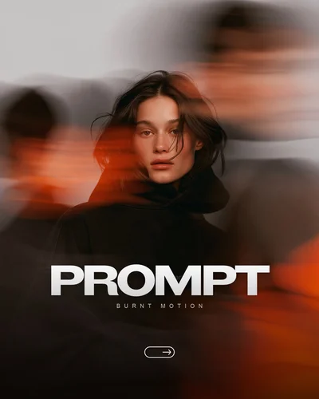
  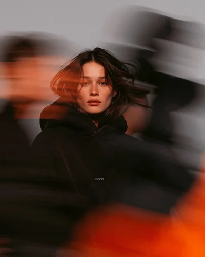
  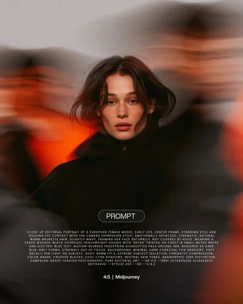
  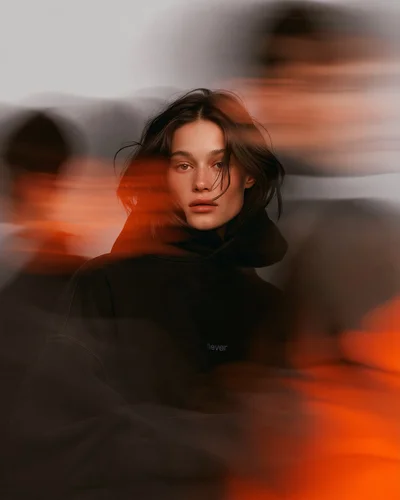
  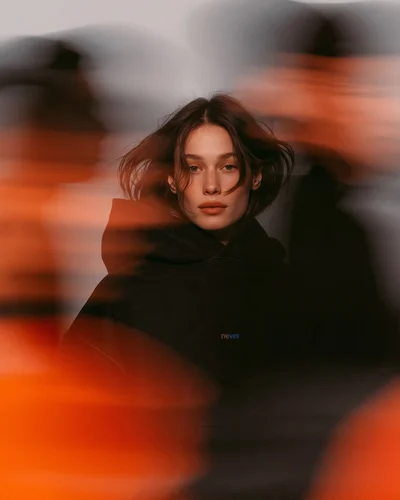
</p>

<sub>First 5 of 9 source images from [@afzanhilmi's post](https://www.threads.com/@afzanhilmi/post/DfYtoD4nyks).</sub>

### [Loose Watercolor Drift prompt](https://www.threads.com/@azed_ai/post/DfMlPyrmyfP)
`status: watching` · `tags: prompt, text-to-image, watercolor, wet-on-wet, minimal, short-prompt` · added 2026-11

A one-line text-to-image prompt by Amira Zairi (@azed_ai) that paints any subject as a loose watercolor wash, with big brushstrokes, bleeding pigment, and no outlines on a white background.
**Why I care:** It's a template with a single slot for the subject, and it reaches the look by removing things: little detail, simple forms, no linework. The figure dissolves into paint at the edges, so the empty paper does a lot of the work.
**Notes:** Swap in a subject and paste the prompt. Unlike the photo-to-poster prompts here, it needs no upload. The post doesn't say which image model it was made for. The full prompt is in the post (in English).

<p>
  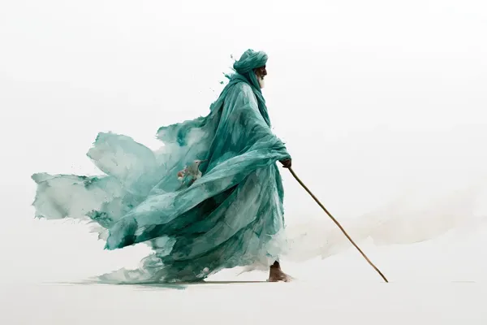
  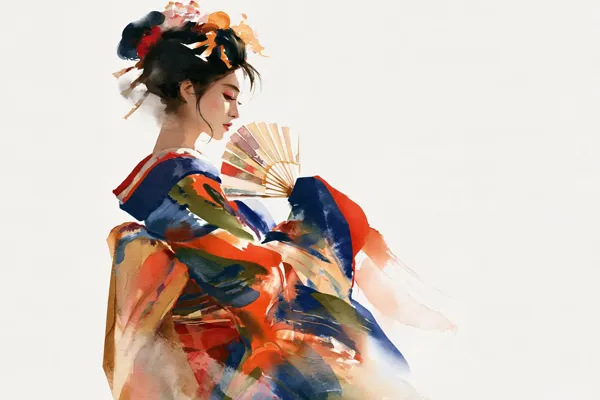
  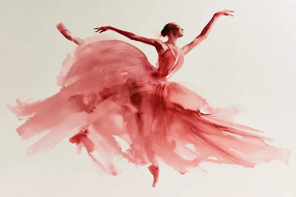
  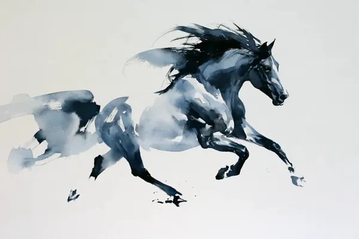
</p>

<sub>AI-generated examples from @azed_ai's post.</sub>

### [Geometric deconstruction poster prompt](https://www.threads.com/@inkacalinka/post/DdDHrkclL7P)
`status: watching` · `tags: prompt, photo-to-poster, geometric, cut-paper, modernist, editorial` · added 2026-11

A prompt by michelle (@inkacalinka) that rebuilds the subject of a photo from large cut-paper blocks in a soft modernist palette, with subtle print texture and lots of empty space.
**Why I care:** It pushes for fewer, larger shapes and warns against tiny fragments, which helps the subject stay recognizable. It also gives separate guidance for people, buildings, and other subjects.
**Notes:** Upload a photo and paste the prompt. Compared with the other geometric prompts here, it's the most blocky and collage-like. The post doesn't say which image model it was made for. The full prompt is in the second post of the thread (in English).

<p>
  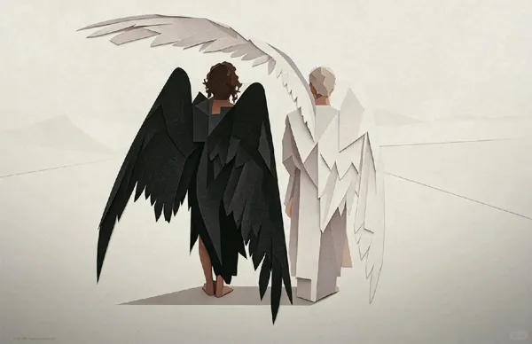
  
  
</p>

<sub>AI-generated examples from @inkacalinka's post, cropped to the generated half.</sub>

### [Journal collage poster prompt](https://www.threads.com/@inkacalinka/post/DdTeQxvm6F7)
`status: watching` · `tags: prompt, photo-to-poster, collage, scrapbook, die-cut, short-prompt` · added 2026-11

A short prompt by michelle (@inkacalinka) that cuts the subject out of a photo and places it on a handmade scrapbook page, with a sticker-style border, colored paper panels, torn notes, and small doodles.
**Why I care:** It breaks the page into five numbered layers: subject, outline, scenery, base, and notes. That makes it easy to read, and easy to edit one layer at a time.
**Notes:** Upload a photo and paste the prompt. The handwritten phrases tend to repeat between images, so edit them if you make a set. The post doesn't say which image model it was made for. The full prompt is in the second post of the thread (in English).

<p>
  
  
</p>

<sub>AI-generated examples from @inkacalinka's post, cropped to the generated half.</sub>

### [Hard-edged geometric poster prompt](https://www.threads.com/@inkacalinka/post/DdYqN5tG9E9)
`status: watching` · `tags: prompt, photo-to-poster, geometric, flat, risograph, editorial` · added 2026-11

A prompt by michelle (@inkacalinka) that redraws a photo below itself as hard-edged flat art made of triangles, rectangles, and arcs, with a palette of 5 to 6 colors from the photo and small archival-style type.
**Why I care:** It explains how small the type should stay, which is the part most poster prompts get wrong. About 60% of the artwork is kept as empty paper, so it feels calm rather than busy.
**Notes:** Upload a photo and paste the prompt. It suits structured subjects like buildings and street scenes, and it can also handle pets. The post doesn't say which image model it was made for. The full prompt is in the second post of the thread (in English).

<p>
  
  
  
  
</p>

<sub>AI-generated examples from @inkacalinka's post, cropped to the generated half.</sub>

### [Second World photo poster prompt](https://www.threads.com/@inkacalinka/post/Ddqm8Alm9e1)
`status: watching` · `tags: prompt, photo-to-poster, concept, line-art, visual-metaphor, reusable-template` · added 2026-11

A prompt by michelle (@inkacalinka) that extends a photo into blank paper with thin black line drawings: a coffee pour becomes a river, or a beach umbrella's shade becomes a tiny pool.
**Why I care:** This is the smartest one in the set. Instead of giving a style, it tells the model to find one visual structure in the photo and ask what it would become if you could touch or use it, so every result has its own idea.
**Notes:** Upload a photo and paste the prompt. It works best on photos with a clear structure, such as water, roads, or light. The post doesn't say which image model it was made for. The full prompt is in the second post of the thread (in English).

<p>
  
  
  
  
</p>

<sub>AI-generated examples from @inkacalinka's post, kept whole because the photo and the drawing connect.</sub>

### [Naive folk illustration prompt](https://www.threads.com/@inkacalinka/post/DeBxUkkG2RL)
`status: watching` · `tags: prompt, photo-to-poster, folk-art, crayon, naive, side-by-side` · added 2026-11

A prompt by michelle (@inkacalinka) for a 4:3 side-by-side poster that redraws a photo as a charming, naive folk illustration with crayon texture, flattened space, and a few bright spot colors.
**Why I care:** It tells the model to leave things out instead of tracing the photo, so the drawing retells the scene with some humor. The dark areas stay scratchy, which is what makes it look hand-drawn.
**Notes:** Upload a photo and paste the prompt. The post doesn't say which image model it was made for. The full prompt is in the second post of the thread (in Simplified Chinese).

<p>
  
  
  
</p>

<sub>AI-generated examples from @inkacalinka's post, cropped to the generated half.</sub>

### [Side-by-side paper illustration prompt](https://www.threads.com/@inkacalinka/post/DeOuirQG5hs)
`status: watching` · `tags: prompt, photo-to-poster, gouache, side-by-side, everyday, no-text` · added 2026-11

A prompt by michelle (@inkacalinka) for a 4:3 side-by-side poster: the original photo on the left, and a loose gouache-style painting of the same moment on textured paper on the right.
**Why I care:** It's made for everyday snapshots, and it's strict about keeping people and objects recognizable. Unlike the others in this set, it asks for no text at all.
**Notes:** Upload a photo and paste the prompt. It outputs one wide image. The post doesn't say which image model it was made for. The full prompt is in the second post of the thread (in Simplified Chinese).

<p>
  
  
</p>

<sub>AI-generated examples from @inkacalinka's post, cropped to the generated half.</sub>

### [Travel stamp photo poster prompt](https://www.threads.com/@inkacalinka/post/DeYSk-zlDNB)
`status: watching` · `tags: prompt, photo-to-poster, stamp, travel, vintage, hand-drawn` · added 2026-11

A prompt by michelle (@inkacalinka) that turns a travel photo into a small handmade postage stamp on cream paper, with postmarks and handwritten notes around it.
**Why I care:** A stamp is a nice way to frame a travel memory, and it gives the design a reason to be small and surrounded by empty space.
**Notes:** Upload a photo and paste the prompt. The model invents the postmarks and small text, so check that spelling, places, and languages make sense. The post doesn't say which image model it was made for. The full prompt is in the second post of the thread (in English).

<p>
  
  
  
</p>

<sub>AI-generated examples from @inkacalinka's post, cropped to the generated half.</sub>

### [Bauhaus abstract photo poster prompt](https://www.threads.com/@inkacalinka/post/Deq3MEtG6Yj)
`status: watching` · `tags: prompt, photo-to-poster, bauhaus, geometric, risograph, editorial` · added 2026-11

A prompt by michelle (@inkacalinka) that rebuilds a photo as abstract Bauhaus-style art on warm paper: circles, arcs, and wedges clustered in the center, with slim serif type and a Risograph print feel.
**Why I care:** Banning rectangles and grids is a smart constraint. It pushes the model toward curves and stops the result from looking like a default geometric filter.
**Notes:** Upload a photo and paste the prompt. It works best on bright, simple subjects like flowers, hills, and clouds. The post doesn't say which image model it was made for. The full prompt is in the second post of the thread (in Simplified Chinese).

<p>
  
  
  
  
  
</p>

<sub>AI-generated examples from @inkacalinka's post, cropped to the generated half.</sub>

### [Fluted glass photo poster prompt](https://www.threads.com/@inkacalinka/post/De092Zwm6T_)
`status: watching` · `tags: prompt, photo-to-poster, fluted-glass, refraction, editorial, short-prompt` · added 2026-11

A short prompt by michelle (@inkacalinka) that shows a photo on top and the same scene below, seen through ribbed fluted glass with vertical streaks of refracted light.
**Why I care:** It's only a few lines, so it's easy to adapt. The clever part is asking for softer distortion at the focal point and stronger distortion at the edges, which keeps the subject readable.
**Notes:** Upload a photo and paste the prompt. It suits strong colors and simple shapes, like sunsets, sails, and silhouettes. The post doesn't say which image model it was made for. The full prompt is in the second post of the thread (in English).

<p>
  
  
  
  
</p>

<sub>AI-generated examples from @inkacalinka's post, cropped to the generated half.</sub>

### [Pastel vector travel poster prompt](https://www.threads.com/@inkacalinka/post/DfB59FhG2rw)
`status: watching` · `tags: prompt, photo-to-poster, flat-vector, travel, pastel, editorial` · added 2026-11

A prompt by michelle (@inkacalinka) that redraws a photo as a soft flat-vector travel poster in airy pale blues and creams, with a short title and tagline.
**Why I care:** It asks for a fresh layout built around each photo, so a set of posters avoids looking like one template with the names swapped.
**Notes:** Upload a photo and paste the prompt. It adds 2 to 4 supporting details that say something about the place, and it keeps pink to tiny accents. The post doesn't say which image model it was made for. Check any Japanese or place-name text in the result. The full prompt is in the second post of the thread (in Simplified Chinese).

<p>
  
  
  
</p>

<sub>AI-generated examples from @inkacalinka's post, cropped to the generated half.</sub>

### [Paper cover illustration prompt](https://www.threads.com/@inkacalinka/post/Dc7fl2ulBQ5)
`status: watching` · `tags: prompt, photo-to-poster, hand-drawn, negative-space, editorial, reusable-template` · added 2026-11

A popular prompt by michelle (@inkacalinka) that pairs each photo with a tiny hand-drawn version on rough paper, like the cover of an independent art book.
**Why I care:** The whole idea is a small subject in a lot of empty space. Limiting the palette to four colors from the photo keeps the drawing tied to the picture above it.
**Notes:** Upload a photo and paste the prompt. It outputs one poster per photo. The author replied that they ran it on aienhancer.ai. There's also a [shorter version](https://www.threads.com/@inkacalinka/post/DddAv77FDu5) of the same prompt that's easier to edit. Both are in the second post of their threads (in English).

<p>
  
  
  
  
</p>

<sub>AI-generated examples from @inkacalinka's post, cropped to the generated half.</sub>

### [Impasto diorama photo poster prompt](https://www.threads.com/@inkacalinka/post/DfMh_ZpmxHo)
`status: watching` · `tags: prompt, photo-to-poster, impasto, oil-paint, diorama, editorial` · added 2026-11

A prompt by michelle (@inkacalinka) that turns each uploaded photo into a 3:4 poster: the photo on top, and below it the same scene rebuilt as a small sculptural landscape of thick palette-knife paint on warm white paper.
**Why I care:** The paint has real volume, so the result feels like a tiny object sitting on the page rather than a filter. It's especially good for autumn scenes, which is what the post uses it for.
**Notes:** Upload a photo and paste the prompt. It works on people, animals, plants, buildings, and scenes, and adds a short English title. The post doesn't say which image model it was made for. The full prompt is in the second post of the thread (in Simplified Chinese).

<p>
  
  
  
  
  
</p>

<sub>AI-generated examples from @inkacalinka's post, cropped to the generated half.</sub>

### [Long-exposure light trail silhouette prompt](https://www.threads.com/@bibanskiy/post/DfM8BNhiL68)
`status: watching` · `tags: prompt, portrait, silhouette, long-exposure, cinematic, film, identity-reference` · added 2026-11

A long prompt by Denis Bibanskih (@bibanskiy) that turns an uploaded photo of a person into a dark silhouette standing in shallow water, with a ribbon of glowing light curving around them, mountains behind, and an analog film look.
**Why I care:** It works like a shot brief, with separate sections for composition, light, water, sky, camera, and film. The key rule is that the world blurs while the figure stays still, and that contrast is what makes the image work.
**Notes:** Upload a clear photo of the person first, since the prompt relies on it for identity. Only use photos of yourself or someone who agreed to it. The post doesn't say which image model it was made for. The prompt asks for gold, but the examples came out closer to rose copper, so expect some drift in color. The full prompt is in the second post of the thread (in English).

<p>
  
  
</p>

<sub>AI-generated examples from @bibanskiy's post.</sub>

### [Motion Haze portrait prompts](https://www.threads.com/@ecolab_studio/post/DfMFpmhEexo)
`status: watching` · `tags: prompt, midjourney, portrait, motion-blur, cinematic, editorial` · added 2026-11

A set of Midjourney portrait prompts by Eco Lab | Studio (@ecolab_studio) built around long-exposure blur: heads smeared into ghostly trails, faces half lost in haze, and sharp figures against streaks of city light.
**Why I care:** Each prompt spells out exactly what stays sharp and what blurs, instead of just asking for "motion blur". Most of the mood comes from that split, plus huge negative space and a restrained palette.
**Notes:** Three prompts are printed on the carousel images, so swipe through the post to read them. They use `--ar 4:5`, and two also set `--v 8.2`, `--hd`, `--stylize` at 300 to 350, and several `--sref` codes, which do a lot of the styling. The last slide says to comment to get all the prompts, so the post may not show every one. Reuse the structure with your own subject rather than the age and appearance details written into them.

<p>
  
  
  
  
  
</p>

<sub>AI-generated examples from @ecolab_studio's post, using the slides without text.</sub>

### [Taiwan vintage engraving poster prompt](https://www.threads.com/@jerry6151/post/DfLi2OdmGHm)
`status: watching` · `tags: prompt, poster, travel, vintage, engraving, taiwan, reusable-template` · added 2026-11

A template prompt by @jerry6151 for a series of vintage travel posters of Taiwan: fine engraved line art of a landmark in muted greens on aged ivory paper, with coordinates, a small red seal, and magazine-style type.
**Why I care:** It's a ready-made poster set for Taiwan, with labels in both Chinese and English. The fixed palette, layout, and series tagline keep every poster matching, so it's a good example of how to build a consistent series with one prompt.
**Notes:** Fill in the city, the landmark, and their English names. The series text is hard-coded to Taiwan, so change those lines to use it for other places. The post doesn't say which image model it was made for. Check the coordinates and Chinese text in each result, since AI can get small details wrong. The full prompt is in the second post of the thread (in Traditional Chinese).

<p>
  
  
  
  
</p>

<sub>Examples from @jerry6151's post.</sub>

### [Frosted glass photo poster prompt](https://www.threads.com/@emersonigpost/post/DewTH-Tibw0)
`status: watching` · `tags: prompt, photo-to-poster, frosted-glass, abstract, editorial, pastel` · added 2026-11

A GPT prompt by @emersonigpost that turns each uploaded photo into a 3:4 poster: the original photo on top, and an abstract version below made of translucent frosted-glass layers, soft blur, bright airy colors, and small editorial type.
**Why I care:** It makes everyday photos look like exhibition posters, even dull subjects like a fuel pump or a construction site. The key idea is selective blur: some areas stay sharp and others look like they're behind matte glass, instead of blurring everything.
**Notes:** Copy the prompt and upload photos. It handles several at once and outputs one poster per photo. The author says it works best on photos with lots of edges and shapes, like furniture and windows, and won't help out-of-focus shots. The full prompt is in the second post of the thread (in English).

<p>
  
  
  
  
  
</p>

<sub>Examples from @emersonigpost's post, cropped to the generated half. The source photos are from Pexels.</sub>

### [mono-color-skill](https://github.com/yanliudesign/mono-color-skill)
`status: watching` · `tags: agent-skill, claude-code, editorial-design, poster, risograph, halftone, packaging` · added 2026-11

A Claude Code skill by Yan Liu that turns a theme, sentence, object, or photo into a printed-look editorial image: one or two inks on paper, halftone or risograph texture, lots of empty space, and restrained typography. It suits posters, zines, packaging, and portraits.
**Why I care:** It's a full visual system instead of a one-off prompt, with reference files for type, color, and layout, so an agent can keep a consistent style across a whole set. It's also a good model for how to package my own design style as a skill.
**Notes:** Install with `git clone https://github.com/yanliudesign/mono-color-skill.git ~/.claude/skills/mono-color`, then restart Claude Code. It returns the image, the exact prompt, and a short recipe. The code is MIT, but the example images aren't: [ASSET-LICENSE.md](https://github.com/yanliudesign/mono-color-skill/blob/main/ASSET-LICENSE.md) only allows viewing and linking, so they're shown here from the author's repo and not copied. Found via [@prompt_case on Threads](https://www.threads.com/@prompt_case/post/Dcs6FiCHCn3). ~3.5k stars.

<p>
  
  
  
</p>

<sub>Images © Yan Liu, loaded directly from the author's repo.</sub>

### [Floating cutaway city poster prompt](https://www.threads.com/@naik_nelofar/post/DdREHihCcVw)
`status: watching` · `tags: prompt, poster, architecture, 3d-style, miniature, reusable-template` · added 2026-11

A template prompt by @naik_nelofar for a 4:5 architecture poster: a city built as a floating miniature model, sliced open to show subways, tunnels, and foundations underneath, on an ivory background with faint blueprint lines.
**Why I care:** It looks far more expensive than a normal AI travel image, and the template should work for any city or country. The detailed cross-section makes it good for a poster series or a high-impact social post.
**Notes:** Slots: `[CITY]`, `[COUNTRY]`, `[REGION]`, and the landmark or cultural feature. The post doesn't say which image model it was made for, and these examples have small blueprint labels worth checking for errors, since AI often gets fine text and facts wrong. The prompt is split across the author's replies (in English). Don't miss the last reply, which adds the cutaway effect.

<p>
  
  
  
</p>

<sub>Examples from @naik_nelofar's post.</sub>

### [Macaron candy poster prompt](https://www.threads.com/@ryobiyori/post/DeENInEkwvV)
`status: watching` · `tags: prompt, photo-to-illustration, poster, kawaii, pastel, travel` · added 2026-11

A ChatGPT prompt by @ryobiyori that makes a side-by-side image: the real photo on the left, and a cute pastel version on the right, built from rounded color blocks that look like stickers or candy.
**Why I care:** It's a very popular format (about 590k views) that turns ordinary travel photos into something shareable. The rules are precise: only five pastel colors, no sharp corners, white rounded outlines between shapes, and small smiling faces on the sun or clouds.
**Notes:** It tells the model to keep any real sign text exactly as written. The poster title and "RYOBIYORI" branding in the examples aren't in the prompt excerpt I read, so expect to add my own title text. The full prompt is in the author's pinned reply (in Traditional Chinese), and only that reply has it, not the main post. Same author as the [Japan scenery poster style](design-references.md#japan-scenery-poster-style).

<p>
  
  
  
  
</p>

<sub>Examples from @ryobiyori's post, cropped to the generated poster.</sub>

### [Minimalist travel poster prompt](https://www.threads.com/@dreamy.designs.ai/post/DcwUmGuGsxr)
`status: watching` · `tags: prompt, poster, travel, flat-illustration, vintage, reusable-template` · added 2026-11

A short template prompt by @dreamy.designs.ai for vintage-style city posters: bold outlines, flat color, lots of empty space, small human figures for scale, and the place name in uppercase typewriter lettering.
**Why I care:** The easiest prompt here to reuse. Swap the three slots and it should hold for any location, which makes it useful for a matching series.
**Notes:** Slots: `[PLACE]`, `[COLOR_PALETTE]`, and `["PLACE_NAME"]`. Made with GPT Image 2, according to the post's label. The prompt ends with Midjourney-style `--ar 2:3 --raw` flags, which other models may treat as plain text. The full prompt is in the second post of the thread (in English). The third post promotes the author's free PDF of more prompts.

<p>
  
  
  
  
  
</p>

<sub>Examples from @dreamy.designs.ai's post.</sub>

### [Modern Eastern culture poster prompt](https://www.threads.com/@orisynthai/post/DdW5C9wAdn7)
`status: watching` · `tags: prompt, poster, editorial, paper-collage, chinese-typography` · added 2026-11

A fill-in-the-blanks prompt by @orisynthai for cultural event posters in a modern Eastern editorial style. It sets huge torn-paper color fields against one tiny story scene, where people and props take up only about 2 to 5% of the image.
**Why I care:** The results look like real design-studio work, not typical AI posters. It gives clear layout rules: one large color shape that still reads at feed size, a small accent color, restrained serif titles, and asymmetric layouts with lots of white space. Those rules are worth reusing in my own design prompts.
**Notes:** Fill in the eight slots: theme, title, main color, micro-scene, character action, cultural elements, event info, and aspect ratio. The post says it was made with "image-2.5". The full prompt runs across the second and third posts of the thread (written in Simplified Chinese).

<p>
  
  
  
  
</p>

<sub>Examples from @orisynthai's post.</sub>

### [Hand-drawn manga comparison poster prompt](https://www.threads.com/@jenniferzhao08/post/De8X3P3Dpey)
`status: watching` · `tags: prompt, photo-to-illustration, manga, poster, limited-palette` · added 2026-11

A prompt by @jenniferzhao08 that turns an uploaded photo into a 3:4 before/after image: the untouched photo on top, and a Japanese hand-drawn manga poster of the same subject below. It works for people, animals, objects, and scenery.
**Why I care:** A ready-made format for social posts and thumbnails. It locks the art direction with exact hex colors (ink black, warm red, gray-blue on off-white paper) and tells the model to keep only what's visible in the photo, so results stay consistent.
**Notes:** The poster's big title defaults to the author's own "Jen Style", so swap it for my own text. The post doesn't say which image model it was made for. The full prompt is in the second post of the thread (written in Simplified Chinese).

<p>
  
  
  
  
</p>

<sub>Examples from @jenniferzhao08's post, cropped to the generated result.</sub>

### [Photo to knitted art toy prompt](https://www.threads.com/@ammiamia_/post/De8NpXJG5si)
`status: watching` · `tags: prompt, photo-to-toy, 3d-style, knit, character` · added 2026-11

A prompt by @ammiamia_ that turns a real photo into a 1:1 knitted designer-toy bust: a huge rounded head, tiny features, yarn hair, and a soft felt texture on a white studio background.
**Why I care:** Fun, recognisable avatars or stickers from one photo. The prompt separates the photo (what to draw) from an optional style reference (how to draw it), and it limits the model to what's actually visible, so it doesn't invent extra hands or props.
**Notes:** Attach the photo, plus a white-background toy image as the style reference. Text and logos become unreadable knit patterns. The post doesn't say which image model it was made for. The full prompt is in the second post of the thread (written in Traditional Chinese).

<p>
  
  
  
</p>

<sub>Examples from @ammiamia_'s post, cropped to the generated result.</sub>
