# Image generation

Image models, prompts, skills, and tools you can generate with. Designs with no reusable prompt go in [Design references](design-references.md).

[← Back to index](README.md)

<!-- Add entries below using the format in _template.md. Newest first. -->

### [Naive folk illustration prompt](https://www.threads.com/@inkacalinka/post/DeBxUkkG2RL)
`status: watching` · `tags: prompt, photo-to-poster, folk-art, crayon, naive, side-by-side` · added 2026-11

A prompt by michelle (@inkacalinka) for a 4:3 side-by-side poster that redraws a photo as a charming, naive folk illustration with crayon texture, flattened space, and a few bright spot colors.
**Why I care:** It tells the model to leave things out instead of tracing the photo, so the drawing retells the scene with some humor. The dark areas stay scratchy, which is what makes it look hand-drawn.
**Notes:** Upload a photo and paste the prompt. The post doesn't say which image model it was made for. The full prompt is in the second post of the thread (in Simplified Chinese).

  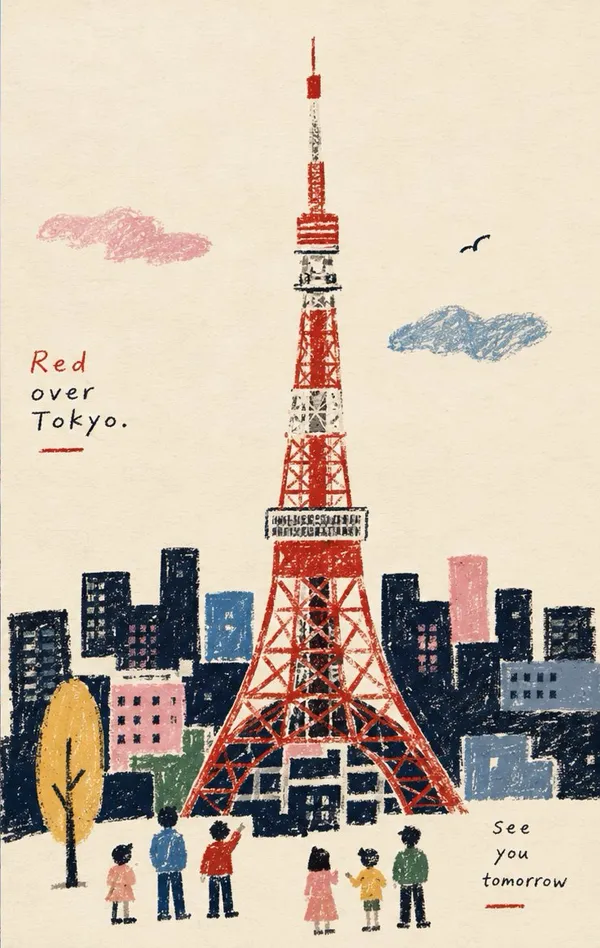
  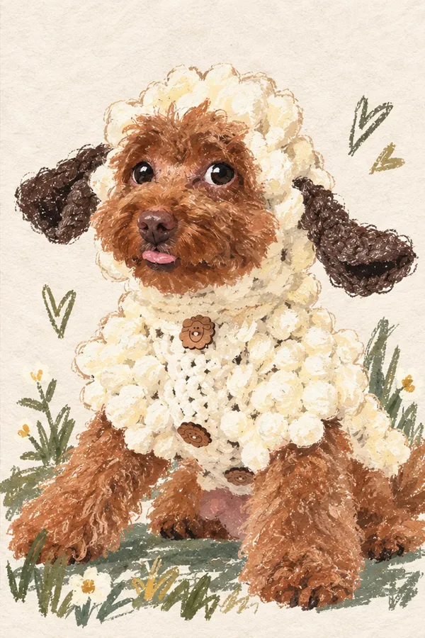
  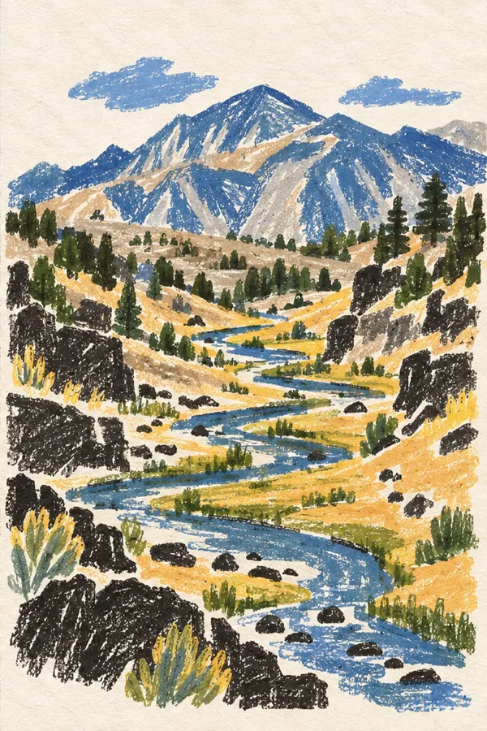

AI-generated examples from @inkacalinka's post, cropped to the generated half.

### [Side-by-side paper illustration prompt](https://www.threads.com/@inkacalinka/post/DeOuirQG5hs)
`status: watching` · `tags: prompt, photo-to-poster, gouache, side-by-side, everyday, no-text` · added 2026-11

A prompt by michelle (@inkacalinka) for a 4:3 side-by-side poster: the original photo on the left, and a loose gouache-style painting of the same moment on textured paper on the right.
**Why I care:** It's made for everyday snapshots, and it's strict about keeping people and objects recognizable. Unlike the others in this set, it asks for no text at all.
**Notes:** Upload a photo and paste the prompt. It outputs one wide image. The post doesn't say which image model it was made for. The full prompt is in the second post of the thread (in Simplified Chinese).

  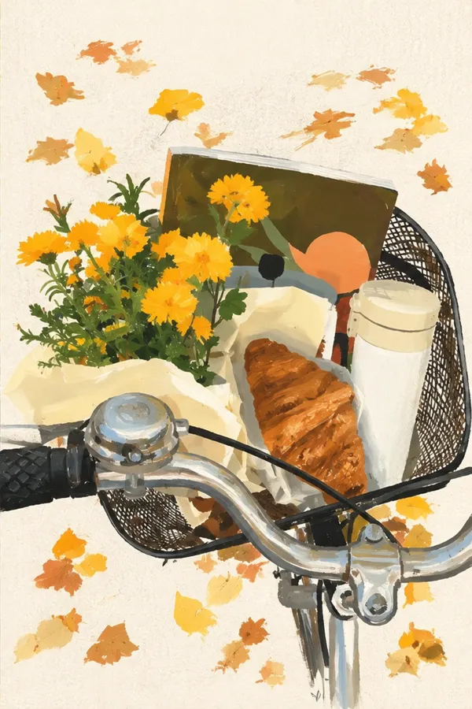
  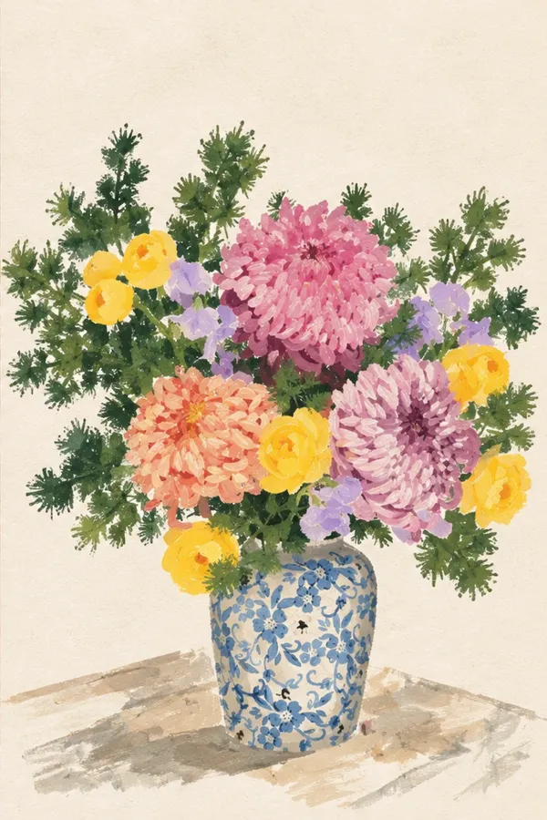

AI-generated examples from @inkacalinka's post, cropped to the generated half.

### [Travel stamp photo poster prompt](https://www.threads.com/@inkacalinka/post/DeYSk-zlDNB)
`status: watching` · `tags: prompt, photo-to-poster, stamp, travel, vintage, hand-drawn` · added 2026-11

A prompt by michelle (@inkacalinka) that turns a travel photo into a small handmade postage stamp on cream paper, with postmarks and handwritten notes around it.
**Why I care:** A stamp is a nice way to frame a travel memory, and it gives the design a reason to be small and surrounded by empty space.
**Notes:** Upload a photo and paste the prompt. The model invents the postmarks and small text, so check that spelling, places, and languages make sense. The post doesn't say which image model it was made for. The full prompt is in the second post of the thread (in English).

  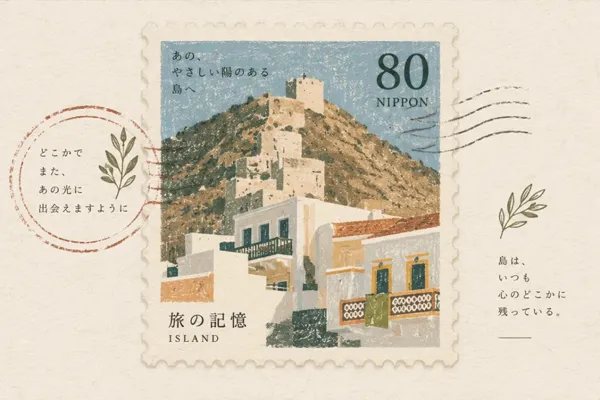
  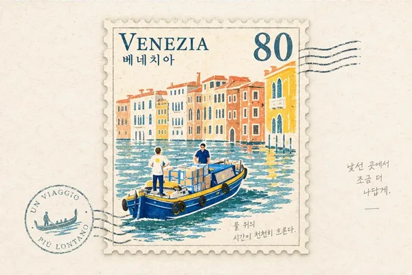
  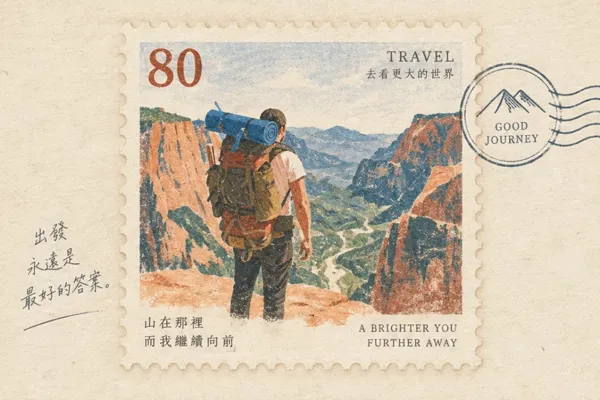

AI-generated examples from @inkacalinka's post, cropped to the generated half.

### [Bauhaus abstract photo poster prompt](https://www.threads.com/@inkacalinka/post/Deq3MEtG6Yj)
`status: watching` · `tags: prompt, photo-to-poster, bauhaus, geometric, risograph, editorial` · added 2026-11

A prompt by michelle (@inkacalinka) that rebuilds a photo as abstract Bauhaus-style art on warm paper: circles, arcs, and wedges clustered in the center, with slim serif type and a Risograph print feel.
**Why I care:** Banning rectangles and grids is a smart constraint. It pushes the model toward curves and stops the result from looking like a default geometric filter.
**Notes:** Upload a photo and paste the prompt. It works best on bright, simple subjects like flowers, hills, and clouds. The post doesn't say which image model it was made for. The full prompt is in the second post of the thread (in Simplified Chinese).

  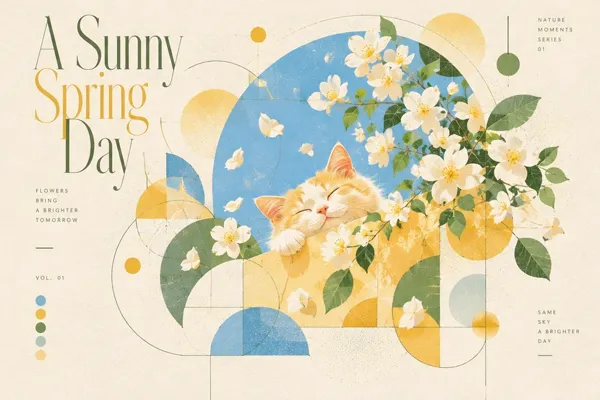
  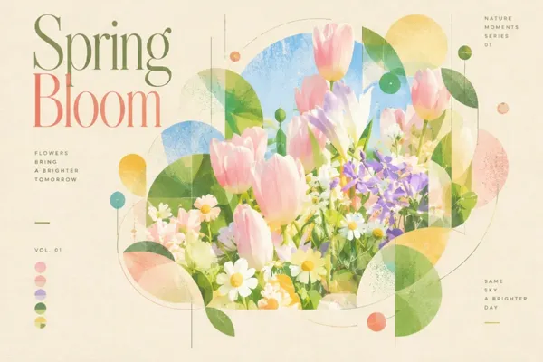
  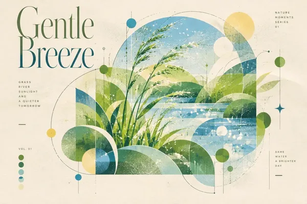
  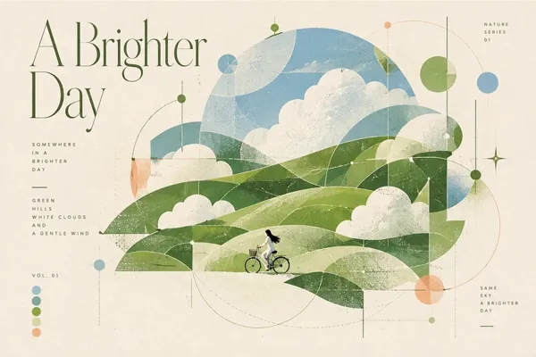
  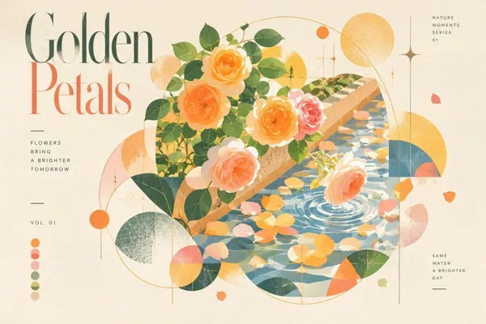

AI-generated examples from @inkacalinka's post, cropped to the generated half.

### [Fluted glass photo poster prompt](https://www.threads.com/@inkacalinka/post/De092Zwm6T_)
`status: watching` · `tags: prompt, photo-to-poster, fluted-glass, refraction, editorial, short-prompt` · added 2026-11

A short prompt by michelle (@inkacalinka) that shows a photo on top and the same scene below, seen through ribbed fluted glass with vertical streaks of refracted light.
**Why I care:** It's only a few lines, so it's easy to adapt. The clever part is asking for softer distortion at the focal point and stronger distortion at the edges, which keeps the subject readable.
**Notes:** Upload a photo and paste the prompt. It suits strong colors and simple shapes, like sunsets, sails, and silhouettes. The post doesn't say which image model it was made for. The full prompt is in the second post of the thread (in English).

  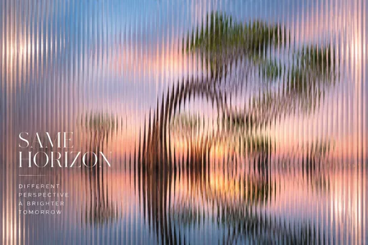
  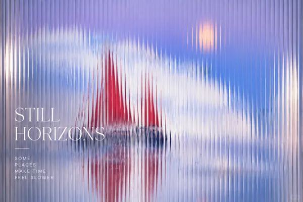
  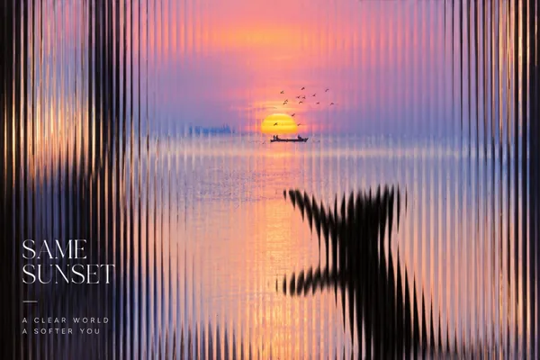
  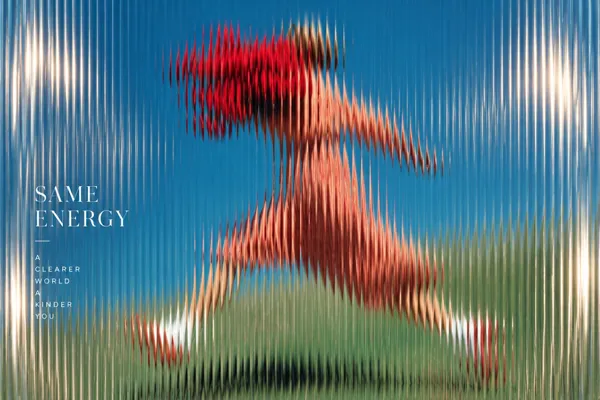

AI-generated examples from @inkacalinka's post, cropped to the generated half.

### [Pastel vector travel poster prompt](https://www.threads.com/@inkacalinka/post/DfB59FhG2rw)
`status: watching` · `tags: prompt, photo-to-poster, flat-vector, travel, pastel, editorial` · added 2026-11

A prompt by michelle (@inkacalinka) that redraws a photo as a soft flat-vector travel poster in airy pale blues and creams, with a short title and tagline.
**Why I care:** It asks for a fresh layout built around each photo, so a set of posters avoids looking like one template with the names swapped.
**Notes:** Upload a photo and paste the prompt. It adds 2 to 4 supporting details that say something about the place, and it keeps pink to tiny accents. The post doesn't say which image model it was made for. Check any Japanese or place-name text in the result. The full prompt is in the second post of the thread (in Simplified Chinese).

  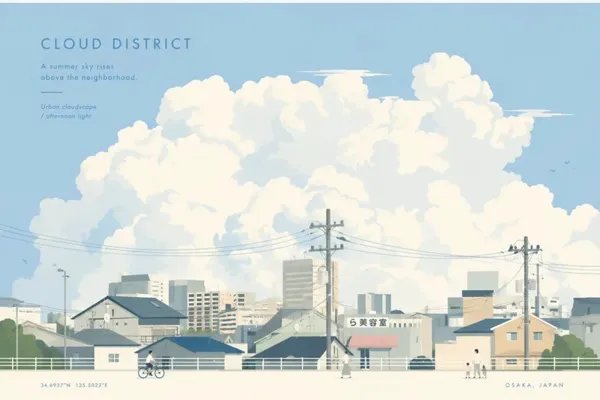
  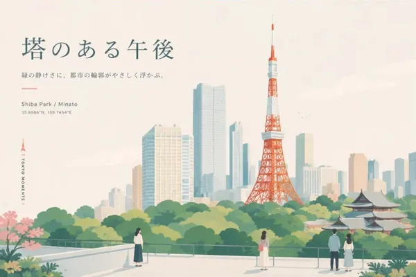
  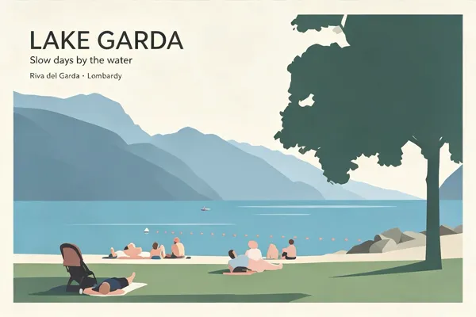

AI-generated examples from @inkacalinka's post, cropped to the generated half.

### [Paper cover illustration prompt](https://www.threads.com/@inkacalinka/post/Dc7fl2ulBQ5)
`status: watching` · `tags: prompt, photo-to-poster, hand-drawn, negative-space, editorial, reusable-template` · added 2026-11

A popular prompt by michelle (@inkacalinka) that pairs each photo with a tiny hand-drawn version on rough paper, like the cover of an independent art book.
**Why I care:** The whole idea is a small subject in a lot of empty space. Limiting the palette to four colors from the photo keeps the drawing tied to the picture above it.
**Notes:** Upload a photo and paste the prompt. It outputs one poster per photo. The author replied that they ran it on aienhancer.ai. There's also a [shorter version](https://www.threads.com/@inkacalinka/post/DddAv77FDu5) of the same prompt that's easier to edit. Both are in the second post of their threads (in English).

  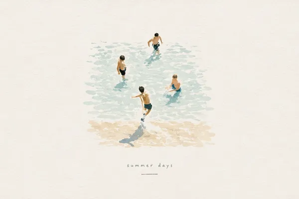
  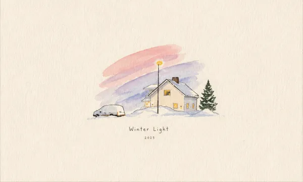
  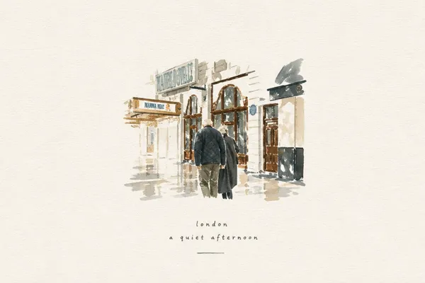
  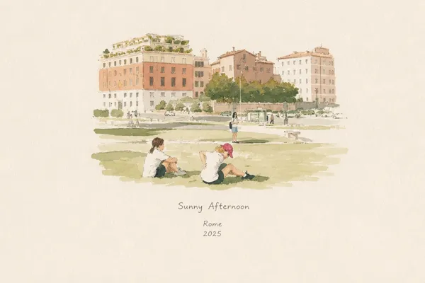

AI-generated examples from @inkacalinka's post, cropped to the generated half.

### [Impasto diorama photo poster prompt](https://www.threads.com/@inkacalinka/post/DfMh_ZpmxHo)
`status: watching` · `tags: prompt, photo-to-poster, impasto, oil-paint, diorama, editorial` · added 2026-11

A prompt by michelle (@inkacalinka) that turns each uploaded photo into a 3:4 poster: the photo on top, and below it the same scene rebuilt as a small sculptural landscape of thick palette-knife paint on warm white paper.
**Why I care:** The paint has real volume, so the result feels like a tiny object sitting on the page rather than a filter. It's especially good for autumn scenes, which is what the post uses it for.
**Notes:** Upload a photo and paste the prompt. It works on people, animals, plants, buildings, and scenes, and adds a short English title. The post doesn't say which image model it was made for. The full prompt is in the second post of the thread (in Simplified Chinese).

  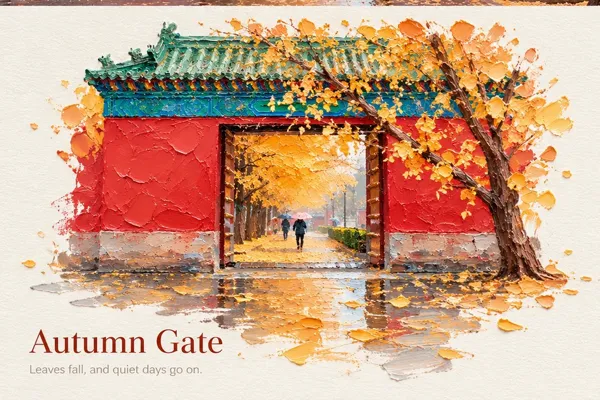
  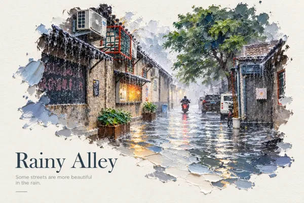
  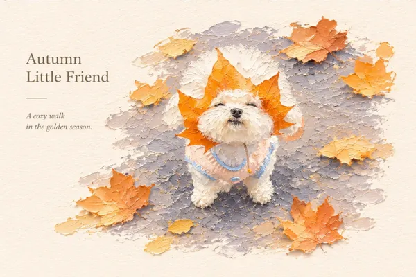
  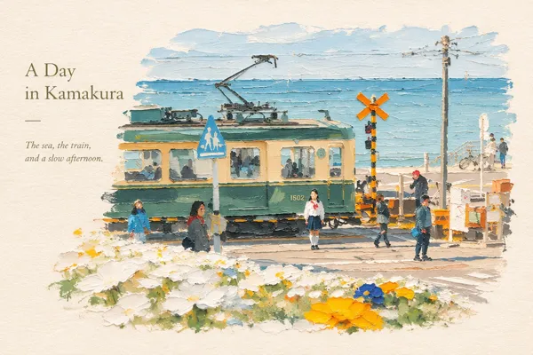
  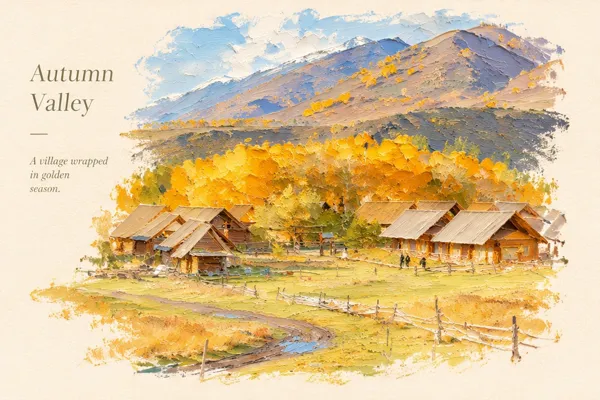

AI-generated examples from @inkacalinka's post, cropped to the generated half.

### [Long-exposure light trail silhouette prompt](https://www.threads.com/@bibanskiy/post/DfM8BNhiL68)
`status: watching` · `tags: prompt, portrait, silhouette, long-exposure, cinematic, film, identity-reference` · added 2026-11

A long prompt by Denis Bibanskih (@bibanskiy) that turns an uploaded photo of a person into a dark silhouette standing in shallow water, with a ribbon of glowing light curving around them, mountains behind, and an analog film look.
**Why I care:** It works like a shot brief, with separate sections for composition, light, water, sky, camera, and film. The key rule is that the world blurs while the figure stays still, and that contrast is what makes the image work.
**Notes:** Upload a clear photo of the person first, since the prompt relies on it for identity. Only use photos of yourself or someone who agreed to it. The post doesn't say which image model it was made for. The prompt asks for gold, but the examples came out closer to rose copper, so expect some drift in color. The full prompt is in the second post of the thread (in English).

  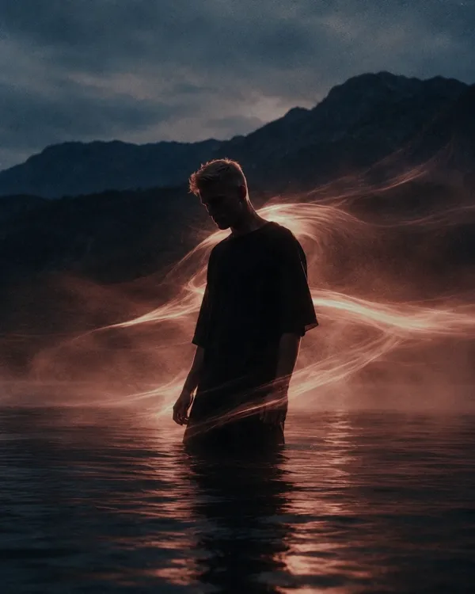
  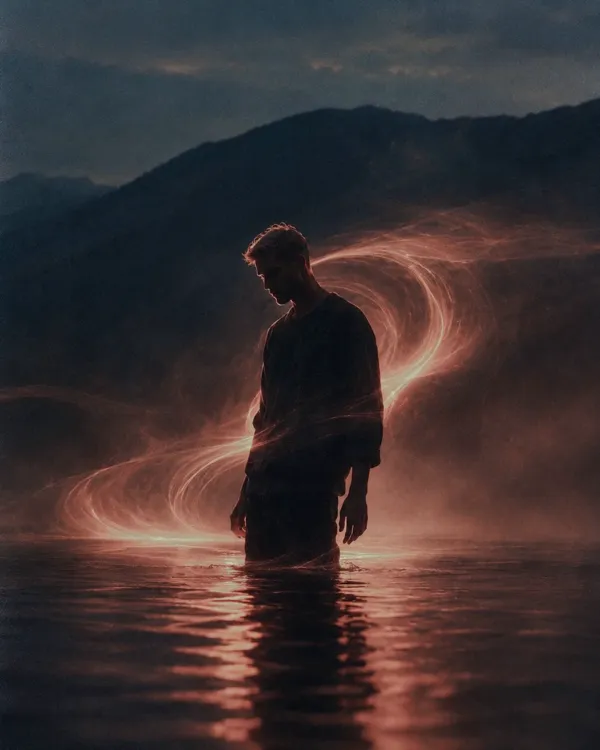

AI-generated examples from @bibanskiy's post.

### [Motion Haze portrait prompts](https://www.threads.com/@ecolab_studio/post/DfMFpmhEexo)
`status: watching` · `tags: prompt, midjourney, portrait, motion-blur, cinematic, editorial` · added 2026-11

A set of Midjourney portrait prompts by Eco Lab | Studio (@ecolab_studio) built around long-exposure blur: heads smeared into ghostly trails, faces half lost in haze, and sharp figures against streaks of city light.
**Why I care:** Each prompt spells out exactly what stays sharp and what blurs, instead of just asking for "motion blur". Most of the mood comes from that split, plus huge negative space and a restrained palette.
**Notes:** Three prompts are printed on the carousel images, so swipe through the post to read them. They use `--ar 4:5`, and two also set `--v 8.2`, `--hd`, `--stylize` at 300 to 350, and several `--sref` codes, which do a lot of the styling. The last slide says to comment to get all the prompts, so the post may not show every one. Reuse the structure with your own subject rather than the age and appearance details written into them.

  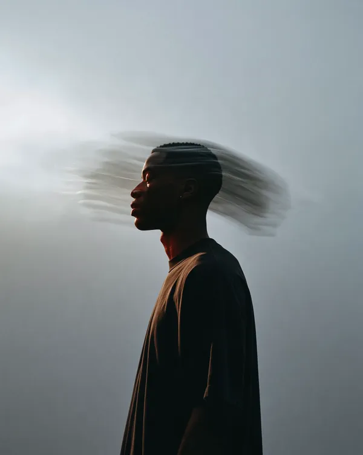
  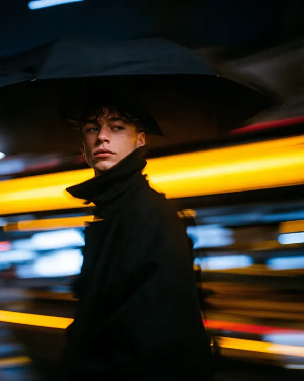
  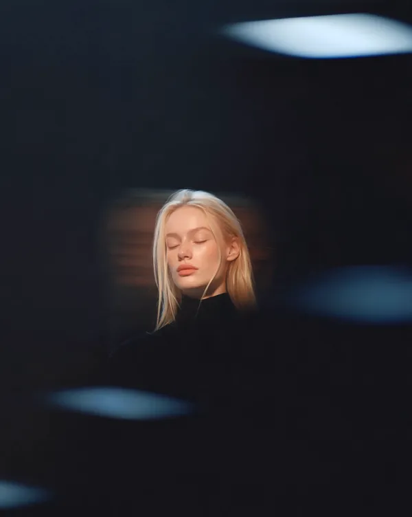
  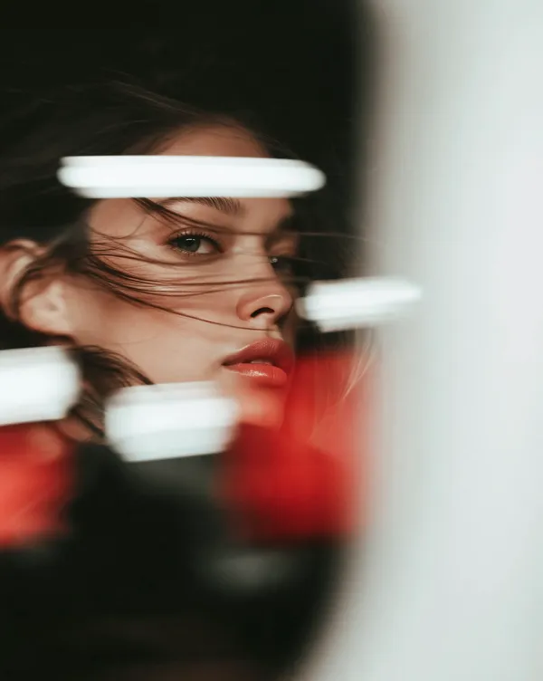
  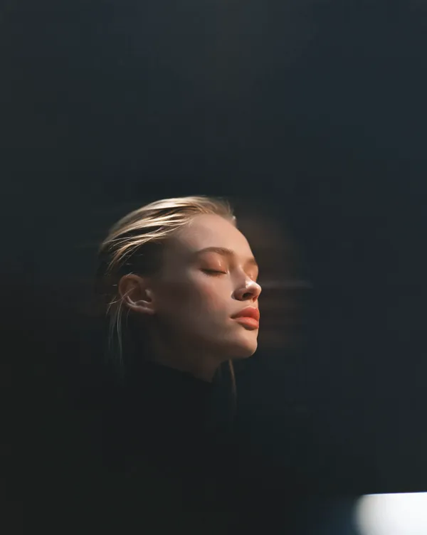

AI-generated examples from @ecolab_studio's post, using the slides without text.

### [Taiwan vintage engraving poster prompt](https://www.threads.com/@jerry6151/post/DfLi2OdmGHm)
`status: watching` · `tags: prompt, poster, travel, vintage, engraving, taiwan, reusable-template` · added 2026-11

A template prompt by @jerry6151 for a series of vintage travel posters of Taiwan: fine engraved line art of a landmark in muted greens on aged ivory paper, with coordinates, a small red seal, and magazine-style type.
**Why I care:** It's a ready-made poster set for Taiwan, with labels in both Chinese and English. The fixed palette, layout, and series tagline keep every poster matching, so it's a good example of how to build a consistent series with one prompt.
**Notes:** Fill in the city, the landmark, and their English names. The series text is hard-coded to Taiwan, so change those lines to use it for other places. The post doesn't say which image model it was made for. Check the coordinates and Chinese text in each result, since AI can get small details wrong. The full prompt is in the second post of the thread (in Traditional Chinese).

  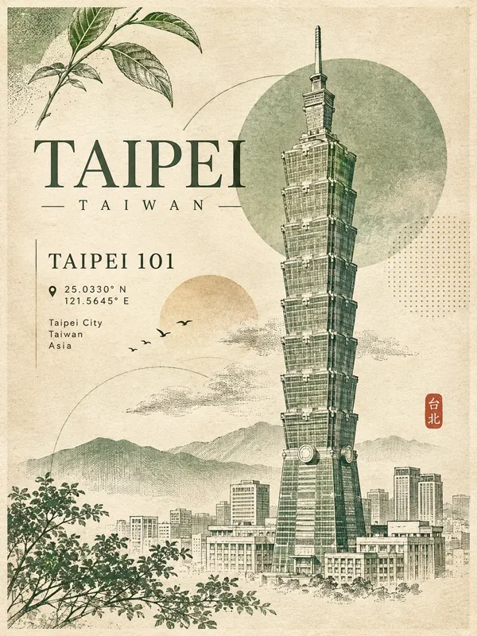
  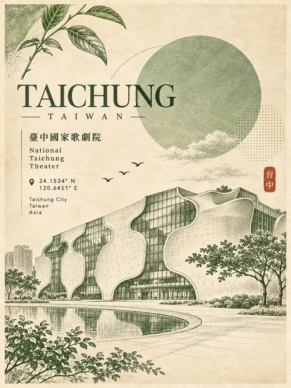
  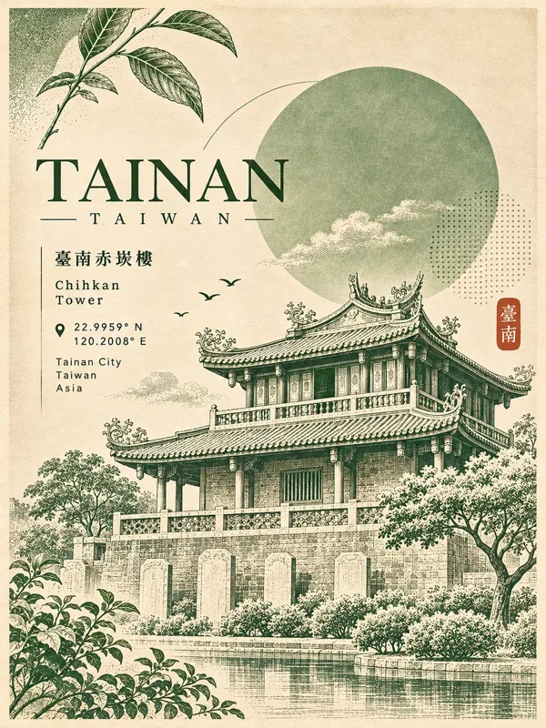
  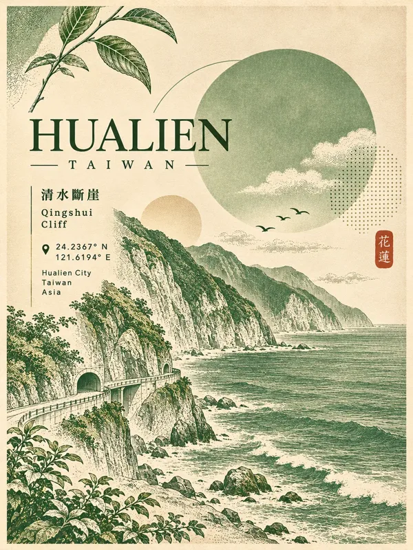

Examples from @jerry6151's post.

### [Frosted glass photo poster prompt](https://www.threads.com/@emersonigpost/post/DewTH-Tibw0)
`status: watching` · `tags: prompt, photo-to-poster, frosted-glass, abstract, editorial, pastel` · added 2026-11

A GPT prompt by @emersonigpost that turns each uploaded photo into a 3:4 poster: the original photo on top, and an abstract version below made of translucent frosted-glass layers, soft blur, bright airy colors, and small editorial type.
**Why I care:** It makes everyday photos look like exhibition posters, even dull subjects like a fuel pump or a construction site. The key idea is selective blur: some areas stay sharp and others look like they're behind matte glass, instead of blurring everything.
**Notes:** Copy the prompt and upload photos. It handles several at once and outputs one poster per photo. The author says it works best on photos with lots of edges and shapes, like furniture and windows, and won't help out-of-focus shots. The full prompt is in the second post of the thread (in English).

  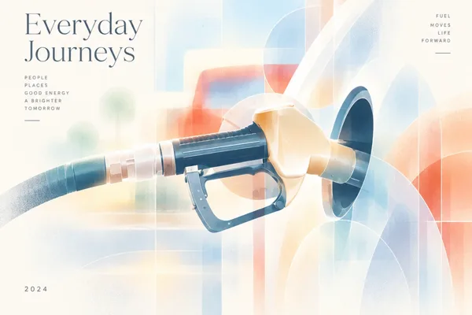
  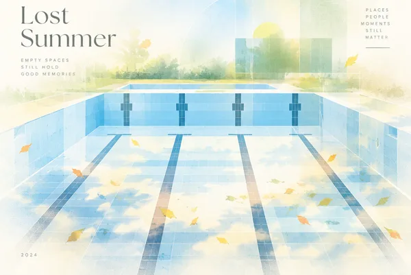
  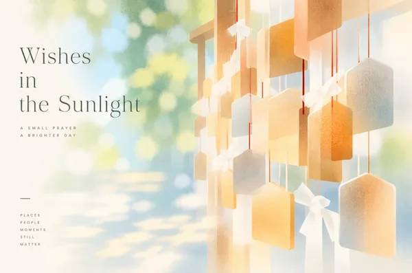
  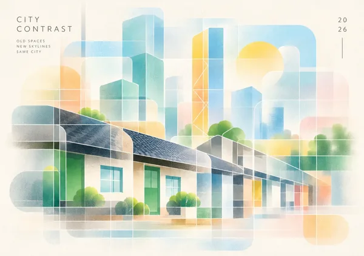
  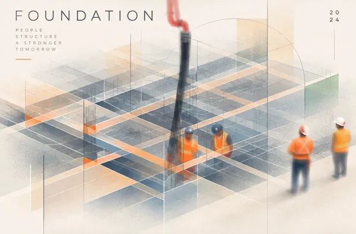

Examples from @emersonigpost's post, cropped to the generated half. The source photos are from Pexels.

### [mono-color-skill](https://github.com/yanliudesign/mono-color-skill)
`status: watching` · `tags: agent-skill, claude-code, editorial-design, poster, risograph, halftone, packaging` · added 2026-11

A Claude Code skill by Yan Liu that turns a theme, sentence, object, or photo into a printed-look editorial image: one or two inks on paper, halftone or risograph texture, lots of empty space, and restrained typography. It suits posters, zines, packaging, and portraits.
**Why I care:** It's a full visual system instead of a one-off prompt, with reference files for type, color, and layout, so an agent can keep a consistent style across a whole set. It's also a good model for how to package my own design style as a skill.
**Notes:** Install with `git clone https://github.com/yanliudesign/mono-color-skill.git ~/.claude/skills/mono-color`, then restart Claude Code. It returns the image, the exact prompt, and a short recipe. The code is MIT, but the example images aren't: [ASSET-LICENSE.md](https://github.com/yanliudesign/mono-color-skill/blob/main/ASSET-LICENSE.md) only allows viewing and linking, so they're shown here from the author's repo and not copied. Found via [@prompt_case on Threads](https://www.threads.com/@prompt_case/post/Dcs6FiCHCn3). ~3.5k stars.

  
  
  

Images © Yan Liu, loaded directly from the author's repo.

### [Floating cutaway city poster prompt](https://www.threads.com/@naik_nelofar/post/DdREHihCcVw)
`status: watching` · `tags: prompt, poster, architecture, 3d-style, miniature, reusable-template` · added 2026-11

A template prompt by @naik_nelofar for a 4:5 architecture poster: a city built as a floating miniature model, sliced open to show subways, tunnels, and foundations underneath, on an ivory background with faint blueprint lines.
**Why I care:** It looks far more expensive than a normal AI travel image, and the template should work for any city or country. The detailed cross-section makes it good for a poster series or a high-impact social post.
**Notes:** Slots: `[CITY]`, `[COUNTRY]`, `[REGION]`, and the landmark or cultural feature. The post doesn't say which image model it was made for, and these examples have small blueprint labels worth checking for errors, since AI often gets fine text and facts wrong. The prompt is split across the author's replies (in English). Don't miss the last reply, which adds the cutaway effect.

  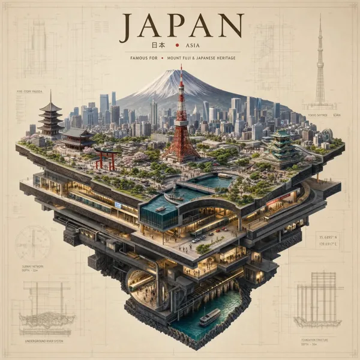
  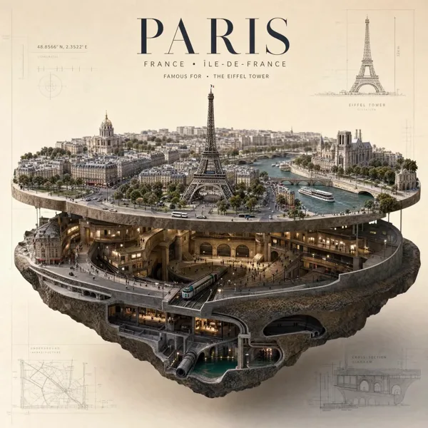
  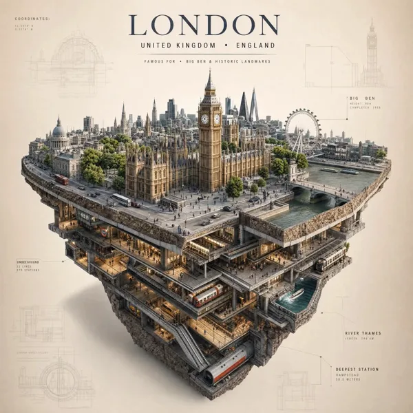

Examples from @naik_nelofar's post.

### [Macaron candy poster prompt](https://www.threads.com/@ryobiyori/post/DeENInEkwvV)
`status: watching` · `tags: prompt, photo-to-illustration, poster, kawaii, pastel, travel` · added 2026-11

A ChatGPT prompt by @ryobiyori that makes a side-by-side image: the real photo on the left, and a cute pastel version on the right, built from rounded color blocks that look like stickers or candy.
**Why I care:** It's a very popular format (about 590k views) that turns ordinary travel photos into something shareable. The rules are precise: only five pastel colors, no sharp corners, white rounded outlines between shapes, and small smiling faces on the sun or clouds.
**Notes:** It tells the model to keep any real sign text exactly as written. The poster title and "RYOBIYORI" branding in the examples aren't in the prompt excerpt I read, so expect to add my own title text. The full prompt is in the author's pinned reply (in Traditional Chinese), and only that reply has it, not the main post. Same author as the [Japan scenery poster style](design-references.md#japan-scenery-poster-style).

  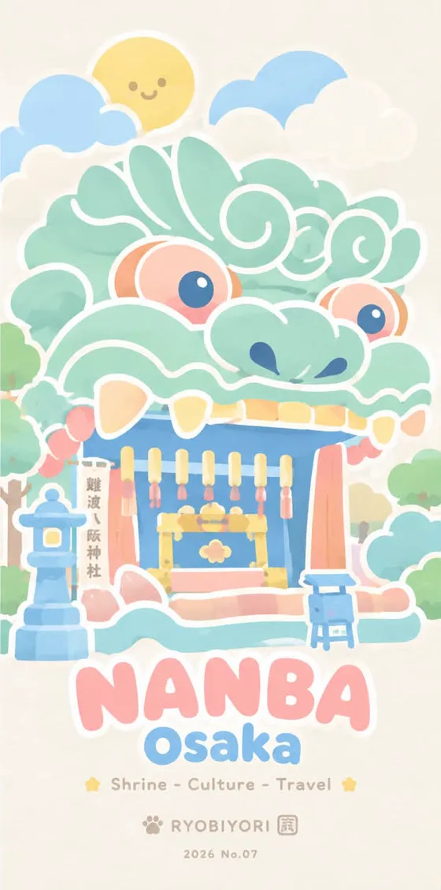
  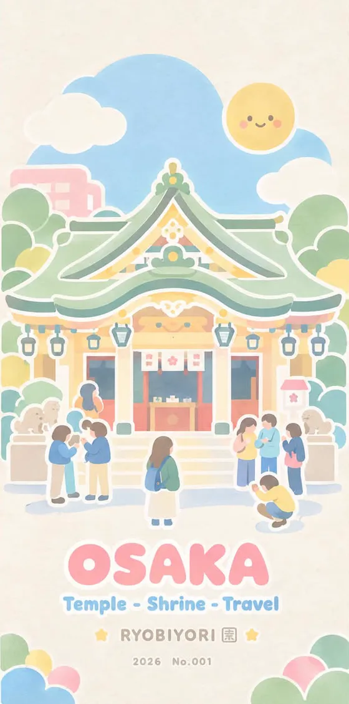
  
  

Examples from @ryobiyori's post, cropped to the generated poster.

### [Minimalist travel poster prompt](https://www.threads.com/@dreamy.designs.ai/post/DcwUmGuGsxr)
`status: watching` · `tags: prompt, poster, travel, flat-illustration, vintage, reusable-template` · added 2026-11

A short template prompt by @dreamy.designs.ai for vintage-style city posters: bold outlines, flat color, lots of empty space, small human figures for scale, and the place name in uppercase typewriter lettering.
**Why I care:** The easiest prompt here to reuse. Swap the three slots and it should hold for any location, which makes it useful for a matching series.
**Notes:** Slots: `[PLACE]`, `[COLOR_PALETTE]`, and `["PLACE_NAME"]`. Made with GPT Image 2, according to the post's label. The prompt ends with Midjourney-style `--ar 2:3 --raw` flags, which other models may treat as plain text. The full prompt is in the second post of the thread (in English). The third post promotes the author's free PDF of more prompts.

  
  
  
  
  

Examples from @dreamy.designs.ai's post.

### [Modern Eastern culture poster prompt](https://www.threads.com/@orisynthai/post/DdW5C9wAdn7)
`status: watching` · `tags: prompt, poster, editorial, paper-collage, chinese-typography` · added 2026-11

A fill-in-the-blanks prompt by @orisynthai for cultural event posters in a modern Eastern editorial style. It sets huge torn-paper color fields against one tiny story scene, where people and props take up only about 2 to 5% of the image.
**Why I care:** The results look like real design-studio work, not typical AI posters. It gives clear layout rules: one large color shape that still reads at feed size, a small accent color, restrained serif titles, and asymmetric layouts with lots of white space. Those rules are worth reusing in my own design prompts.
**Notes:** Fill in the eight slots: theme, title, main color, micro-scene, character action, cultural elements, event info, and aspect ratio. The post says it was made with "image-2.5". The full prompt runs across the second and third posts of the thread (written in Simplified Chinese).

  
  
  
  

Examples from @orisynthai's post.

### [Hand-drawn manga comparison poster prompt](https://www.threads.com/@jenniferzhao08/post/De8X3P3Dpey)
`status: watching` · `tags: prompt, photo-to-illustration, manga, poster, limited-palette` · added 2026-11

A prompt by @jenniferzhao08 that turns an uploaded photo into a 3:4 before/after image: the untouched photo on top, and a Japanese hand-drawn manga poster of the same subject below. It works for people, animals, objects, and scenery.
**Why I care:** A ready-made format for social posts and thumbnails. It locks the art direction with exact hex colors (ink black, warm red, gray-blue on off-white paper) and tells the model to keep only what's visible in the photo, so results stay consistent.
**Notes:** The poster's big title defaults to the author's own "Jen Style", so swap it for my own text. The post doesn't say which image model it was made for. The full prompt is in the second post of the thread (written in Simplified Chinese).

  
  
  
  

Examples from @jenniferzhao08's post, cropped to the generated result.

### [Photo to knitted art toy prompt](https://www.threads.com/@ammiamia_/post/De8NpXJG5si)
`status: watching` · `tags: prompt, photo-to-toy, 3d-style, knit, character` · added 2026-11

A prompt by @ammiamia_ that turns a real photo into a 1:1 knitted designer-toy bust: a huge rounded head, tiny features, yarn hair, and a soft felt texture on a white studio background.
**Why I care:** Fun, recognisable avatars or stickers from one photo. The prompt separates the photo (what to draw) from an optional style reference (how to draw it), and it limits the model to what's actually visible, so it doesn't invent extra hands or props.
**Notes:** Attach the photo, plus a white-background toy image as the style reference. Text and logos become unreadable knit patterns. The post doesn't say which image model it was made for. The full prompt is in the second post of the thread (written in Traditional Chinese).

  
  
  

Examples from @ammiamia_'s post, cropped to the generated result.
