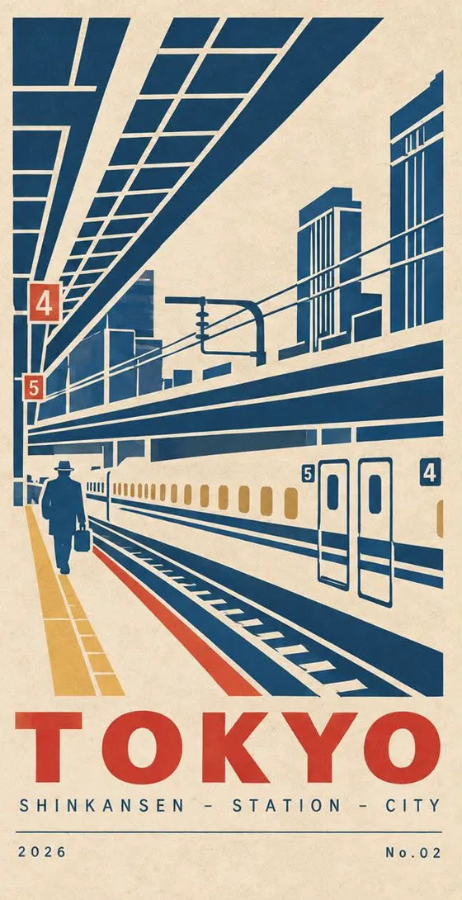
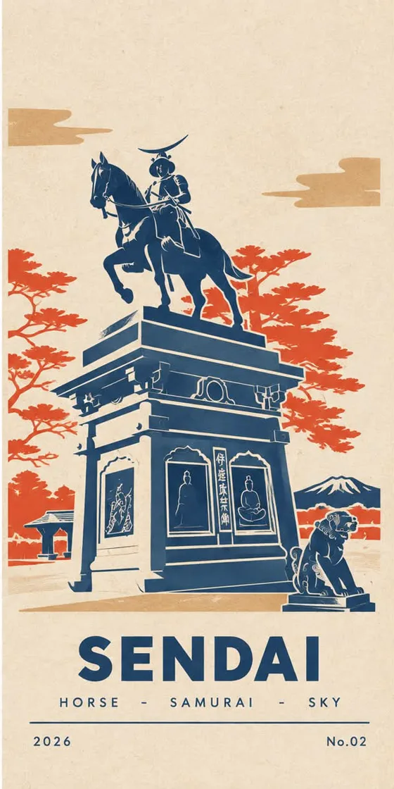

# Image generation

Image models, prompting tools, and design assets.

[← Back to index](README.md)

<!-- Add entries below using the format in _template.md. Newest first. -->

### [Macaron candy poster prompt](https://www.threads.com/@ryobiyori/post/DeENInEkwvV)
`status: watching` · `tags: prompt, photo-to-illustration, poster, kawaii, pastel, travel` · added 2026-11

A ChatGPT prompt by @ryobiyori that makes a side-by-side image: the real photo on the left, and a cute pastel version on the right, built from rounded color blocks that look like stickers or candy.
**Why I care:** It's a very popular format (about 590k views) that turns ordinary travel photos into something shareable. The rules are precise: only five pastel colors, no sharp corners, white rounded outlines between shapes, and small smiling faces on the sun or clouds.
**Notes:** It tells the model to keep any real sign text exactly as written. The poster title and "RYOBIYORI" branding in the examples aren't in the prompt excerpt I read, so expect to add my own title text. The full prompt is in the author's pinned reply (in Traditional Chinese), and only that reply has it, not the main post. Same author as the [Japan scenery poster style](#japan-scenery-poster-style).

  
  
  
  

Examples from @ryobiyori's post, cropped to the generated poster.

### [Minimalist travel poster prompt](https://www.threads.com/@dreamy.designs.ai/post/DcwUmGuGsxr)
`status: watching` · `tags: prompt, poster, travel, flat-illustration, vintage, reusable-template` · added 2026-11

A short template prompt by @dreamy.designs.ai for vintage-style city posters: bold outlines, flat color, lots of empty space, small human figures for scale, and the place name in uppercase typewriter lettering.
**Why I care:** The easiest prompt here to reuse. Swap the three slots and it should hold for any location, which makes it useful for a matching series.
**Notes:** Slots: `[PLACE]`, `[COLOR_PALETTE]`, and `["PLACE_NAME"]`. Made with GPT Image 2, according to the post's label. The prompt ends with Midjourney-style `--ar 2:3 --raw` flags, which other models may treat as plain text. The full prompt is in the second post of the thread (in English). The third post promotes the author's free PDF of more prompts.

  
  
  
  
  

Examples from @dreamy.designs.ai's post.

### [Japan scenery poster style](https://www.threads.com/@ryobiyori/post/Dc7b9C8E6-m)
`status: watching` · `tags: style-reference, poster, japan, limited-palette, photo-to-poster` · added 2026-11

Real travel photos turned into retro screen-print posters by @ryobiyori using ChatGPT: navy, red, and mustard on cream paper, with geometric shapes and a big place name at the bottom.
**Why I care:** A striking way to turn my own travel photos into a matching poster series. The post went viral, with over 500k views.
**Notes:** **No prompt is shared.** The author says they're still refining it and may explain later, so this entry is a style reference only. To try it, I could write my own prompt from the look above, or combine it with the [travel poster prompt](#minimalist-travel-poster-prompt). There's also a follow-up autumn version in the replies.

  
  
  

Examples from @ryobiyori's post, cropped to the generated poster.

### [Modern Eastern culture poster prompt](https://www.threads.com/@orisynthai/post/DdW5C9wAdn7)
`status: watching` · `tags: prompt, poster, editorial, paper-collage, chinese-typography` · added 2026-11

A fill-in-the-blanks prompt by @orisynthai for cultural event posters in a modern Eastern editorial style. It sets huge torn-paper color fields against one tiny story scene, where people and props take up only about 2 to 5% of the image.
**Why I care:** The results look like real design-studio work, not typical AI posters. It gives clear layout rules: one large color shape that still reads at feed size, a small accent color, restrained serif titles, and asymmetric layouts with lots of white space. Those rules are worth reusing in my own design prompts.
**Notes:** Fill in the eight slots: theme, title, main color, micro-scene, character action, cultural elements, event info, and aspect ratio. The post says it was made with "image-2.5". The full prompt runs across the second and third posts of the thread (written in Simplified Chinese).

  
  
  
  

Examples from @orisynthai's post.

### [Hand-drawn manga comparison poster prompt](https://www.threads.com/@jenniferzhao08/post/De8X3P3Dpey)
`status: watching` · `tags: prompt, photo-to-illustration, manga, poster, limited-palette` · added 2026-11

A prompt by @jenniferzhao08 that turns an uploaded photo into a 3:4 before/after image: the untouched photo on top, and a Japanese hand-drawn manga poster of the same subject below. It works for people, animals, objects, and scenery.
**Why I care:** A ready-made format for social posts and thumbnails. It locks the art direction with exact hex colors (ink black, warm red, gray-blue on off-white paper) and tells the model to keep only what's visible in the photo, so results stay consistent.
**Notes:** The poster's big title defaults to the author's own "Jen Style", so swap it for my own text. The post doesn't say which image model it was made for. The full prompt is in the second post of the thread (written in Simplified Chinese).

  
  
  
  

Examples from @jenniferzhao08's post, cropped to the generated result.

### [Photo to knitted art toy prompt](https://www.threads.com/@ammiamia_/post/De8NpXJG5si)
`status: watching` · `tags: prompt, photo-to-toy, 3d-style, knit, character` · added 2026-11

A prompt by @ammiamia_ that turns a real photo into a 1:1 knitted designer-toy bust: a huge rounded head, tiny features, yarn hair, and a soft felt texture on a white studio background.
**Why I care:** Fun, recognisable avatars or stickers from one photo. The prompt separates the photo (what to draw) from an optional style reference (how to draw it), and it limits the model to what's actually visible, so it doesn't invent extra hands or props.
**Notes:** Attach the photo, plus a white-background toy image as the style reference. Text and logos become unreadable knit patterns. The post doesn't say which image model it was made for. The full prompt is in the second post of the thread (written in Traditional Chinese).

  
  
  

Examples from @ammiamia_'s post, cropped to the generated result.
